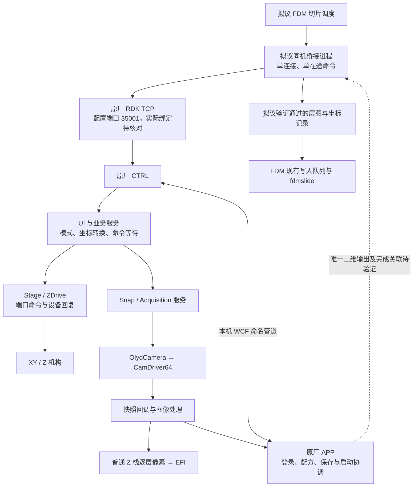

# DSX1000 数字切片接入：离线可行性报告

分析日期：2026-10-22。分析对象为用户提供的软件副本，设备环境为 Windows 10 1909、同机运行 FDM 和原厂软件、无互联网。**已完成两轮静态分析和接入设计，并准备了独立现场收集工具；尚未完成设备接入验证。没有修改 FDM 产品代码，没有运行原厂程序或发送设备命令。**

## 结论与推荐路线

**原厂软件确有可供进一步接入验证的运动反馈和独立快照链路，值得继续；但目前不能认定已能可靠替换 FDM 的固定等待。** 已发现原厂 RDK TCP 命令入口，普通内部 Z 栈也确实由图像事件与 Z 移动回复推进。主要缺口已经从“有没有控制入口”缩小为：位置反馈的真实含义和鲜度、RDK 的整数微米 Z 目标限制、快照完成与唯一文件关联，以及取消/断线恢复。

优先验证 **FDM → 同机独立桥接进程 → 原厂 RDK → 原厂控制链**。先以单次二维快照组成完整 Z 栈，原厂软件继续负责设备初始化、驱动、标定和相机占用。该候选路线有两个前置门槛：

1. **业务扫描必须能接受整数微米的目标 Z 网格。** `MVZR` 虽以 Double 解析，最终对“当前显示 Z＋相对量”执行 `conv.i4` 再交给 UI 移动接口；不能把设备内部 10 nm 的软件换算尺度当成 RDK 的亚微米控制能力。所需层间距若小于 1 µm，或需要任意小数微米的起点/位置，当前 RDK 路线不能直接满足。
2. **必须建立可靠的到位和图像完成判据。** 运动回复不自动证明达到目标；`SHOT` 最终回复只表示异步采集已派发，`SHOTSTS=0` 也可能是停止/失败后的状态。不能在收到 SHOT 应答后立即移动下一层。

原厂批量 Z 栈内部有全部合成前层图，却尚未找到可由外部客户端可靠提取全部层图及其位置的接口。因此它仍是优先级更高、但尚不满足采用条件的优化路线；不是本轮已经可用的方案。若上述两个门槛不通过，结论应保持“接口缺口未解决”，再针对原厂批量层图出口或内部托管桥接做限定范围的分析，不能以降低焦层要求或输出一张 EFI 图替代本次目标。

第二轮进一步证实：正常非拼接采集的 APP 自动保存处理返回后，CTRL 才更新转交结果并最终置 `SHOTSTS=0`；但取消/失败也可到状态0，原生存储器的全部关闭与持久化行为仍未闭合。Z 位置的 UI 刷新明确经过 `BeginInvoke`，不存在已证的外部鲜度屏障；共享错误会被后续命令回复消费，不能直接归属于当前拍照。详见 [深入分析](deep-analysis/deep-findings.md)。现场先使用 [收集工具](collector/README.md) 和 [中文操作卡](collector/中文现场操作卡.md)。

## 能力与证据

“已证实”仅指这份构建的静态控制流/文件事实；“推断”表示可据此提出的接入方案；“待实机验证”表示尚无设备运行证据。

| 能力 | 当前结论 | 证据与剩余问题 |
|---|---|---|
| 对外 XY/Z 控制入口 | **已证实（静态）** | RDK 有 `MVSTG`、`MVZR` 等分发实现；XY 为整数 µm 绝对位置，Z 为相对请求但目标整数化。见 [入口](entrypoints/entrypoints-findings.md)、[运动](motion/motion-findings.md)。现场 RDK 模式/选件是否可用未核对。 |
| 运动后反馈 | **已证实有回复等待；物理到位待验证** | 设备层通过端口应答和事件等待完成同步操作。原厂普通栈等待此返回后再触发下一张；Z 位置通知不是完成事件。 |
| 达到所请求的 Z | **单凭成功回复不足** | 近/远限位和 STOP 在已查路径可不设置 RDK 错误，仍释放等待。必须验证目标与足够新鲜的位置报告、终结原因及容差。 |
| 外部位置回读 | **已证实存在；鲜度/坐标语义待验证** | `ZPOS?` 读取异步更新的 Focus 字段；`STGPOS?` 读 UiResultData 缓存。第二轮已找到 `BeginInvoke` 边界，不能标成已验证的实时编码器读数。 |
| 到位后的独立图像 | **内部快照路径已证实；外部关联待验证** | `CAM_SIA_CaptureEx` 和 snapshot 回调不同于 live 通道。外部 SHOT 请求、真实曝光、新输出文件之间仍需闭环。见 [采集](acquisition/acquisition-findings.md)。 |
| 外部图像完成/错误 | **正常保存返回顺序已补证；成功关联待验证** | APP 自动保存返回先于转交结果状态0；取消/失败亦可到0。内存错误粘滞，共享错误由后续任一 final reply 消费；不是逐拍照回执。 |
| 内部完整 Z 栈 | **已证实（普通模式）** | 合成前逐层复制像素，保存 FrameNo、名义 ZHeight 和缓冲信息。ZHeight 是层距乘层号，不能冒充绝对实测 Z。 |
| 外部批量原始层出口 | **未证实** | debug raw 输出没有可靠逐文件回执、唯一任务身份或完整位置元数据；未证明配置 `ZSTACK_IMAGE_SAVE` 能开启可用出口。 |
| 停止、取消与失联处理 | **待实机验证，属于准入条件** | 单连接接收串行；长命令期间取消可能排队，断开连接未证实自动停机。不可用第二连接或关闭 socket 假定已停止。 |
| 离线同机部署 | **架构可行性推断** | 复用现有安装和本机通信，无需以升级 Windows/驱动为前提；桥接程序及实际运行库仍需在 1909 验证。 |
| 实际提速 | **未测量** | 能减少冗余等待的结构依据已找到；收益由运动、光学稳定、曝光/文件输出和写盘共同决定，不预设倍数。 |

## 控制链路

图中 FDM/桥接部分是设计，不是已实现模块。普通原厂 Z 栈的细化事件图见 [采集报告](acquisition/acquisition-findings.md)。没有把 WCF 图像/配方通知直接当作可用的外部运动 API。

## 分析范围和软件身份

输入根目录为 `/Volumes/LARD/2.中转/OLYMPUS`。已清点 3,037 个普通文件；DSX 安装副本内 527 个文件全部做 SHA-256，另核验三份 DSX MSI，共 530 份全文件哈希。LEXT 组件、备份材料和安装副本已分组。副本没有可用的现场采集日志。

CTRL 程序集为 **1.2.4.1217 / .NET Framework 4.6.2**；APP 为 **1.2.4.44 / .NET Framework 4.7.2**。二者标记 AnyCPU，另有 x64 原生相机依赖；AnyCPU 的 PE x86 外层标记不能用来判断实际进程位数。所有结论都绑定这份副本的哈希和 MVID，现场版本仍需核对。见 [身份及手册证据](manual-evidence.md)、[完整清单](identity/file-identities.csv)。

本轮使用 REA 托管元数据、完整 CIL、调用关系、P/Invoke 边界和随附手册交叉验证。关键结论已在托管控制流中定位，没有为扩大范围而反编译全部 native DLL；`CamDriver64` 内部曝光同步与硬件协议的物理语义仍是明确边界。

官方 [DSX1000 资料](https://evidentscientific.com/en/products/obsolete/dsx1000) 用于设备家族配置对照，不能证明用户这台设备的选件、RDK 授权或实测能力。随附手册页码、扫描参数和占用规则见本地证据。没有将其他版本/新产品的自动化能力套用到这份 1.2.4 副本。

## 交付导航

现场工具：[Windows x64 ZIP](collector/release/DsxEvidenceCollector-1.0.0-win-x64.zip)（约1.2 MB）与 [ZIP SHA-256](collector/release/DsxEvidenceCollector-1.0.0-win-x64.zip.sha256)。包内包含 EXE、源码、基础收集脚本、中文操作卡及最终验证记录；35项模拟测试通过。编译环境缺少4.8专用引用包，实际使用现有4.8.1框架程序集构建，严格4.8与Windows 10 1909兼容性仍待现场确认，见 [验证摘要](collector/验证摘要.md)。

| 交付 | 内容 |
|---|---|
| 本报告 | 可行性、推荐路线及不通过时的具体缺口 |
| [第二轮深入分析](deep-analysis/deep-findings.md) | APP 保存返回、命名、异步缓存、共享错误和模式参数证据 |
| [现场收集工具](collector/README.md) / [中文现场操作卡](collector/中文现场操作卡.md) | 默认观察＋手动 RDK 验证；五层/45张为人工记录模板，未接入 FDM 自动扫描 |
| [证据化接口清单](interfaces.md) | 命令、参数单位、状态、调用顺序、依赖及占用关系 |
| [FDM 接入设计](integration-design.md) | 当前源码/分支背景、模块边界、完成判据、数据兼容和离线部署 |
| [现场验证规程与性能表](field-validation.md) | 原厂观察、最小控制、五层与45张验收、异常恢复及性能统计 |
| [运动专项](motion/motion-findings.md) / [采集专项](acquisition/acquisition-findings.md) / [入口专项](entrypoints/entrypoints-findings.md) | 逐条静态证据、方法 token、IL 和未决问题 |
| [产物校验记录](verification.json) | 文档链接、证据包/源文件哈希和产品代码未改动检查；不是实机验收 |

两轮共保留 **102 条独立 REA 记录**（首轮90条、第二轮新增12条）。各专项的压缩证据包保留 REA 完整记录，并有解压前后哈希。方法 token 只在对应 SHA-256/MVID 的构建内有效。报告中的证据 ID 可以在这些包中检索；精选 CIL 可直接阅读。

离线阶段的完成标准已达到：已经形成有条件的推荐路线，并准确列出阻断直接接入的接口缺口。**只有设备上验证“运动到位—正确新帧—完整 Z 栈”，并通过取消/恢复后，才可把这一设计称为已可用的 DSX 支持。**

## 2026-10-23 算法研究补充

[算法总报告](algorithms-2026-10-23/README.md) 已补齐景深合成、焦点三维、防抖、自动拼接、表面/剖面、三维显示、高度单位合同，并扩展单图反光抑制。各分支提供可实现规格、独立源码、证据和失败反例；统一临时副本重放 **188/188** 项通过。算法目录保留446条去重REA记录，与前期研究合并后为541条，不将重复导出的同一记录重复计数。

后续实现见 [FDM借鉴方案](algorithms-2026-10-23/FDM-ADAPTATION.md)，带回同输入原厂对照数据见 [算法现场卡](algorithms-2026-10-23/FIELD-ALGORITHM-CARD.md)。核心功能已具备独立复现条件；原厂全部历史引擎/逐位数值兼容、光学准确度与设备自动采集仍按各自边界验收。
