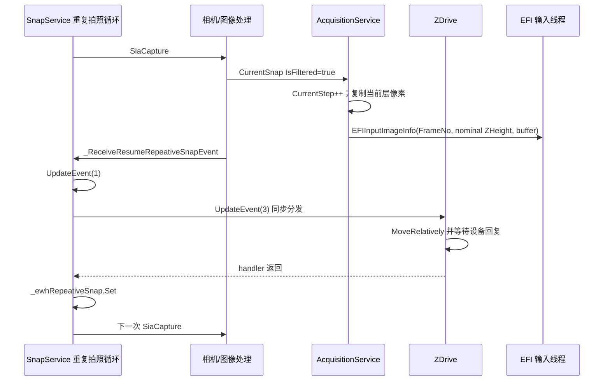

# DSX1000 采集与完整 Z 栈：静态证据

分析日期：2026-10-22。范围限于提供副本中的 `DSX-BSW-CTRL`，没有运行 DSX 程序、加载 CLR 程序集或访问设备。所有 token 都是当前 SHA-256 对应构建内的坐标，不能套用到其他版本。REA 成员证据完整保留在 `raw/`；解析后的选定方法全文见四份 `*.cil.txt`。本文把静态控制流与实机语义分开。

## 结论

1. **已证实：原厂普通 Z 栈采集存在逐层、合成前的独立像素缓冲区。** 采集服务将每层图像复制到按层索引分配的缓冲区，关联 `FrameNo`、`ZHeight`、字节数，再提交给 EFI。这里的“合成前图”仍可能经过滤波、色彩处理或同层 HDR；并非未经相机处理的传感器 RAW。
2. **已证实：普通重复拍照模式通过事件推进下一层。** 已过滤图像回调同步发布事件 `3`，运动服务处理该事件并等待 Z 移动请求的设备回复，然后才唤醒下一次 `SiaCapture`。这证明软件结构上已有反馈链；设备回复是否代表实际到位、是否还需要最小光学稳定时间，仍要实机确认。
3. **已证实：普通二维拍照使用独立的快照入口与回调。** `StartSnapTask → SiaCapture → CAM_SIA_CaptureEx`，驱动事件 `3` 进入快照回调；预览传帧使用事件 `2`。这支持外部逐层二维拍照的候选路线，但不能仅据此保证外部收到的文件必然属于当前请求。
4. **未证实：有受支持的外部 API 能直接取得原厂批量采集的全部层图。** 内部存在层图指针不等于 RDK/WCF 能导出它们。已有 debug `.raw` 保存通路，但缺少可靠结果回报、物理位置元数据及明确外部生命周期契约，不应当作为默认集成路线。
5. **建议：在整数µm目标网格满足业务时，优先验证 RDK 控制位移后逐次二维 `SHOT`，以每层独立文件组成完整 Z 栈。** [入口专项](../entrypoints/entrypoints-findings.md)已证明RDK的Z目标最终转换为整数µm，且SHOT最终回复仅为异步派发，不是图像或保存完成。此路线仍需通过“可验证到位—新快照—文件完整保存”实机验证；亚微米层距不能直接采用此入口。原厂批量 Z 栈的层图桥接仍是缺少外部生命周期/输出接口的候选。

## 文件身份与原始证据

| 代号 | 文件 | SHA-256 | 成员证据 ID |
|---|---|---|---|
| A | `OlybAcquisitionDomain.dll` | `6c6aff3590c0406b6fed4eaa47b447e84ebeea3882d930b93fc2c99880d64302` | `ev_891cb106c231976c46418566a57ec65e2fc1312be125613c325169caa6de500f` |
| C | `OlybCameraDomain.dll` | `ccecfd020f6543bba5e9cb8f04268452784a7bd98a07185d2430b075d9930988` | `ev_834f41d1d8bf823d3b53aa85461b76af8c1dbbe939c362670a25b7cdfa0611a9` |
| D | `OlydCamera.dll` | `19a1e1b01cafda823c8daafe11f3b461705157213798f116fd90dc25119a0955` | `ev_a6e39f1bc4f47017a22e7f595e5bf75abb1cfc7f72f32b1ad192428600c879fa` |
| E | `OlyiExtendFocusImageSGSharp64.dll` | `cb03932b0582204728b20e68bf6342f4f6d1ed0b155b8652ba1bca0a34baaebc` | `ev_24a221a19a0268e311c802c076fa435586198dfa3b238878f45d11cf71640553` |
| S | `OlybScenarioDefinition.dll` | `3adada8987b382a8fd4397690fc39cccc7ab06128db86fceccfc400d315cfd98` | `ev_676fb60a189fe73fc169c1c909e7b767fc0663267b7041084f157993d217060f` |

原文件根目录：`/Volumes/LARD/2.中转/OLYMPUS/OLYMPUS/DSX-BSW/DSX-BSW-CTRL`。五份成员记录的 coverage 均为 complete、issues 为空；这表示元数据/CIL 解析完成，不表示运行行为已经验证。`evidence-manifest.json` 记录证据文件哈希、MVID、选择方法的签名、IL 哈希和偏移。

`OlydCamera` 的 P/Invoke 证据另为 `ev_0f1f7a2b33802ee2152b6c124bd2858278a18bb61e4de8409aa4f5a36f6bb9a5`：104 个声明均指向 `CamDriver64.dll`。声明解析不证明独立客户端能初始化/共享相机，也没有检查 native 内部曝光同步语义。

## 普通二维快照与新帧边界

见 `device-camera-control-flow.cil.txt`、`snap-control-flow.cil.txt`。

| 文件/方法 | CIL 证据 | 已建立的行为与限制 |
|---|---|---|
| C `SnapService.StartSnapTask` `0x060000c4` | IL 118–128 | 空间检查通过后调用当前设备相机 `SiaCapture`；错误路径将 CurrentSnap 的图像缓冲头清空并记录失败状态。 |
| D `ACameraBase.SiaCapture` `0x0600007a` | IL 10–89 | 重置内部 `_i64FrameNo`，设置相机状态、记录 `_dtSnapStartTime`，调用 `DplibCamSiaCapture`，检查设备调用结果。这个方法返回本身不代表图像已生成或保存。 |
| D `DplibCamSiaCapture` `0x06000146` | IL 6–20 | `CAM_SIA_CaptureEx(CameraObject, 0, _pCamSnapBuff)`；NativeMethods token `0x0600024a`。 |
| D `DPController._SetCallbackProcessTable` `0x060001d0` | IL 24–77 | 事件 `2` 路由 live transfer，事件 `3` 路由 `_OnCapturedCallbackProcess`。 |
| D `_OnCapturedCallbackProcess` `0x0600007e` | IL 99–197 | 从 `ImageManager.GetCamSnapBufferHeader` 创建 `InputSnapEventArgs`，填写回调时间、采集耗时、尺寸等，切回相机状态 `0`，发出 `_OnInputSnap`。 |
| D `_OnInputSnap` `0x0600007f` | IL 14–27 | 对 `_inputSnapEventHandler` 同步 `Invoke`。这是进程内事件，尚无跨进程缓冲区协议。 |
| C `_SetDeviceEventHandler` `0x060000c2` | IL 27–49 | 注册 `_ReceiveInputSnap` 到 `InputSnapEventHandler`。 |
| C `_ReceiveInputSnap` `0x060000d3` | IL 35–170、223–322 | 把回调缓冲头、转换类型、CamByte、拍照模式对应的尺寸及曝光参数写入 `CurrentSnap`；设置 `IsFiltered=false`、`Is3DComplete=false`，再 `UpdateOrCreate`。 |

可据此区分快照与预览，但仍需建立外部新帧身份：已检查回调并未提供贯穿到 RDK 文件结果的全局唯一采集 ID。`_i64FrameNo` 每次 `SiaCapture` 重置，不宜直接充当 FDM 全局帧号。入口与运动专项已进一步证明外部 `SHOT` 最终回复只等待异步派发，并未等到数据落盘；最终保存完成的可靠关联仍是缺口。

建议桥接层为每个焦层分配 `capture_id` 和不可复用的目标文件名，串行执行一次请求，等候外部完成状态和文件可完整解码，验证尺寸、通道、位深、校准等，再原子登记到 `.fdmslide`。不要把“目录出现一个文件”或“预览画面更新”单独视为成功。硬件曝光时刻、驱动回调、RDK 完成和写盘时刻需要在现场同一时间线中核对。

## 原厂普通 Z 栈的事件与像素序列

图表达受检查的普通模式逻辑；不声称不同 `CurrentSnap` 订阅者的相互调用顺序已完整重建，也不把设备回复直接等同于光学稳定。

- C `_StartRepetitiveSnap3D` `0x060000ca`：订阅 `CurrentSnapDao.EntityUpdateHandler → _ReceiveResumeRepeativeSnapEvent`，循环调用 `SiaCapture` 或同层 HDR，等待 `_ewhRepeativeSnap`，再检查是否继续。
- C `_ReceiveResumeRepeativeSnapEvent` `0x060000d7`：只有 `IsFiltered=true` 进入；`ExtendMode` switch 的 case `0` 依次调用 `UpdateEvent(1)`（IL 57–63）、`UpdateEvent(3)`（IL 68–74），然后 `EventWaitHandle.Set`（IL 80–85）。case `1` 直接走 Set；不能将普通层进模式的结论套用到所有连续模式。
- 运动专项证据 `ev_3a11f4f672b22c536ff4a0b883514fbf5e6f5de8288ae07abde4955e5183cc74`：`Microscope3DAcquisitionService.StartZMovePitchTask` `0x06000081` 订阅事件；`_MoveZPitch` `0x0600008a` 仅在事件 `3` 时读取 `Zpitch` 并调用 Z 相对移动、等待设备应答。
- 数据库专项证据 `ev_fc5f7d5ef1644e9899021e77c833b1615a828d67daf31b9c904498e0b9d5286d`：`AcquisitionEventDao.UpdateEvent` `0x06000ab0` → `DaoBase.Update` `0x06000028` → `OnEntityUpdateHandler` `0x0600003f` 使用 delegate `Invoke`，没有 `BeginInvoke`。因此该运动 handler 返回早于上面的 Set。
- C `_WaitForExtendSnapIdle` `0x060000da` 有状态轮询和有上限的 10 ms 等待；这是原厂状态等待的一部分，不代表每层仍采用自研设备式的长固定延迟。不能静态推算提速倍数。

## 合成前层图确实存在，但尚无外部所有权契约

见 `acquisition-control-flow.cil.txt`。

| 方法 | 具体数据行为 |
|---|---|
| A `_ReceiveSnapImage` `0x06000030` | 只有 `_dgtReceiveExtendProcess` 存在且 `IsFiltered=true` 才向后处理提交图；HDR 开启时选择 `RealHDRImageDao` 的图。 |
| A `_OnImagedProcessAcquisitionFine` `0x06000033` | `CurrentStep` 增加后，层数未超过 `Zstep` 时调用 `_EnqueueZstackImage(image, CurrentStep, float(Zpitch * CurrentStep))`（IL 127–150）；最后一层停止重复采集，进入后续流程。 |
| A `_EnqueueZstackImage` `0x06000062` | 通过 `ImageManager.Attach` 取源像素；`GetExtendSGSnapImage(FrameNo-1)` 取每层目标缓冲；正常彩色路径调用 `CopyMemory`，单色路径 `ConvertMonochromeImage_3chTo1ch`；随后 `Dettach`，构造带层号、ZHeight、指针、字节数的记录入队。 |
| A `_SGInputImageThread` `0x06000063` | 对每个记录调用 `EFIMV_InputImage(EFIContext, MVContext, ImageBuffer, ZHeight, IntPtr.Zero)`；将指针保存在 `InputImageList[FrameNo-1]`。 |
| A `SGAfterProcessTask` `0x06000014` | `EFIMV_ReleaseContext` 后把上下文置零，解除工作缓冲，排空队列并清除队列记录里的图像指针。 |

关键含义：`ZHeight` 在这条普通路径是 `Zpitch × 1-based CurrentStep` 的算法输入，不是当前焦点的绝对物理坐标回读。不能直接拿它作为 `.fdmslide` 的绝对 Z。层图指针归原厂图像管理器管理；本轮未检查其分配/释放实现，无法承诺外部借用指针在函数返回后、任务结束后或下一次采集时仍有效。若未来采用进程内桥接，必须在明确生命周期内复制数据，并给每层补齐绝对位置和任务身份。

## `ZSTACK_IMAGE_SAVE` 与 debug `.raw` 必须分开看

副本 `DSX-BSW-CTRL.exe.config` 第 78 行有 `ZSTACK_IMAGE_SAVE=false`。对 CTRL 树中 `.dll/.exe/.config/.ini/.xml` 做 ASCII 与 UTF-16LE 字面量搜索，命中该键的只有此配置文件。搜索范围、各文件哈希与命中记录在 `config-literal-scan.json`。此搜索不证明键无效，也不排除动态构造/外部路径读取；**本轮未建立它和当前保存代码的调用关系**。不能建议只把 false 改 true 就能导出层图。

已追到的实际保存路径如下：

1. A `SGPreProcessTask` `0x06000011` 调 E `EFIDebugInfo.GetDebugInfo` `0x06000090`。
2. E `EFIDefaultParam..cctor` `0x06000087` 提供 `EFIParam\\` 和 `EFIParamDefault.ini`；`EFIDebugInfo..cctor` `0x06000092` 提供 `Debug` 段名。
3. E `EFIUtil.SetParamFromIniFile` `0x06000007` 反射属性并逐项 `ReadIniFile`；`<SetParamFromIniFile>b__2` `0x060000ab` 将属性名用作 INI key。因此 `SaveStackImagePath` 来自该段属性映射。所查 CTRL 副本树没有发现 `EFIParamDefault.ini`；实际根目录/现场配置仍需查验。
4. A `SGInputImageThreadEndTask` `0x06000013` 在收尾时调用 `_SaveZstackImage(debugInfo, CurrentStep, InputImageList)` `0x06000053`。
5. 该方法仅在 `SaveStackImagePath` 非空且目录存在时执行；按索引 `0000` 起写 `zstack_{width}x{height}x{bytesPerPixel}_{index}.raw`。`bytesPerPixel=(ImageBitNum/8)*3`，写入长度为 width×height×bytesPerPixel；WriteFile 返回值被 `pop` 丢弃，异常只写日志，方法没有成功结果返回。

因此这是一条有价值的对照/研究通路，但目前不足以作为可靠的产品导出接口：文件中无已见绝对 XY/Z 元数据、缺少任务唯一标识、重复采集可能复用文件名、没有逐文件成功回执。尤其其固定三通道长度与入队时存在的单色压缩路径需要额外核对，不能未经验证直接启用单色 debug 保存。另一个 `_SaveZstackImage` 重载 `0x06000054` 使用 `AcquisitionCondition.ZstackImageFile`；在 A 的完整静态 call_edges 内没有发现对这个重载的调用，不能据此认定其可达或已启用。

## 分辨率、曝光和现场验证约束

C `_SetCcdMode` `0x060000c7` 从 `CameraSiaImageSizeDao` 按相机 ID 与 CCD 模式取得 XSize/YSize/ShiftMode，然后调用 `SetSiaImageSizeAndMode`。因此快照尺寸不应以预览尺寸推断。`StartHdrHighResoSnapTask` `0x060000cd` 调 `ExecuteRotationalHdrSnap` 并等待完成；HDR 有 each-snap 与 whole-snap 两类回调（`0x060000d4/0x060000d5`）。必须把“同一 Z 多曝光合成”和“不同 Z 的完整焦层”分开计数。

首轮对照建议固定倍率、二维拍照模式、分辨率、曝光、HDR/滤波设置、像素格式和保存格式。取五个已知 Z 位置逐次拍照，保存 unique capture_id、命令发送/回复时刻、实测位置、文件完成时刻、尺寸/位深/文件哈希，并用不同焦面纹理验证层序。再测 3×3×5=45 张。若原厂软件不能提供曝光时刻关联，可先用画面变化/移动前后特征与串行唯一文件验证新帧，不能把软件创建时间单独视为曝光时间证明。

未解决的接入缺口：RDK整数µm目标是否满足业务；独立于SHOT最终回复的快照完成与成功落盘关联；未处理模式下的图像格式和校准保留；硬件回复与曝光稳定的关系；超时/取消后的相机状态和缓冲区处理；原厂 batch 所有原始层的对外传输/所有权。以上均不应由静态方法名或配置名替代现场证据。

## 证据复核

`rea-evidence-bundle.json.gz` 包含此代理 MCP 会话导出的 9 条完整证据；`raw/*.members.json.gz` 另保留 5 条通过本机 REA CLI 取得的完整成员证据。压缩使用 gzip mtime=0，解压后的完整 SHA-256、压缩包 SHA-256、记录数均在 `evidence-manifest.json`，已逐一回读校验。

`print_cil.mjs` 使用本机已有 REA 6.7.0 的 CIL 解码器，仅读取原始文件，解码前校验文件 SHA-256 和每个方法 IL SHA-256；解码器身份也记录在 manifest。示例：`node print_cil.mjs OlybCameraDomain 0x060000d7`。脚本依赖报告所记本地 REA 路径与副本路径；无需 CLR，不执行厂商代码。四份解析文本的所有 33 个选定方法均为 `DECODE_ISSUE null`。没有因本次分析修改设备配置、原厂文件或 FDM 代码。
