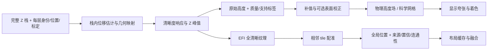

# DSX 算法逆向与独立复现资料

本轮已把景深合成、焦点三维、预览防抖、自动拼接、表面校正和三维显示的主要运算恢复为可执行研究实现，并扩展了单图反光抑制。分析对象是提供的 DSX-BSW 副本；每个分支均保留文件身份、调用关系、关键算式、参数来源、反例和复现边界。当前资料足以开始独立实现这些功能，原厂逐位兼容和实际光学精度仍需要原厂输入/输出对照。

这轮工作没有修改 FDM 产品代码，没有运行原厂程序，也没有连接设备。算法研究不能替代此前接入任务中的“运动完成—新帧—完整 Z 栈”现场验证。

## 先读这些结论

1. **DSX 的焦点三维是从 Z 栈恢复单值高度场。** 核心是多尺度清晰度响应、沿 Z 的自然三次样条峰值估计、弱纹理补值和引导滤波。它不是体数据重建；同一 XY 上的多个清晰表面最终只保留一个高度，所以 FDM 仍应保存完整焦层。
2. **景深图、高度图和置信/支持信息应分开保存。** 平滑后的高度可能更好看，也可能增加误差；弱纹理补出来的表面不能与实际测得的表面混为一谈。合成测试已有这样的反例。
3. **实时“防抖”主要是数字预览平移。** 相位相关得到偏移，托管逻辑门控、累加，最后改变 WPF 显示位置；原图像素不因此去除曝光模糊。高相关分数也不能证明设备到位、图像新鲜或对象没有转动。
4. **自动拼接至少有三个不同引擎。** APP 默认 Composite 使用局部搜索和父邻居累计；CTRL 走 NMV；另一 OLS 路线包含相位相关、全局图优化及可选硬件坐标校准。不能把某一路的置信门限、融合开关当成所有模式的规则。
5. **高度码值、物理高度和显示夸张是三件事。** 原程序存在 `65535//层数` 的量化、独立 Z 分辨率元数据和显示高度倍数；第一层名义 Z 也未必是零。直接把图中的 16 位数字解释为 µm 会出错。
6. **查到的 Hamal 反光抑制是单图局部色调处理。** 可借鉴其局部直方图和增益曲线；它不是本轮已证明的多曝光 HDR，无法从已截断成全白的输入恢复真实纹理。

## 资料导航

| 功能 | 已恢复到可实现的核心 | 规格、原型与证据 | 主要边界 |
|---|---|---|---|
| 景深合成 / 焦点三维 | 金字塔响应、频带权重、样条 Z 峰值、补值、引导加权中值、高度自引导、精细重着色；栈内给定位移的裁边/重采样 | [规格](efi-3d/implementation-spec.md)、[源码](efi-3d/reference_efi.py)、[证据](efi-3d/evidence-index.json) | CPU SG64；CUDA、旧 Core64 和 ALMIS 不能视作同一实现；详见 E01–E11 |
| 实时防抖 | FFT 尺寸表、Hann、跨功率、矩形低通、3×3 亚像素拟合、门控与显示累加状态 | [规格](stabilization/implementation-spec.md)、[源码](stabilization/nmv_reference.py)、[结论](stabilization/findings.md) | 无原厂数值对拍；重复纹理、纯色和转动均有反例 |
| 自动拼接 | APP 搜索代价与调度、CTRL 配准链、OLS 相位配准/全局最小二乘/五参数校准、颜色与高度融合 | [规格](stitching/implementation-spec.md)、[源码](stitching/reference_prototype.py)、[边界表](stitching/gap-ledger.md) | 独立端到端模型选择普通二维图路径；旧引擎所有多层与内存分块细节未全复刻 |
| 表面校正 / 剖面 | 倾斜、二次基底、三点平面、四点球面、带宽剖面、手动三点二次曲线、高度重编码 | [规格](surface/implementation-spec.md)、[源码](surface/reference.py)、[证据](surface/findings.md) | 球面外无效域显式标记；退化保护部分为我们的改进 |
| 三维显示 | 高度标定/归一化、网格、法线、轴向/翻转、显示夸张、PLY 导出 | [规格](rendering/implementation-spec.md)、[源码](rendering/reference.py)、[交互演示](rendering/height-field-lab.html) | 独立渲染器；未复刻所有 Direct3D 着色、拾取及 UI |
| 高度与光学合同 | NA/物镜/光学变倍到 cutoff，名义 Z 到 UInt16 范围的 Int32 缓冲，分辨率到 TIFF/数据库字段 | [结论及公式](height-contract/findings.md)、[源码](height-contract/reference.py) | 绝对原点需另供；实际镜头、INI、标定与文件导出须核对 |
| 可选：反光抑制 | 80×60 缩略图、非对称 LUT、33×33 局部直方图、累计曲线与亮度/色度增益 | [规格](stabilization/hdr/implementation-spec.md)、[源码](stabilization/hdr/hamal8_reference.py) | 8 位指定模式；不覆盖 14 位、Spica 或多曝光 HDR；尺寸支持域显式限制 |



这张图是建议的新实现边界，不表示 DSX 所有工作模式都按同一顺序运行。原厂路径见各分支的调用图。

## 如何重现研究检查

当前仓库虚拟环境已具备 NumPy、SciPy、OpenCV。下面的入口把源码复制到临时目录，重新生成合成输入并运行七组检查；不会改写分支中已归档的输入和证据：

```sh
.venv/bin/python docs/research/dsx1000-integration-2026-10-22/algorithms-2026-10-23/run_all_references.py
```

结果见 [validation-summary.json](validation-summary.json) 和 `validation-suite/`。它记录每个源码 SHA、依赖版本、退出码、断言结果和耗时。耗时只反映本机研究脚本，不是 DSX 性能测量。单独重放 EFI 的 NPZ 输入方法见其规格；其他核心是可直接导入的 Python 函数，验证脚本给出完整调用示例。

独立交叉审查还修正了小数 Z 候选末端丢失、16 位共线 RGB 数值退化、金字塔奇数边界漏测、球面无效区与网格合同不兼容、缩略图尺寸支持域过宽等问题。见 [EFI 审查](efi-independent-review.md)、[几何审查](geometry-independent-review.md)、[防抖/Hamal 审查](stabilization-independent-review.md)。原型中的保护措施、求解器替换和原厂事实分别记录，没有把“更稳健”写成“原厂就是这样做”。

当前统一重放 **188/188** 项通过。搬运后可运行 `python3 build_research_index.py --check` 校验算法目录的 [SHA256SUMS](SHA256SUMS)；[algorithm-evidence-index.json](algorithm-evidence-index.json) 按证据 ID 去重并列出所在压缩包。更早的设备接口证据仍保留在上一级研究目录中。

## 下一步使用

- [FDM 迁移建议与数据合同](FDM-ADAPTATION.md)：结合当前代码，按收益安排独立实现。
- [现场算法对照操作卡](FIELD-ALGORITHM-CARD.md)：配合已交付收集工具带回原图、参数和原厂结果。
- [复现验收台账](REPRODUCTION-AUDIT.md)：查看已完成范围与仍需原厂/实机验证的边界。
- [全研究交付校验](../verification.json)：引用是否可解析、原厂文件身份是否匹配、FDM 产品文件是否改变。

建议首先落地离线 Z 栈重放和单位正确的高度场，再接拼接布局与三维显示。实际自动采集仍须先证明可靠到位、新帧身份与停止恢复；算法改善不能掩盖采集链路的问题。
