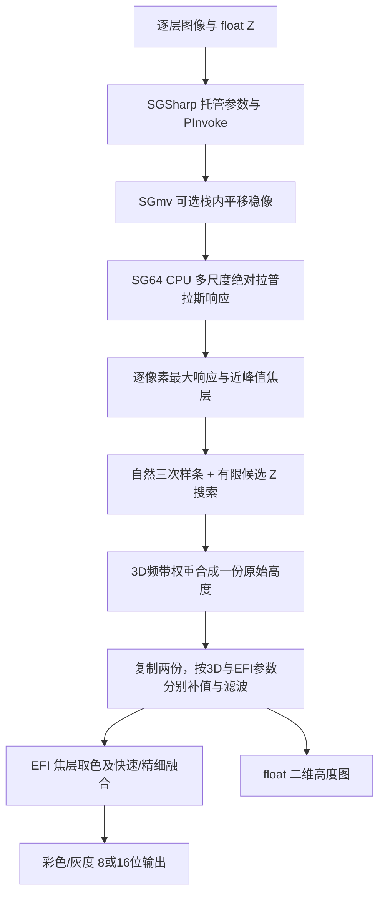

# DSX1000 景深合成、焦点高度与栈内稳像：阶段证据报告

2026-10-23。仅静态读取用户提供的软件副本，没有执行原厂程序或连接设备。CPU 主链的公式、顺序、数据类型与边界已整理为 [implementation-spec.md](implementation-spec.md)，独立参考程序与 37 项合成验证已保存。反编译代码不是原始源码，未做原厂输出的数值对照，不能宣称 bit-exact。

## 已走通的链路

这是一张 XY 对应一个估计 Z 的表面，不是体数据重建。EFI 图、经补值的高度图、完整多焦层原图是三种不同产物。完整数字切片仍应保存全部焦层。

## 证据和文件身份

| 文件 | SHA-256 | 作用 |
|---|---|---|
| OlyiExtendFocusImageSGSharp64.dll | cb03932b0582204728b20e68bf6342f4f6d1ed0b155b8652ba1bca0a34baaebc | .NET 参数、INI、8个 EFIMV 导入 |
| OlyExtendFocusImageSGmv64.dll | 4d5223236add17a5a7601c1762260d5ab5a73d5b0fc524903405455d530de85a | 图像位移估计、裁切/重采样包装、转调 SG64 |
| OlyExtendFocusImageSG64.dll | f51d75f9b28c5f7135b591e6c41669cd7ba5ebd4ee00bbf378c90cd9a7d11547 | CPU/reference/CUDA 分派与 EFI/高度核心 |

原始目录为 `/Volumes/LARD/2.中转/OLYMPUS/OLYMPUS/DSX-BSW/DSX-BSW-CTRL/`。SGSharp MVID 为 `d49a91dc-5d44-47ce-87e4-3412eff536cf`；SG64 引用的 PDB 未提供。地址均为对应 x64 PE 的 Ghidra 虚拟地址。完整 Evidence 在本目录 `*-evidence.json`；可读伪码在 `*-pseudocode.md`，托管 IL 在 [managed-key-il.md](managed-key-il.md)。

## 1. 清晰度不是单个全图分数

`EFI_CreateContext` 的 mode=1 走 `SweepGuideCPU`；其输入入口 `0x18001e520 → 0x180022960` 真正调用 ConstructLapPyr、ResizeLapPyr、SmoothLapPyr、SearchMaxLap、GetLapZStackNearMaxLap，而非只发现同名字符串。每幅图有多尺度响应和逐像素层号。

金字塔缩小的可见核是可分离 `[1,4,6,4,1]`，二维归一化为 `/256`。从低分辨率重建后与上一尺度相减，并清符号位取绝对值；之后每层调用 `cv::GaussianBlur`。因此当前证据支持“高斯金字塔重建残差的绝对值”，不能简化成普通 3×3 Laplacian 核。最大响应更新使用 `old <= new`，相同响应会选较晚输入的层。

主要证据：`ev_d27841304e8f5d1fd2151c73ee8bc2442553886109e27002bf2b4338dec60216`、`ev_86838a8dce3e48684acb1ece763e25c502e9b9062ef5d7fbf05cc7b117806a97`、`ev_e3ea72f1e8944cbc8bf62d4582151080b7754312d99e2d15acc670aeb8696bef`、`ev_af649763122711c16f1ee288880da4ec0e8854314b84967d38ed88fd3c4f7266`、`ev_8a0c56d03763cf3b6aa001c84437b22100a4a38f2f799be9540674d4e545b9f4`。

## 2. 高度来自近峰值插值，支持小数 Z

输入 Z 保留 float。默认非任意顺序模式要求单调；任意顺序模式另行排序并保留索引映射。去重阈值接近浮点零，不是把 Z 四舍五入成整数。只有一张唯一 Z 时直接输出常量高度。焦层不足时使用另一条回退路径，不能宣称所有输入都走样条。

样条路径先围绕每像素的离散最大响应选近邻焦层，再解自然三次样条三对角系统（端点二阶系数为零）。候选 Z 用有限网格枚举，Horner 计算三次多项式，取最大响应对应的 Z；不是求三次曲线导数后解析求极值。候选间隔为 `(zLast-zFirst)/((uniqueCount-1)*nDataInterpNum)`。插值得到更密的数值网格，不增加实际光学采样信息。

已专门用汇编纠正一次伪码类型误判：`0x180003361` 整数乘出分母后，`CVTDQ2PS → DIVSS → MOVSS` 保存 float 间距，没有把间距转整数。因此不能据反编译器的 int 指针类型认定小数间距被截断。

主要证据：`ev_cf52a7fd57ecde67a70af79600563ab4fa5e70a8d741ab7f42b9c87f546e952f`（样条）、`ev_bb2e3c3e524897a281f424abbe687b7acd4355942d41c191c3f385a6fefc3501`（候选）、`ev_4995d6886e1994bac47df223cac38803753e228fbcafe4a2007e423a28ef56e1`（float 汇编）。

## 3. “弱纹理填满”与“可靠测得高度”必须分开

主 Construct 路径确实调用弱纹理补值，不只是有预留参数。`0x180012b70` 按 3D/EFI 分别取 LapThresh，低响应位置视为待补；对降采样的 `valid*(height+1)` 和 `valid` 分别高斯模糊，用两者之比传播数值，保留可靠锚点，累计变化 SAD 达到阈值后退出，再插回原图的低响应位置。`+1/-1` 用来区分空值和零高度。

这会在没有足够局部纹理的位置生成连续表面。后续 `0x18001aa20` 的引导加权中值及 `cv::medianBlur`，以及 `0x18001c480` 的归一化、引导平滑、反归一化进一步改变高度。3D 和 EFI 使用两套参数，但复制同一份原始高度。补查汇编确认 nItrMax 只控制是否进入循环，循环没有计数上限，只按 SAD 退出；阈值为0时严格小于条件不能满足。参考原型另外强制上限并记录未收敛，不复现无限循环。

主要证据：`ev_95adec5bb101242d5660b807890989f7587d5f12c237cd164e7fa36be4fc5651`、`ev_8f3644f8f11c96afc308a2d923058b00f290f0a2dd7d56956b77dc82b46e918d`、`ev_7536072e8ebcfd1d1440749f9dd10fc377a473f350d94267af031ec3fb9e0ffc`、`ev_0a0f49acf4d588b10168a58666899c7a3c58fdfb83a596d2533e4cb5010d65c8`。

## 4. EFI 与高度并行，快速/精细不是 CPU/GPU 的别名

SGSharp 含 3D/EFI 分别的频带权重、平滑、阈值，以及 FastSweep/FastFine 的融合阈值。3D 权重合成高度和其响应，FastEFI 权重合成颜色和用于引导/最终混合的响应。`BlendEFICPU` 真正计算随清晰度变化的混合权重。四个权重来自 `GetLensCutoff` 光学截止量与六个阈值的分段线性分配，不是直接把倍率当权重。CPU/GPU 则由另一个 ComputeMode 决定。原厂界面的快速/精细扫描如何选择每条实现、以及现场实际覆盖的 INI 参数，仍须结合上层调用和实机配置核对，不能把托管构造默认值视为正在使用的参数。

缓存不足时还有 Construct→InputImageForConstruct→EndConstruct 的二次供图模式。Construct 返回1表示需要按第一遍相同顺序再供图，EndConstruct 供图不齐也返回1，完成返回0。0x18另可来自高度平滑退化，不能混为二次供图状态。结束时输出图像和 float 平面高度数据；这一级未生成三角网格。网格显示、表面校正、16位高度存储及比例转换属于后续模块，不能混为同一个结果。

证据：`ev_93900dcdfbf4362d4415fde79e60a122b72bcee3e3b0e1ffdbc175568f9702b7`、`ev_2fc389a03d9d3e986eba3a170b1562b137e9a5d46a60d41a2ff353e5b5df69bc`、`ev_7b67ede848601e9752368f7180cc7132fc949ffa62475b28c06928c1edb1f548`。

## 5. 栈内稳像及几何影响

SGSharp 的8个导入实际进入 SGmv；SGmv `EFIMV_InputImage` 先做预处理再调用 SG64。稳像开启后可动态装载 `OlyNmv.dll` 或 `ALMIS3ol64.dll`。已证 `0x180002490` 取相邻图像位移及质量指标；`0x1800022d0` 累计偏移，质量不足时沿用上一偏移，按 X/Y 限幅；`0x1800028b0` 通过 `cv::warpAffine` 做负平移和裁边。原始 Z 栈仍可能因无纹理或失焦使位移估计失效。ALMIS 核心未在本分支深入。

裁后尺寸是 `W-2*marginX, H-2*marginY`。`0x180002cc0` 在某输出模式下将裁后的 EFI 和 float 高度一起 resize 回输入尺寸；另一个模式直接保留裁后输出。接口返回的是图像/高度指针和状态，当前8个 EFIMV 导入中没有独立逐像素有效性、位移或几何变换返回值。调用者知道输入参数中的 margin/output mode，但本层未证明上层是否保存这些信息。若裁后拉回 W×H，物理映射不能继续把每一输出像素当成原始采样 pitch，应连同裁边原点和缩放记录。

主要证据：`ev_e10926e0c8ced8ddb986326c944d8ab6ccdfa111da8887cd88eeeb3811daceeb`（动态依赖）、`ev_78891cdd2bcfd8566cec695e965adfefb45c73bedea96965b2540cdf05079728`（位移）、`ev_dcff2c3c3436528e84cb307e4a47eb21452593b85dfc13f2d9f7f243bd865459`（质量/累计）、`ev_4578638030f20c660b4f3b9025dbae51735f21c35168af7850cc810a9f08277f`（warp）、`ev_adc6c1f6c3871960ee4242a662d1f59381cf3733b87f35ea142eaad19c3a88f0`（尺寸）、`ev_eddf0d080abe37827270d7f85d472566bea8cc351f8254c587d52bae04842e2e`（resize）。

## 可借鉴设计与未证边界

- 完整保存原始焦层与实际 Z；合成图、未补值高度、补值高度、置信度/有效性、几何变换分别保存。低响应填补不得伪装成测得值。
- 多尺度响应、近峰值插值、图像引导去噪值得复现比较；原厂常数仅作为本版本证据，不直接当成 FDM 的业务默认参数。
- 栈内漂移校正应保留累计位移、质量、裁切及尺度，而不只输出“防抖后图片”。不能用数字稳像取代机械到位反馈。
- 已证明 CPU 主链实际执行路径；尚未证明 CUDA 数值等价、实际显卡可用性、光学测量准确度及速度。既有 Z 输入来源与“原始图”的含义见 [采集分析](../../acquisition/acquisition-findings.md)。
- 已完成边界核、频带融合、精细取色、CPU缓存二阶段与独立参考程序；关键细节和残余缺口见实现规格。37项测试包括低纹理、多峰、边界焦层、小数/不均匀Z与已知真值两平面场景。合成场景平滑后高度误差反而增大，说明视觉连续性不等同于测量可信度。参考实现验证算法规格，不替代设备与原厂对照验收。

工具资源说明：首次关闭 SG64 时 REA 返回 cleanup_incomplete，提示 Ghidra 子进程所有权检查失败；导出先于关闭，证据已保存。后续只读进程核对显示当时两个PID已经不存在，没有强杀其他分析进程。SGmv和重新打开的SG64补查及证据导出成功。

最后一次 SG64 导出含66条补查记录，随后已保存分析快照；REA关闭仍报sysctl_errno_22所有权检查问题。只读核对PID22717已不存在，未强杀进程。该工具清理诊断不影响已导出的静态证据，也不代表执行过原厂DLL。

独立审查修订：原型已修复 float32/float64 候选网格混用造成的末层漏一格，并以 float64 引导矩计算避免 16 位共线彩色输入奇异。增加非恒定边缘/脉冲及完整多层16位反例；三种旧错误变体均被新增验证捕获。补查现已闭合16位载入：灰度/彩色均直接uint16→float32保留原强度，无/256或>>8；见[8条补充证据说明](../stabilization/efi-loader-e11-findings.md)及规格E11。引导矩float64保障仍是明确数值改进，归E06，不冒充原厂浮点行为。
