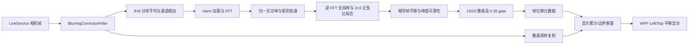

# DSX 防抖与图像配准：静态结论

副本的**实时防抖是相邻帧的数字平移估计，加上 WPF 显示位置补偿**。它不是电机到位检测，也不修复曝光期间已经产生的模糊。在 live filter 内，输入像素原样复制到输出，仅增加位移与重置元数据；显示层累计位移并移动画面。这个边界已经由托管→原生→UI 调用链闭合，而非根据 DLL 名称推测。

研究时间 2026-10-23。范围是所给 DSX-BSW-CTRL 软件副本；没有运行原厂程序、没有设备连接、没有修改 FDM。精确公式与方法/地址见 [implementation-spec.md](implementation-spec.md)，证据包及文件身份见本目录索引。

## 已闭合的控制和计算链

1. 原厂 `OlyNmv` 是相位相关路线：全画面下采样、Hann、归一互功率、矩形低通、未归一化逆 FFT、全局峰。默认 divider=8，LPF cutoff=.5。
2. 亚像素不是常见 OpenCV 5×5 峰质心。原厂取 3×3，抛物线作初值，拟合两个方向正弦比乘积；第三优化参数虽初始化为 1，却没有进入已确认残差。
3. `reliability=整数峰值/(cutoff²×FFT宽×FFT高)`，不是通用概率或 OpenCV response。原厂 live 要求它严格大于 .35。
4. 估计相对上一成功转换/估计帧，成功后立即推进参考。大位移或低 reliability 在后续 live gate 被拒绝，只重置显示累计，不退回旧参考。
5. 任一轴大于 20 像素时按大移动分支重置；其后大于 15 的另一个分支也重置。接受值向负无穷取整到 .001 像素，再累计。默认显示余量 X=20、Y=20×高/宽；轴超出余量时单轴归零。
6. 相机到台物理坐标、运动完成、曝光完成没有进入这条状态机。不能把它用作数字切片“移动已完成”的证据。

## 可以借鉴的部分与不能照抄的部分

| 内容 | 静态已证实 | 对 FDM 的意义 |
|---|---|---|
| 低分辨率相位相关 | 原生公式与尺寸表已恢复 | 可作轻量帧间平移监视或采集诊断；是否有足够纹理由样本决定 |
| confidence 与运动幅度分开 gate | .35 与 15/20 px 分支已恢复 | 能区分“图像不可信”和“可能是主动移动”；阈值不能直接按 µm 使用 |
| 上一帧 reference + 显示累计 | 状态更新及重置链已恢复 | 可复现显示防抖；参考推进策略必须与拒绝策略明确分离 |
| 元数据与图像像素分离 | 此 filter 只复制像素 | 保留定量图与原始帧；显示位移不要污染台坐标或 `.fdmslide` 物理元数据 |
| 亚像素拟合 | 3×3 模型、迭代参数、有限差分已恢复 | 可独立实现；需要原厂数值 oracle 才能声称等价 |
| 数值健壮性 | 直接 sin/sin、平坦初值可非有限 | 建议新实现显式处理零点与弱纹理，并保留这是改善而非原厂事实 |
| Z 栈防抖 | 另有 EFI fast/fine stabilization 参数及裁边 | 应采用 EFI 分支的参数与算法，不混用本 live 显示规则 |

最有价值的设计是**图像位移、可靠性、显示累计三者分开**。对完整 Z 栈采集，这个算法可以额外检查邻层或重复帧的几何关系，但不能替代设备状态，也不能把高 reliability 当“正确新帧”的身份校验。重复纹理可能形成很好的错误峰；光滑非零图像本身加窗后也可能产生虚假高置信的零位移。

## 复现材料

- [nmv_reference.py](nmv_reference.py)：独立算法与 live 状态模型，不加载原厂 DLL。
- [implementation-spec.md](implementation-spec.md)：公式、参数、原生地址、托管 token、状态边界。
- `fft-sizes.json`：从 native 数据段取出的 240 项精确 FFT 尺寸。
- `run_validation.py`、`validation/results.json`、`validation/fixtures.npz`：固定 seed、源码 SHA、依赖版本、合成输入与结果。测试只能证明研究实现，不是 DSX 实机验收。
- `phase-correlation-evidence.json.gz`、`solver-evidence.json.gz`：保留 REA 原始证据；后者包含显示链与求解器补证。`evidence-index.json` 可按 ID 检索。

## 尚未证明的边界

本次未运行原厂 DLL 做数值 oracle。原厂 OpenCV 与静态链接求解器和当前 Python 依赖的浮点路径可能不同，非有限残差的行为尤其需要对照。本次也未证明相位相关可纠正旋转/局部形变，或 raw TIFF 保存会应用这条 WPF 位移；它们没有出现在已追踪计算模型中。

`OLSStitching/OlyaImageStitching.exe` 是另一条实现，拼接研究已经发现其 LPF 分支使用参与模型的第三振幅参数、另一种可靠性，而非 LPF 分支还有 5×5 质心。这不与本报告矛盾：本报告的正弦比两参数、未使用第三项、整数峰归一化结论严格限定 `CTRL/OlyNmv.dll` 的上述 SHA，不把一个变体推广到全套软件。

现场可先记录正常 live 防抖开关、`InputShift/OutputShift/Reliability/ResetAccShiftFlag` 和 `Reset BlurAccumulation` 日志，再同时保存连续原始帧。将原始帧交给研究实现，比较方向、量级、重置帧与可见效果；曝光模糊、台到位和帧身份另以采集链证据判定。
