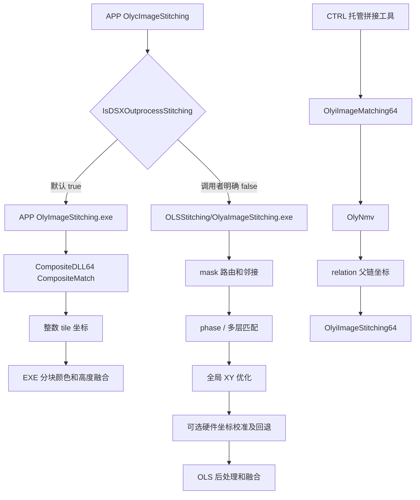

# 自动拼接重建规格 v2

范围：APP 默认 Composite、CTRL NMV 和 OLS 内置相位相关/图优化主干。静态证据定位见 [evidence-map.md](evidence-map.md)。地址均为其 PE 的 Ghidra VA；托管为 MethodDef token。身份见 [identity-manifest.json](identity-manifest.json)。这里只定义算法研究实现，不要求运行或链接原厂程序。

## 1. 三个入口不可混用



必须将引擎名、文件 SHA、配置、tile 原始顺序、物理先验和像素坐标一同保存。坐标先验的单位转换不属于下面的配准算法；不应把硬件微米直接传作像素。

## 2. APP 默认配准

### 数据与参数

- 输入：同尺寸 8/16 位三通道图，规则行列关系，tile 有效性/缺失状态；原程序用内存或临时图像文件。
- 参数：X/Y overlap%、X/Y tolerance%、奇数滤波核、ProcedureType、MinVote、最大相机角、fallback overlap、ImageType、NoiseReduct、BufferingMode。
- `SetDialogData@18000c420` 将滤波核调整为 `(N/2)*2+1`，这只涉及算法滤波，不能沿用于用户 Z 参数。
- APP 配置默认 ProcedureType=6、LogFilterSize=5、MinVote=.1、MaxCameraAngle=4°、ImageType=0、NoiseReduct=1、Buffering=1。配置副本与原始字节 SHA 在 config/ 和身份清单中。

### 预处理

`InitMemoryComposite@180007340`：8 位图扩大 256 倍成 uint16；颜色转灰度；可选平滑；找所有图的共享最小/最大值；共同线性映射至 16 位范围。不是逐 tile 独立对比度拉伸。全平灰度除零、历史 OpenCV cvConvertScale 舍入等未闭合；原型显式返回 flat_input，而不声称复刻该未证边界。

### 种子与顺序

- type4 `ContrastCalc@180009090`：在四向边带计算相邻像素差平方平均，helper `1800120b0`。
- type5/6 `BrightMatch@180009a00`：边带平均灰度 / 灰度极差。
- `SetMatchOrder@18000c890`：已访问集合的四邻接前沿中选择最大指标；不是求所有图像之间的特征对应。完整并列和边界处理保留反编译片段。
- `OrderMatch@18000d330`：只评估已访问邻居；按源/目标哪一侧边带指标较高选择 GetShift 的方向。选择返回纹理值最大的一向。结果方向相同值的代码比较顺序为左、右、上、下，需结合有向掩码，不应当作无条件世界坐标方向。

### 配对匹配

`GetShift@18000a420`：重叠宽度加容差构成边带；模板去掉容差；浮点转换和 Gaussian，ImageType=2 时加 Laplace 3 后再平滑。垂直于主接合方向的搜索裕度由 `abs(sin(angle)*longDimension)` 产生。

`GetMatching@1800122a0`：两个候选坐标都递增 2 px，严格更低误差才更新。代价函数 `180014140`：

```
A, B = corresponding ROI samples at x=0,2,..., y=0,2,...
if sum(A²)*sum(B²)==0: cost=1
else: cost=abs(1-sum(A*B)/sqrt(sum(A²)*sum(B²)))
```

不存在减均值，所以它不等同 ZNCC。正乘法曝光变化可抵消，偏置变化不能抵消。匹配边界处原函数使用两图的有效交集；v1 Python 只支持完整包含 ROI，边界请求会明确报错。

返回 `q=min(range(A_fullROI), range(B_fullROI))/65535`。`OrderMatch` 只用 `q>MinVote` 作接受判据，不把代价变成 q。失败回退按名义 overlap，继续保留可拼接布局；“回退坐标”必须在新实现中标记，不能表现成成功的图像配准。

### 位置

`OrderMatchPosition@18000e8c0` 按父邻居位置加/减 tile 尺寸和求得 overlap。结果使用整数坐标；随后减最小 X/Y，使画布非负；输出宽度还做 4 字节边界对齐。未观察到该路径对所有边联合优化。

## 3. CTRL 的 NMV 配准

`OlyiImageMatching64@180006970` 以 relation 的父 tile 为参考，用阶段坐标先验构造重叠 ROI (`180007d40`)，不足 1 px 返回错误 0x12f；按下采样 divisor 对齐 (`180008210`)。`180007f90` 调用 OlyNmv 系列，返回 `[reliability,-dx,-dy]`。上层将位移加到父坐标，然后四舍五入成整数像素。

NMV 的数学细节以 [防抖规格](../stabilization/implementation-spec.md) 为准，限定 SHA `3f7556ebfb87e739a2503c66330703c1836c4f2e7871a549c3b7b3e81f31b875`。本链可见 q 返回但未见 q 的门限判断。配置 OlyNmv.ini 的 .35 不能自动作为这里的拒绝条件。CTRL 默认 Divider=8、LPF=.5、SubPixel=true；这里的亚像素估计最终被上层整像素位置使用。

## 4. OLS 主干与位移门限

实际链 `156060 → 138300` 初始化，`ismatching=true` 后：

- `isplanefilm=false` → `130c30`，OpenMP worker `13c340` 配对。
- `isplanefilm=true` → `12e080`，worker `13bcb0` 在层图组合上取位移；invalid mask 的有效比例会乘入 score。完整多层选层优先级尚待补齐。
- 两者的匹配核心均有到 `132670` 的实际调用，随后都到 `124330` 全局优化。

`138300 → 15f5c0` 的 mask 路由仅用布尔格点。`StitchRouteSearch@1800039c0` 裁剪包围框、扫描首个有效点、按连续行段与相邻行种子遍历；返回序列/ID。OLS 包装层检查每个点上/下/左/右已访问邻居，建立图边。没有图像或相位数据进入路由 DLL；它不是最优接缝搜索。

### 外层过滤 `132670`

1. 根据先验位移求两个 ROI（`1299b0`）；无交集则 status=1，位置保持先验，score=0。
2. 对 ROI flatten/sort（`129bd0`），取 `floor((N-1)*.999)` 的强度；8 位小于 4、16 位小于 1024，则 status=2，保持先验。
3. 某调用场景带 CLAHE（`1255a0 → 126170`，构造函数的 `CLAHE_Impl` 虚表已核实，clip limit=40、网格=8×8）；转换 double，创建 Hanning。是否执行取决于外层参数，不能认为所有场景均开启。
4. ROI/搜索几何不足时 status=4，保持先验。
5. `phasecorrelationlpfenable=false` 调 `15cf90`；true 调 `15b990`。
6. score 未显式配置（<0）时，成功读入至少一个 `HWStageXYPosition` 坐标的标志选择 .1，没有坐标时为 .05；`score<=threshold` 或 `score>=1.2` 返回 status=3、score=0、先验；其余返回 status=0，位置=先验−phase_shift。

状态码是这个函数的内部算法返回值，不是设备错误码。

### 非 LPF：`15cf90 → 159380`

- pad 到 OpenCV optimal DFT 长宽，窗和图一起 pad。
- DFT、共轭频谱积、按模归一、IDFT、fftshift。
- 只在中心指定搜索窗口找最大值，不是全相关面无约束搜索。
- 以最大点为中心 5×5（触边裁剪），计算 `Σx*C/(ΣC+epsilon)`、`Σy*C/(ΣC+epsilon)`。
- 位移 = 相关面中心−质心；score=`ΣC/(W*H)`，并非单峰高度。

### LPF：`15b990 → 157a70 → 01a440`

跨功率归一化 `1573d0`，矩形 LPF `157840` 使 cutoff 限在 [.1,1]，保留 FFT 四角低频区，边界取整 `floor(N*cutoff/2)`。它不是 Gaussian。

在中心受限窗口找到峰，然后峰周围 3×3 原始样本拟合：

\[
C(x,y) \simeq a
 \frac{\sin(\pi c(x+\delta_x))}{\sin(\pi(x+\delta_x)/W)}
 \frac{\sin(\pi c(y+\delta_y))}{\sin(\pi(y+\delta_y)/H)}.
\]

三个初值为横/纵抛物线估计与 a=1。残差 `01a440` 明确读取 a；非线性迭代后 delta 限于 [-1,1]；返回拟合峰位置 `(integerPeak−delta)`，score=a。触边无法得到 3×3 时保留整数峰。原型用 SciPy least_squares 与可去奇点的 sinc，不声称其迭代/除零行为等价于原厂。

## 5. OLS 全局图优化：精确目标与规范

每个方向单独优化一个 N 维坐标向量。边记录 `int i,int j,double d,double w`。普通图包装 `130c30` 将有效 score 转 `w=sqrt(score)`；score<=0 时先换成 .05。因此最终代价不是通常想象的 `score*r²`，而是 `sqrt(score)*r²`。

\[
r_{ij}=p_i-p_j-d_{ij},\quad F=\sum w r^2.
\]

函数证据：目标 `124f90`，梯度 `124dc0`，目标+梯度+Hessian `124a90`，ALGLIB 包装 `124330 → 1036e0`。

单条边贡献：

```
g[i] += 2*w*r; g[j] -= 2*w*r
H[i,i] += 2*w; H[j,j] += 2*w
H[i,j] -= 2*w; H[j,i] -= 2*w
```

没有 anchor 项；每个连通分量的全局平移不受约束。初始坐标来自硬件/规则图，不等于它们是优化中的硬约束。最终坐标还会减最小值。Python 模型为每个连通分量加“均值等于初始均值”的显式规范，用线性最小二乘解同一个二次目标；这是为了可复现而选择的规范，不能说原厂用了该锚定法。

坏边处理边界：score=0 不是删边。若参考新架构，应分别设计原厂兼容模式（保留 `.05`）与改进模式（剔除/稳健损失/重测），并记录变化，不能把改进的测试通过说成原厂结果。

## 6. OLS 硬件坐标重标定

`122ec0` 接受两组配对点及距离阈值；`125190` residual 是变换后点与目标的 Euclidean 距离；`125310` 变换为：

\[
\begin{pmatrix}x'\\y'\end{pmatrix}=
\begin{pmatrix}\cos\theta&-\sin\theta\\\sin\theta&\cos\theta\end{pmatrix}
\left[\begin{pmatrix}s_x&0\\0&s_y\end{pmatrix}\begin{pmatrix}x\\y\end{pmatrix}
+\begin{pmatrix}t_x\\t_y\end{pmatrix}\right].
\]

变量顺序 `[tx,ty,sx,sy,theta]`，初值 `[0,0,1,1,0]`。一般 N>2 情况随机三点拟合，最多 min(C(N,3),1000) 个尝试，短迭代 20 次再精化；距离严格小于传入阈值为内点，以内点数选最好集合，再全内点拟合。使用 C rand/32767 的抽样，不等同 NumPy 的随机序列。N=2 走直接五参数拟合，欠约束风险是真实未证边界；未观察到预先共线判定。

硬件坐标来源已闭合：`1396a0` 读当前数据目录的 `HWStageXYPosition`，每行以 `%lf,%lf` 解析；X 减最小 X，Y 减最大 Y，然后都除以 1000。有效点数大于 0 设置 `DAT_1401c9a38`；后续还按 X/Y scale 和方向换成像素。这个除数是代码事实，但仅凭该文件读取函数不能认定原始数值的物理单位。

`138300` 的参数偏移 `+0x1b8/+0x1bc` 分别映射 `recalibrationenable → DAT_1401c70d4` 与 `gridmatchingenable → DAT_1401c70d0`。普通图 `130c30` 有两个不同条件：

1. **存在硬件坐标且 recalibration 开启**：对正 score 边，将先验向量和图像匹配向量分别乘 X/Y 物理 scale，求带叉积符号的夹角。平均角为 `Σ(score²×angle)/Σ(score²)`；无有效权重时取 0。只旋转 score=0 的先验回退向量，然后再进行全局图优化。正 score 匹配边不被此步覆盖。
2. **存在硬件坐标且 gridmatching 开启**：在全局坐标结果之后执行上述五参数坐标拟合。`12df90` 将 X/Y 像素偏差按不同物理 scale 转换，比较 Euclidean 长度与硬件阈值；越限路径回退到硬件坐标。

这两个开关不是同一个“总校准”开关，也不证明所有拍摄模式都启用。证据：硬件读取 `ev_7fdf845af0ab9a249621f8b2434f8ece165d687ca58b06818c56ec0b4145c075`，其余按上述地址查证据表。

Python 研究模型拒绝共线/不足三点，是有意的改进；N=2 原厂分支未复刻。测试单坏点剔除证明独立模型能工作，不证明原厂的随机精度。

## 7. 实际融合

### APP / CTRL

配准结果和融合分离。先计算全画布边界、缩放、按 BlockSizeRatio 切块、按块加载覆盖 tile；每个输出像素找覆盖 tile 列表。

APP 8/16 位颜色 weight helper `01ec10/01ed40`：

```
d = max(1,min(x-left,right-x,y-top,bottom-y))
w = d ** (CorrectType+1)   # type 0..3
```

right/bottom 为左上+尺寸，注意边界的非对称一像素规则。覆盖筛选在 helper 前完成，不能把该 helper 当成任意坐标安全接口。

取覆盖列表最后 tile 的值和 weight。若单覆盖、Count=1、CorrectEnable=0 或 w>内部 limit 则直接写。否则：

```
sumColor = color_last*w_last; sumWeight = w_last
for earlier tile in reverse order until Count:
    wi = trunc(min(weight_i, cap_for_last_pixel)*Adjuster)
    sumColor += color_i*wi; sumWeight += wi
pixel = floor(sumColor/sumWeight)
```

原型给定 cap 参数，尚未完整重建 cap 查表、分块边界和所有 uint64 溢出行为。APP 支持四次幂；CTRL 已查看 helper `180007120/071f0` 明确线性/平方，不泛化说两个引擎所有 type 均相同。

默认 APP 配置 ColorCorrectEnable=0，所以默认颜色直接覆盖；仅开关打开时走混合。`CompositeDLL64::CompositeImage` 的一维线性、二维双线性插值函数也已反编译，但已观察 APP 配准调用者不调用这个导出。它单列为可用代码，不混入当前真实输出链。

### OLS 普通二维图的真实融合

`12d460` 构造普通 `ImageStitching`，`12dd40 → 14a910 → 14abe0` 经虚表调用到 `148530`（虚表槽的指针字节已留证），随后为 `147110 → OpenMP 14d450 → 146790 → 1459e0 → 017f10/018370`，分别处理 8/16 位像素。普通二维调用链和逐像素处理已闭合。

这一版本也按覆盖列表倒序、Count、开关、权重阈值和 cap/Adjuster 决定直接覆盖或加权平均，但有明确差异：**单通道图融合时忽略零值像素及其权重；所有权重均被排除则输出 0。三通道图的零通道值正常参与加权。** 不能将单通道零值规则推广为所有图像的 invalid mask。其 weight helper `018bf0/018d10` 尚未逐条转译，所以没有把 APP 的四种幂次表当作 OLS 已证事实。逐像素证据 `ev_524bd065c4c9ae2fe069d063122c774e372e60d0e4f1db8f5d16f09a30aeb5b2`、`ev_12165dff92870fe2dbc07c00fa11cd706ea62ab4a28bd3cafe8911f783a371f5`。

多层类型使用另一个虚表入口 `151e90 → 14f610 → 151150`，还可到 `152740`。其所有层选择/高度后处理没有闭合，列为另一工作模式的兼容边界，不混入普通二维图的结论。

### 高度校正

APP `019be0 → 018de0 → 01b8c0`，CTRL `180010da0 → 1800102c0`：选择父/子重叠 ROI，可建立外圈 mask 排除中央区域，求平均高度。`offset=mean(parentROI)-mean(childROI)`，给子图整幅加 offset；以后继续传播。这不是平面拟合，也不能消除倾斜或高度尺度差。

## 8. 原型与验收范围

直接运行：

```sh
.venv/bin/python docs/research/dsx1000-integration-2026-10-22/algorithms-2026-10-23/stitching/run_reference_tests.py
```

依赖复用项目已有 Python，没安装环境。测试源码、fixtures、依赖版本、随机种子、源文件和输入哈希均进入 test-results.json。39 项覆盖核心公式、合成图像位移、反例、图连接性/偏置、融合和标定。

### 可直接执行的推荐研究主路径

`reference_prototype.reconstruct_grid(tiles, priors, rows, cols)` 已把以下步骤串联，输入是同尺寸灰度数组和按行列顺序排列的整数像素先验：

1. 枚举规则网格水平、垂直邻边；按先验在公共世界坐标求相同大小的重叠 ROI。小于 12 px 的交集明确失败，这是原型选择的保护条件。
2. Hanning + LPF(.75) 相位相关 + 3×3 正弦比/振幅拟合；中心搜索最大 14×14；门限 `.1 < score < 1.2`。该简化主路径没有启用原厂可选 CLAHE，也没有模拟所有外层强度分支。
3. 本原型 A/B 的顺序下，`d_ij=prior_i-prior_j+phase(A_i,A_j)`；原厂包装的配对方向相反而使用减号。以坐标约定和合成输入验证符号，不能机械复制正负号。
4. 所有边联合求 X/Y；使用原厂二次目标、明确的每分量均值规范。可选 `reject_bad_edges=True` 直接剔除失败边；默认保留先验低权重边。剔除模式是研究改进，输出同时记录所有连通分量。
5. 坐标减最小值后四舍五入，生成整数画布。全部覆盖 tile 用线性边缘距离羽化，输出 mosaic 和覆盖 mask。返回字段 `valid` 的定义仅为 `sum_weight>0`，表示有图块覆盖该像素，**不表示该像素来自可信配准**。此主路径有意不用原厂 cap、Count、分块及单通道零值排除规则；这些不影响验证基本自动拼接链，但不是旧输出兼容实现。

测试 `3x3 end-to-end overlap phase graph and feather` 真正执行以上全路径：9 张 96×96 tile，步距 64，先验扰动 ±2 px，12 条边全部接受，最大位置误差 0.073707 px，整数 tile 原点全部恢复，融合图对原合成场景 MAE=0。输入为 `fixtures/grid-inputs.npz`（seed=20261024），输出 NPZ/PNG 同存。这里 MAE=0 依赖取整后位置相同、tile 来自同一无曝光差场景，不能外推真实样品接缝质量。

第二个全路径反例将中心 tile 变黑，剔除模式拒绝其四条边，图变成两分量并明确报告孤立中心 tile。该 tile 仍按先验坐标保留位置，经全画布平移归一化后继续进入 mosaic；它覆盖的像素仍可具有 `valid=True`。因此必须结合 `pairs[].accepted` 和连通分量判断配准状态，不能仅凭 `positions`、mosaic 或 `valid` 认定图块已由图像可靠定位。此测试验证失败信息能从图像传到图诊断，并未验证“自动去除所有不可信图块”。另 37 项是模块性质及反例测试。基本二维自动拼接的功能重建已经有完整可运行路径；原厂其他模式与数值兼容边界见 gap-ledger。

原型没有调用任何原厂二进制。未覆盖列表见 gap-ledger；不得把 39/39 解释成原厂全部分支验收或真实 DSX 计量精度。
