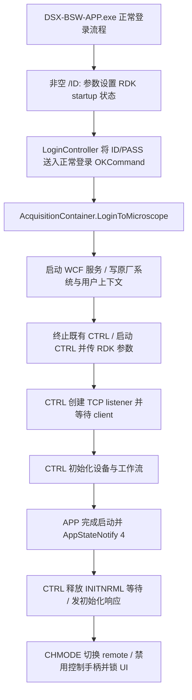

# DSX1000 接入口、启动和设备占用：静态分析结论

日期：2026-10-22。目标为提供的 DSX-BSW-CTRL / DSX-BSW-APP 软件副本。仅解析 PE/CLI 元数据、方法体与配置；没有加载目标程序集、运行原厂软件、连接端口或操作硬件。方法 token 只对所记录的文件 SHA-256 / MVID 有效。本文的“已证实”均指该副本的静态实现，不等于设备验收。

## 结论

**存在实质性的原厂 RDK TCP 控制入口，可以作为优先验证的接入路线。** 其 `MVSTG`、`MVZR` 和 `SHOT` 处理器确实下调原厂运动与采集流程，不只是 GUI 通知。推荐让既有 APP/CTRL 持有设备，FDM 通过同机协议客户端调度；暂不需要把原厂 DLL 装入 Python，也不需要先重写独立硬件控制进程。

但它不是现成的“精确到位—曝光结束—文件完成”统一接口：

- XY 参数是整数 µm；Z 虽然按 Double 解析，相对位移与当前显示位置相加后经过 `conv.i4`，以整数 µm 目标交给 UI。**小于 1 µm 的目标焦层间隔不能据此承诺。**
- 运动响应来自下层命令返回后释放等待，但释放发生在 `finally`；Z 的限位/STOP 部分分支不设置 RDK 错误。成功响应不是目标坐标必达证明。
- `STGPOS?` / `ZPOS?` 读取 UI 数据，非每次直接向硬件查询。XY 返回还会量化成整数 µm；响应不能自动视为新鲜的编码器位置。
- **`SHOT` 的 final reply 在异步采集被派发后返回，既不是新帧完成，也不是写盘完成。** `SHOTSTS?` 的 0 同时用于结果返回和停止，不能单独作为成功依据。
- 同一连接不能依赖 pipeline；多个 client 的回复通过 `SendAll` 广播。连接中断没有已证实的自动停止或解除 remote 流程。

因此本路线是强候选，尚不能宣布生产接入闭环。现场首要门槛为：所需焦层精度是否符合整数 µm 入口、位置更新时序是否可靠、逐次 SHOT 与唯一完整新文件能否严格关联、取消是否有可靠完成反馈。

## 1. 启动、登录与生命周期

已证实的原厂启动链为：

- `DSX-BSW-APP.exe` `MainController.OnApplicationStartUp` `0x060000bf` 识别 `/ID:` 与 `/PASS:`。只有非空 ID 参数令 `SetRDKStartupState(true)`；后续仍调用 `OnLoadLogin`。`OlycLogin.dll` `LoginController._clsLoginView_Loaded` `0x06000080` 填入正常登录控件并执行 `OKCommand`。这是原有登录通路，不能当作绕过登录的开关。[E1, E2]
- `OlycAcquisitionContainer.dll` `OLYCoordinator.StartMicroscope` `0x06000014` 先开本机服务、写系统/用户上下文，再 `_StartMicroscopeProcess`；后者 `0x06000053` 根据 RDK 状态传精确首参 **`_dsxApplicationRdkOnlineMode`**。它先调用 `_KillMicroscopeProcess`，故不可在已有采集工作进行时另启动一套 APP。APP 原本也有单实例检查。[E1, E3]
- `CTRL.exe` `StartupApp._Startup` `0x06000011` 比较该首参后才实例化 `CContextForMicroscopeControl`；初始化 TCP，等首个连接建立，然后后台调用 `INITNRML=` 对应 handler 等待初始化完成。[E4]
- APP `StartedNotifyToMicroscope` `0x06000158` 发 main-state 4；CTRL `ProcessJoinService._AppStateNotify` `0x060000b0` 的对应分支 `CommandWaitRelease(0)`；`ProcINITNRML_SET` 等待该事件后发响应并清 IsRdkStartup。**INIT 是原厂启动自动发起的等待/通知，不能简单按“连接后再手动 INIT”设计。**[E3, E5, E6]
- `CHMODE=1` handler 先调用 `Console.ExecuteConsoleDisableControlSync`，失败置错误 19；成功后同步通知 APP remote 模式、设置 IsRemoteMode、打开锁定窗口。`CHMODE=0` 反向通知、清 remote、关闭锁窗、`Console.ExecuteConsoleControl` 恢复控制。[E6 `0x06000005`]

**尚未证明：**安装中是否随附公开 RDK launcher/开发包；该机的软件许可、选件及账号权限是否允许此启动方式；用户正常启动入口是否还有包装进程。APP 会读取 `IAccessControlState` 构造选件列表并传给 CTRL，但目前证据不足以声称 RDK 无选件要求。应沿原厂支持的已授权模式验证，不直接孤立运行 CTRL 或伪造上下文。实际启动方法、账号使用和凭据处理应在现场确认后设计。

## 2. Transport 和协议约束

- `InitializeContextForMicroscope` 从本机 DNS 主机名解析地址，取地址列表首项，并读 `PortNumberOfMicroscopeControl`；副本配置值为 **35001**。**不是硬编码 127.0.0.1**，实际绑定地址需现场观察。[E6 `0x0600002c`; E7]
- `CAsyncSocketServer.Initialize` 创建并 Bind TCP socket；监听队列参数 10，接收块 1024 字节，**UTF-8、CRLF** 作为命令分隔符。存在异步 accept / receive；并非 WCF 的命名管道。[E6 `0x0600002e`; E7 `0x06000038`]
- 命令定义通过枚举字段的 `RdkCommandAttribute` 建表；本目录 `rdk-command-metadata.json` 保存 31 项精确标志。解码脚本核对文件 SHA 和每个属性 blob SHA 后解码；属于可复现的字节级派生证据。[E8, E9]
- 参数由空格/逗号拆分，未发现 quoted-path escaping。带空格/逗号的文件路径应视为待验证条件；首次验证使用简单独立目录。未知命令只记录日志并返回，未保证错误响应。[E6 `ProcCommandsForServer`; E8 `GetParameterString`]
- set 命令的成功 final reply 为 `命令名: +`，query 成功为 `命令名: 参数`，错误为 `命令名: ! 编码`；不含客户端任务 ID、帧 ID 或实际保存文件路径。`_SendFinalReply` 汇总内存错误和共享 RdkErrorOperation 错误后发送。[E6 `0x0600001c`; E8 `0x06000011`]
- server `callbackReceive` 同步调用命令 handler，handler 返回后才再次 `BeginReceive`。一个接收块的命令先入 `Stack` 再取出，不能当作 FIFO 批命令执行。**设计为一个控制 client、一次只发一条命令并等该条 final；禁止 pipeline。**[E7 `0x0600003a`]
- 回复是 `SendAll` 广播；IsUnderProcessing 和命令等待表也为共享状态。不得用第二 client 充当已验证的取消旁路。[E7 `0x0600003b`]
- `WaitOne(1000)` 的循环是可以被事件即时唤醒的等待，**不是每条命令强制等待 1 秒**；未见总时限。FDM 必须设置自己的故障超时，但超时并不自动取消原厂任务。[E8 `0x06000014`]

## 3. 接口的精确意义

| 接口 | 静态证实 | 不能据此推断 |
|---|---|---|
| `MVSTG=` | 三参数 X/Y/speed；XY Int32、乘 1000 为内部 nm；speed 0/1/2；要求 remote、镜头、live、非拍摄中；调 `StageMoveAbsolutelyCheckRangeWithoutAngle`，等命令 21 | 原点/方向已标定；亚微米位置可调；final 后位置缓存已刷新 |
| `MVZR=` | 一参数，Double.Parse；相对请求加当前显示位置后 `conv.i4`，调 `ExecuteZLengthMove(Int32)`；等命令 8 | 参数支持 Double 就等于亚微米运动；正常 final 就到达目标 |
| `STGPOS?` | 从 `Stage.GetDisplayStagePotionForRDK` 取 UI `MovePositionXY`，格式 `X,Y`；转换至 µm 后 0 小数、半值远离 0 | 直接硬件查询；纳米/亚微米读回精度；立即具有当前命令的鲜度 |
| `ZPOS?` | `Focus.RawZCurrentPos → ConvertZPosForDisp(ZMoveRange) → ConvertUnitOfLength → Double.ToString` | raw属性名就是编码器真值；硬件原点等于显示原点；文化无关的数字格式 |
| `SHOT=` | ONOFF/path 两参数；0 使用既有保存配置，1 设置本次文件名/目录并必要时临时启用 AutoSave；时间序列模式被拒绝；调 SnapOperation 或 StartExtend | 自动选择普通2D；自动给出原始像素；返回值带图像或文件路径 |
| `SHOTSTS?` | 取 AcquisitionShotStatus：开始界面设1；结果转交和停止都设0 | 0唯一代表成功；有完成序号；可分辨上一张与下一张 |
| `ENDSHOT=` | 仅参数0；模式1调 StopExtend，模式0置 SnapOperation=false，然后立即 final | final 是停止完成；同连接长handler期间能立即处理；断连能替代停止 |

证据见 E6、E8，以及 `../motion/` 中的运动证据。Z 参数转换的决定性 IL：`<ProcMVZR_SET>b__9` `0x06000051`，`IL_0017 add`、`IL_0018 conv.i4`、`IL_0019 ExecuteZLengthMove`。注意其输入是**相对位移**，送入 UI 的是整数 µm **绝对显示目标**；不能把它建模为保留所有小数的相对步进。

运动代理查明：`StageService.MoveAbsolutely` 同步调用硬件后在 finally 释放 21；该释放先于场景后续位置读取任务。Z `MicroscopeZDriveService.MoveRelatively` 也在 finally 释放 8/7，而且 Near/Far limit 与 STOP 的专门分支不一定置 RDK 错误。这要求位置鲜度/目标容差/取消标记共同约束，**不能仅凭 ACK 后取图**。[E10, E11]

## 4. SHOT 的完成边界：已证实“派发”，未证实“图像完成”

完整的决定性链路是：

1. `ProcSHOT_SET` `0x06000012` 重置命令14事件，通过 UI Dispatcher.BeginInvoke 设置 `Acquisition.SnapOperation`，随后等待14。
2. UI `StateCheckBeforeAcquisition` `0x060049d2` 的正常尾部调用 `Acquisition.StartAcquisition` (`IL_082f`)，然后 **立即** `CommandWaitRelease(14)` (`IL_083c`)。
3. `StartAcquisition` `0x0600005d` 普通模式走 `ExecuteStandardModeSnap` `0x060004c5`，调用 `InfAcquisition.StartStandardModeSnap` / `StartFullModeSnap`。
4. `OlyuDomainManager` 的这两个实现最终到 `_ExecuteScenarioTable → ScenarioController.ReleaseEvent`，后者只 Set 事件，工作线程稍后 `WaitOne → DgtStateBehavior.Invoke` 执行工作。于是上面的14释放是**异步任务已派发**，不是 capture callback 或文件完成。
5. RDK handler 被唤醒后 `_SendFinalReply`；没有附带实际文件名、图像字节或采集身份。

E6、E12、E13；对应可读 CIL 在 `shot-dispatch-selected-methods.json`、`../motion/OlyuMicroscope.shot-release-selected.json`、`../motion/OlyuMicroscope.ui-state-selected.json` 及运动代理域管理证据。

`AcquisitionStartNormalScreen` `0x060049f3` 设置状态1。`TransferImageResultInfo` `0x060048f4` 与 `StateAcquisitionStop` `0x060049c6` 均可设置状态0，且有自动保存恢复等待。因此**不能将 SHOT final 或 SHOTSTS=0 描述为文件 flush 完毕**。本次尚未闭合自动保存器完成、图像转交以及文件最终关闭的全部顺序。

候选接入需要每张图独立请求身份与独立文件基名，记录开始前已有文件集合、SHOT 返回、状态、错误、文件创建/解码结果；待实测证明存储完成屏障后才推进下一层。轮询仅可在先前命令 final 已收到后进行。若采集非常快而未观测到状态1，也不能简单把0当完成：必须使用已证明对应本请求的新文件/新图像事件。普通快照是否为所需未合成焦层、像素格式以及相机回调路径见 [采集分析](../acquisition/acquisition-findings.md)。

### 4.1 保存配置、普通拍照与条件文件

`CHATSAVE=`（E6 `ProcCHATSAVE_SET` `0x06000011`）四参数依次是 **ONOFF、目录、基础文件名、计数器**。开启时目录必须已存在、不得以反斜杠结尾，UInt32 计数器被限制为 0..999。随后依次设置 AutoSaveCheck、AutoSavePlace=0、AutoSaveFolderPath、AutoSaveFileName、AutoSaveFileCounter，每一步都重置/等待命令17。它设置保存策略，**不返回图像、不设置文件扩展名或像素格式、不保证基础名与最终实际文件名完全相同**。

`SHOT=1,...` 另有本次路径/文件名覆盖通路；只给相对文件名时可使用已有 AutoSaveFolderPath。原厂保存器可能应用计数器/扩展名等命名规则。本轮尚未证明最终文件名算法或覆盖同名文件规则，因此现场应采用空白独立目录、每次独立基础名，核对实际落盘路径后再锁定映射。`SHOT` final 无文件名载荷，不能用返回值直接建立图像身份。

`RDSETTING=`（E6 `0x06000010`）只接受首参数0和已存在的文件路径；写 AcquisitionSettingFile，然后通过 `Reappearance.MenuConditionLoadButtonHandler.Execute` 加载原厂采集条件。它不等于可任意编辑的 Z 序列配方，更不是原始焦层导出接口；条件文件内的模式、曝光、分辨率、处理/保存格式需在正常原厂 UI 中确认。

特别注意 `ACQMODE=` 的参数与内部枚举**反向映射**（E6 `0x06000008`）：字符串参数 **1 → AcquisitionMode 0 → 普通 Snap**；字符串参数 **0 → AcquisitionMode 1 → Extend**。最终还必须确认普通采集类型、timelapse 关闭和处理链配置，不能以命令数字直觉判断2D/3D。

## 5. 取消、断连与接管

- 正常 `CHMODE=0` 确有恢复手柄与 UI 的分支，适合正常任务收尾，但其命令本身受到“拍摄中不可执行”标志限制。
- `ENDSHOT` 是停止请求，不含停止完成等待；`SHOTSTS=0` 同时可能表示停下或结果转交，必须补充错误/取消与文件状态。
- TCP server `callbackReceive` 的 EOF / SocketException 路径只有错误日志和返回，未调用 motor stop、CHMODE 或解除 UI 锁。`CContextForMicroscopeControl.Exit` 关闭 server 和初始化 watcher，也未在该方法内证明手柄恢复。
- 目前未找到统一 XY/Z 运动 STOP 的 RDK 命令；已看到的 `ENDSHOT` 不能替代任意运动停止。超时或断连后禁止自动续扫/重复相对移动，先恢复明确控制权与实际位置。

**阻断生产验收的缺口：**移动卡住、原厂进程退出、断连后，安全停止和恢复本地操作的可靠规程尚需设备上验证。现场保持原厂正常停止/电机控制手段可用，不能靠重新启动 APP 自动纠正，因为 APP 自身启动会结束旧 CTRL。

## 6. 为什么暂不选 DLL 直接加载或 WCF 运动控制

WCF 接口有图像、配方、登录、应用状态及 UI 操作。完整 `AppOperation` 枚举包括显示列表、切换采集页、专家/初学模式等，`AcqOperation` 包括切页、校准、配置等，没有本轮所需的 XY/Z 运动枚举。不能把“有 WCF”直接等同于可运动；本轮真实运动入口证据来自 RDK 处理器及其下游。[E14]

托管程序集采用 .NET Framework/Windows UI/原厂单例与 DAO、工作流线程上下文；它们并非已证实可独立实例化的无状态 SDK。APP/CTRL 的启动握手、登录上下文、设备驱动/标定与相机原生依赖应保留。本文不把 PE 的 x86 machine 字段单独当作运行进程必须32位的证据；实际 CLR flags 与原生依赖以主清单为准。可独立部署的 FDM 协议 client 不需要与原厂进程同位数，但如果将来改用 DLL bridge，则需单独重做位数/运行库/初始化/互斥与许可验证。

## 7. 证据索引与复现

| ID | 完整 REA Evidence ID | 主要文件/用途 |
|---|---|---|
| E1 | `ev_601f8611d29f8866c2fa031f9d379edc120074330000542124b9a2221003c467` | APP.exe 启动/登录 |
| E2 | `ev_36b2490eae91287db11bc4f99b998a1793fa1c6b475ed6196e5c3c1c825c8d0f` | OlycLogin.dll |
| E3 | `ev_843208320387c5be1655ded4cca7240e491442b3ec62025009b2df6b3a04cc1a` | OlycAcquisitionContainer.dll / APP→CTRL |
| E4 | `ev_04fbf5d130975e17b9ffd0fb7b75283d6e0d85f4cbd137803982e306dfbc13c3` | CTRL.exe `_Startup` |
| E5 | `ev_b28983bf89a6f28ecaeb257f439dfe93b1e867e246a0d32a22aa3ce7e959c88f` | OlybProcessJoinDomain.dll INIT完成 |
| E6 | `ev_65fec493efc403e113aea715f07bba33ccb14f9aa7c2e35d543eb784aa47a93b` | OlyuRdkMicroscopeControl.dll |
| E7 | `ev_483fd29056ac66acddc05c8ee3199516b5b11879cff9f4a2d5fcdb52547f18d4` | OlymAsyncSocket.dll |
| E8 | `ev_b6476514101ca3e1981909681091f2aa25ebc7839621d0763994fe7d99992c05` | OlymRdkData.dll 命令/状态 |
| E9 | `ev_d975f998174812b6e239d1707d0d3d2445761473bcbbcc5a12281bace1c3afef` | OlymRdkData 元数据属性 |
| E10 | `ev_f358e75a4fb3a68e478952f023c231ddf2bebe9ebd8428237e2a7d4906ae8f4c` | StageService 运动 finally/释放（运动代理） |
| E11 | `ev_3a11f4f672b22c536ff4a0b883514fbf5e6f5de8288ae07abde4955e5183cc74` | ZDriveService finally/限制（运动代理） |
| E12 | `ev_d7dbd43d2f0023c5080a8597d697e5890582641af43fba882388cf806865b7b3` | OlyuMicroscope.Acquisition |
| E13 | `ev_378406d3cc5d33fff9bac20201e3e02f62d6c8d92469fb1ab8c86b8b422a8ea1`、`ev_39d30b0eff53f7d043487746bef513de6c267af445646e80a6f5de31b297ba7c` | UI status + DomainManager 异步派发（运动代理） |
| E14 | `ev_829e6bd66270cc328ef7e962fb1f80592e012849ae6f8f870559bbb22bff144e`、`ev_9f8dbdde3fd7b44578f750e7303507672484bea2ebf5e11c4fc5052af0befa80` | WCF common/communication |
| E15 | `ev_855f51c173d088e2d3819fc4f1397ad027a52731108f639331e3ebd35228f1e1` | XY显示坐标取整（运动代理） |

本 agent 的 37 条完整原始记录保存于 `rea-evidence-bundle.json.gz`，解压后严格等于原始 REA bundle；`evidence-bundle-manifest.json` 记录压缩前后 SHA-256、字节数和往返一致性检查。其他代理证据在各自 bundle 中，REA 会话间不能直接引用对方 retained record。

`selected-methods.json`、`startup-selected-methods.json`、`shot-dispatch-selected-methods.json` 为便于审查而抽取的解析 CIL，保留原证据 ID / 方法 token / 方法哈希。`decode_rdk_attributes.py` 只读 PE 元数据，不执行程序集；`rdk-command-metadata.json` 是其可重建输出。未能闭合的图像保存完成顺序、位置缓存鲜度与异常恢复已在上述段落显式保留，不能用名称或注释补成确定结论。
