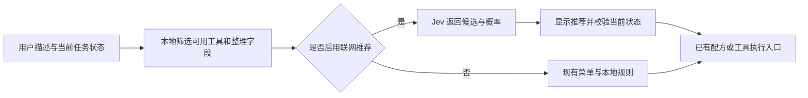

# Jev 模型调研与 FDM 项目适用性评估

调研日期：2026-09-20。项目：`fiber-diameter-measurement`，当前检视提交：`0d09fb2`。本文依据当天可访问的官方资料与当前工作区源码；涉及应用效果的排序是工程判断。

本次完成资料调查和代码核对，未调用付费推理接口，未上传项目数据，未安装 SDK，未修改应用代码。没有在本项目、国内网络、Windows 设备或真实显微样本上验证 Jev 的准确率与延迟。

## 1. 结论

**Jev 值得作为可选的语义决策服务做小范围验证，最适合把用户描述匹配到已有工具、分析配方或故障处理建议。当前没有证据支持把它接进分割、测径或硬件控制主链路。**

FDM 的主要工作负载是本地像素处理、分割、几何计算与设备操作。Jev 的优势主要针对原本需要语言模型完成的分类、评分和选择任务。项目当前没有需要被 Jev 替换的通用大模型决策环节，因此不能套用“接入后整体加速几十至几百倍”的结论。

若产品必须保持完全离线，当前可核实的 Jev 接入方式与该要求不匹配。可借鉴它“问题拆小、候选明确、输出带不确定性、代码执行”的设计，但本地数值决策仍应先比较规则与小型分类器。

## 2. Jev 是什么，以及为什么近期受到关注

TypeSafe AI 于 **2026-09-15** 发布 Jev early access，称其为 System One Model。厂商披露了并行输出设计和 Reinforcement Learning for Calibrated Decisions（RLCD）训练方法，目标是直接产出程序可消费的判断。公开发布材料不足以复现其训练与完整内部架构，不能把它简单断言为“普通大模型换一个 JSON 提示词”。[官方发布说明](https://typesafe.ai/blog/introducing-system-one-models-and-jev)

Vercel 于 **9 月 16 日**宣布 AI Gateway 接入 Jev。其 **9 月 18 日**文章自报：上线 24 小时内，使用 Jev 的付费团队数量超过此前任一模型发布的两倍。这个数字说明该平台上的初期关注度，不能证明显微测量适用性或长期可靠性。[Gateway 上线公告](https://vercel.com/changelog/typesafe-ai-jev-now-available-on-ai-gateway)、[Vercel 采用情况](https://vercel.com/blog/ai-gateway-jev-model-launch)

它的基本接口是：给出状态材料和若干具体问题，返回事先限定的答案。多个问题可共享同一状态、在一次请求中分别评估；若后一个问题确实依赖前一个答案，仍需由代码串联请求。[接口概览](https://docs.typesafe.ai/introduction)、[问题设计](https://docs.typesafe.ai/primitives)

| 类型 | 含义 | 在本项目中的假设用途 |
| --- | --- | --- |
| Choice | 从已定义选项中选一个，返回各选项概率和 confidence | 从当前可用的分析配方中推荐一个，或返回“不适用” |
| Score | 按有序、带文字说明的等级评分 | 为待复核问题给出优先级 |
| Noul | 返回某个明确命题为真的概率 | 判断用户的文字描述是否要求分析纤维方向性 |

Choice 最多支持 255 个候选；Score 支持 2–10 个等级。Score 是等级上的评分，不能用它插值恢复精确直径、面积或电机步数。[Choice 文档](https://docs.typesafe.ai/primitives/choice)、[Score 文档](https://docs.typesafe.ai/primitives/score)

## 3. 当前能力和宣传数字的边界

| 项目 | 截至调研日可核实的情况 | 对 FDM 的影响 |
| --- | --- | --- |
| 模型版本 | 官方列出 `jev-1.13.0`；`jev-latest`、`jev-preview` 当天均指向它 | 试验应固定版本并记录实际返回版本 |
| 输入 | 仅文本、JSON 对象或数组；不接收图像、音频、视频 | 不能直接看显微图、掩膜、焦层或截图 |
| 中文 | 官方表示英文效果最好，包含中日韩文字的其他语言准确率较低 | 中文操作描述与专业术语需要单独评估 |
| 定制 | 当前不提供客户数据微调或 LoRA；通过输入材料、问题与候选定义适配 | 不能假设可拿纤维样本直接训练专属 Jev |
| 上下文 | 请求总计 64k tokens；状态加最长单个问题至多 32k | 不宜把整份日志或整张切片的全部记录塞进一个请求 |
| 官方输入价格 | 每百万 tokens 0.042 美元，输出不收费 | 模型费用较低，但集成和评价成本仍需考虑 |

以上规格和价格来自[官方模型说明](https://docs.typesafe.ai/models)。语言和媒体输入约束另见[State 文档](https://docs.typesafe.ai/concepts/state)。

厂商给出的端到端延迟为 **70–500 ms**，并披露主要从美国西海岸访问同地区服务。宣传中的 **193.6 倍速度、444.6 倍成本优势**源于其工作流评测，厂商也说这些可能接近实际收益的上端；不能当成本项目的预计收益。[发布说明及测量条件](https://typesafe.ai/blog/introducing-system-one-models-and-jev)

该评测覆盖安全事件、Agent 执行记录、发票处理和客服。参考标签来自两个高能力模型的回答共识，属于厂商工作流比较，不是显微领域的人工真值测试。[官方评测方法](https://evals.typesafe.ai/)

还需要区分三件事：

1. **类型正确不等于判断正确。**“零幻觉”宣传的关键保证是输出落在定义的结构和候选内；模型仍可能选错合法选项。[Vercel 对类型约束的说明](https://vercel.com/i/what-is-jev)
2. **confidence 不等于正确率。**官方说明其为概率分布集中程度的统计量，不能把 `confidence=0.9` 直接解释成“测量有 90% 概率正确”，也不能直接替换 FDM 原有几何评分。[Confidence 文档](https://docs.typesafe.ai/confidence)
3. **它有明确的能力短板。**官方列出精确数值、计数、日期比较、多步间接推理、冗长无关上下文等问题；不同问题的输出也没有自动满足互补概率等关系的保证。[Jev 1.13 已知局限](https://docs.typesafe.ai/model-jaggedness/jev-1.13)

公开 Python SDK 是 API 客户端，提供同步与异步调用。本次查阅的官方资料未找到可下载的模型权重或官方离线推理方案；SDK 开源不代表模型能够本地运行。[Python SDK](https://docs.typesafe.ai/sdk/python)、[官方 SDK 源码](https://github.com/typesafe-ai/typesafe-sdk-python)

## 4. 当前代码中已经具备哪些条件

以下是当前实现，不代表已接入 Jev：

| 已有能力 | 当前代码证据 | 可复用之处 |
| --- | --- | --- |
| 明确的分析配方目录 | [analysis_batch.py](../../src/fdm/services/analysis_batch.py#L545) | 已有方向性、GLCM、粒子、亮度和组合配方，可提供封闭候选集合 |
| 图像处理配方存储 | [image_recipe_presets.py](../../src/fdm/services/image_recipe_presets.py#L45) | 能按保存的配方推荐；实际配方执行与参数仍由现有系统负责 |
| 批处理预检与结果管理 | [image_batch.py](../../src/fdm/services/image_batch.py#L390) | 像素兼容、资源、取消和源版本约束已有代码承担 |
| 快速测径的诊断字段 | [fiber_quick_geometry.py](../../src/fdm/services/fiber_quick_geometry.py#L305) | 有候选数、分叉数、端点数、裁边、ROI、方法和阶段耗时等信息 |
| 测量状态与诊断载荷 | [models.py](../../src/fdm/models.py#L575) | Measurement 已有 confidence、status、debug_payload，但没有独立 Jev 决策结果契约 |
| 记录筛选和排序界面 | [measurement_records.py](../../src/fdm/ui/measurement_records.py#L59) | 可作为未来复核建议的呈现入口，仍需新增建议字段及界面 |
| 景深合成及地图状态 | [preview_analysis.py](../../src/fdm/services/preview_analysis.py#L87) | 有采样/接受帧数、低可信状态、运动状态、相关响应和质量分数 |
| 数字切片的来源快照 | [segmentation_source.py](../../src/fdm/services/segmentation_source.py#L48) | 已记录文档、原图坐标原点、焦层、来源版本和有效覆盖，可约束异步建议的适用对象 |

特别核对：当前快速测径已经使用 `skimage.morphology.skeletonize` 的编译实现并支持预热。[后端加载](../../src/fdm/services/fiber_quick_geometry.py#L33)、[当前骨架化调用](../../src/fdm/services/fiber_quick_geometry.py#L926)。不能继续以早期 Python 后备实现作为当前性能现状。

## 5. 哪些地方可能用到

下表中的优先级是相对试验价值，工作量是对接入、界面和评价工作的相对判断，并非排期承诺。

| 场景 | 具体决策 | 适配判断 | 工作量与条件 |
| --- | --- | --- | --- |
| 自然语言工具／配方推荐 | 用户描述 → 已有工具或配方 ID | **最值得先试**；包含真正的语言语义判断 | 中；需要新入口、候选描述与中文评价集 |
| 混合故障信息分流 | 日志片段＋用户描述 → 检查设备、修正分割、重试或转人工排查等建议 | **可试**；适合多种自由文本表述 | 低至中；要证明比固定错误码映射增加价值 |
| 测量复核排序 | 几何诊断＋操作备注 → 哪些记录先看、建议哪种复核 | **有条件试验**；贴近业务，但 Jev 不直接观察图像 | 中至高；需要人工标注，比较本地规则和分类器 |
| 选择分割／处理策略 | 任务描述＋可用能力 → 从受支持候选中推荐方法 | **中等**；语义任务匹配可能有用 | 中；硬件能力和格式兼容先在本地确定 |
| 数字切片采集异常建议 | 某位置的质量摘要与失败记录 → 建议复采、复核或检查焦层 | **后期研究**；实时收益不明确 | 高；需新增按位置整理的质量轨迹和实机评价 |
| 标签或类别名称整理 | 自由文字 → 已有项目类别候选 | **小范围可用**；适合元数据归类 | 低至中；无法据此鉴定图中纤维材质 |

### 5.1 首选：工具与配方推荐

例如用户输入“比较这批图片中纤维的方向和纹理”，程序可以给 Jev 当前适用的配方列表，由它返回 `directionality-and-glcm-v2` 或“不适用”。该组合已经存在于[配方目录](../../src/fdm/services/analysis_batch.py#L620)。这是待验证的预期行为，不是本次实际模型输出。

推荐接口应只产生候选 ID。配方参数、输入图片、ROI、资源预算与执行过程继续通过项目已有配置和预检。若用户想要的功能不在候选集合内，输出“不适用”或“需要进一步说明”。这需要建设一个新的产品入口，不能算作现有任务的直接提速。

该方向的收益是减少寻找菜单与理解工具名的时间。应先比较关键词／同义词匹配；如果这些已足够好，引入云端模型的收益可能很小。

### 5.2 故障处理：只在现有映射覆盖不足时有价值

项目已有明确错误原因，例如 `incomplete_boundary`、`target_too_thin`、`width_mismatch` 和 `unstable_width`，并有对应的中文建议。[当前错误映射](../../src/fdm/services/fiber_quick_geometry.py#L350)

这些一对一映射无需 Jev。更值得验证的是用户描述、设备状态和不同模块日志混在一起的情形，例如“换成数字切片后有时失败，普通图片正常”。Jev 可从已有排查指南中选择检查方向；它不会自己生成可靠的长篇诊断，需要用固定说明模板展示建议。

### 5.3 测量复核：业务相关，但证据要求更高

可以研究“哪些记录应优先人工检查”，而不是让 Jev 直接决定直径和面积。现有快速测径诊断以及面积实例的 `class_name`、`score`、`bbox`、`area_px` 都能为评价提供材料。[面积实例结构](../../src/fdm/services/area_inference.py#L135)

但如果输入只有几何数值、阈值和有限错误码，本地规则或有监督分类器是更直接的基线。只有当人工备注、任务目的、样品文字说明等语义信息提供额外价值时，Jev 才更可能有优势。

FDM 当前 `Measurement.confidence` 来自既有算法；快速测径返回的是代表候选线的评分。未来 Jev 的分布、confidence、建议类别及版本应单独存储，避免把不同语义的分数混入同一列。

本地可精确算出的量应先计算好。例如候选宽度离散程度、边界截断标志、标定是否存在，不能交给 Jev 做算术。更不能让模型按群体分布自动删除“异常粗／细”的真实纤维，以免改变样本统计。

### 5.4 数字切片：适合辅助建议的假设，暂不支持替代采集策略

当前采集规划包含网格、焦层、步距、边界和阻断原因；电机由本地控制器执行相对位移与软限位检查。[采集计划结构](../../src/fdm/ui/main_window.py#L689)、[运动控制](../../src/fdm/services/motion_control.py#L213)

可以设想在一次视野／焦层采集结束后汇总质量指标，让 Jev 建议“先复核此处”或“查看某类采集问题”。但当前景深合成、地图构建的质量报告不等于已经实现逐 tile 的自动质量决策系统，需要补充数据采集、关联和评价。

单纯选清晰度最大的焦层、比较位移、计算覆盖率和决定固定步数，本地算法更直接。跨焦层统一对象与二维轮廓依赖视觉特征、坐标关系及分割结果，当前纯文本 Jev 缺少直接输入能力，不能替代该环节。

## 6. 不建议使用 Jev 的位置

| 位置 | 原因 |
| --- | --- |
| 替代 EdgeSAM 或面积实例分割引擎 | Jev 当前不接收图像，不能产出像素掩膜 |
| 骨架化、边缘定位、亚像素测量 | 属于几何／信号处理，Jev 不提供相应算子 |
| 直径、面积、标定、统计和导出数值 | 可由代码精确计算；官方明确承认数值精度短板 |
| 跨焦层对象关联、去重和轮廓融合 | 需要空间与视觉证据，不能仅凭文本判断取代 |
| 逐帧预览、鼠标移动与缩放缓存 | 网络调用会引入额外等待，与渲染目标不匹配 |
| 三轴运动步数、软限位与时序 | 由当前控制器和采集状态机确定；没有把概率模型接入闭环的验证依据 |
| 自动撰写完整检测报告／解释 | Jev 没有自由文本生成能力，固定模板或生成模型承担这类需求 |

这些判断依据本项目的运算性质，以及 Jev 的[输入限制](https://docs.typesafe.ai/concepts/state)和[已知局限](https://docs.typesafe.ai/model-jaggedness/jev-1.13)，并不表示所有快速决策模型都永远无法支持这些任务。

## 7. 如果后续试验，建议怎样接入

下面是建议结构，尚未实现：

建议设立单独的决策服务接口，先返回建议，再考虑自动化程度：

- 决策内容可包含 `candidate_id`、完整概率分布、独立 confidence、模型版本、问题版本和状态版本。用单独的数据结构表达，避免改变测量值含义。
- 网络调用放在后台任务中；交互超时或不可用时继续允许使用原有功能。其商业价值取决于实际端到端体验，而非服务端单次推理耗时。
- 关联文档 ID、请求 ID、图像来源版本。对数字切片还要关联焦层与原图区域；用户切换图片／焦层后到达的建议不应应用到新对象。项目已有来源快照可作为设计依据。
- 模型只选择当前已经具备条件的候选；图片格式、资源约束、标定与数值计算由已有代码核对。
- 建议显示的解释采用已编写的模板；若选择了某个原因码，应将其标明为建议原因，而非模型证明出的根因。

以上是适应当前离线桌面架构的产品和实现建议。Python SDK 虽然易于接入，但候选设计、中文测试、请求生命周期、打包和日常使用体验才是主要工作。[官方 Python 客户端](https://docs.typesafe.ai/sdk/python)

## 8. 最小验证方案

**第一轮只验证“中文描述 → 已有分析工具／配方推荐”。**

1. 整理约 150–300 条真实或经领域人员编写并复核的任务描述，覆盖方向、纹理、粒子、直径、面积、含糊表达与暂不支持的功能。这个数量只是探索起点，不足以证明上线可靠性。
2. 固定候选定义和模型版本。准备独立保留集，避免只测试写候选时用过的例句；分别评估中文和术语混合输入。
3. 对比当前菜单搜索／关键词规则与 Jev，记录首选正确率、适用候选推荐率、不确定时保留原操作的比例，以及高置信错误数量。
4. 实测用户端 p50／p95 延迟、超时率与费用。概率校准用真实标签检查；不直接把 confidence 当作正确率，也不从示例中照搬 0.8 或 0.9 阈值。
5. 先在不自动执行的模式下记录建议和人工选择。只有确实减少找工具时间、且错误推荐可控时，再决定是否建设正式入口。

若第一轮有价值，再做独立的“复核排序”试验：收集真实普通图片与多焦层数字切片，按原始样品／切片分割评价集，避免相邻 tile 和焦层进入不同集合；比较本地规则、本地分类器和 Jev。主要指标应是固定人工复核量下的错误发现率、错误结果被漏看的比例及操作时间，并检查保留结果的直径／面积分布是否发生偏移。

费用示例：若一次完整请求（状态加问题）为 2,000 输入 tokens，10,000 次为 2,000 万 tokens，按当前官方标价计算约 **0.84 美元**。这是算术预算示例，不含网关差异、重试、额外前处理、人工标注和开发成本；实际以调用渠道账单为准。[计价依据](https://docs.typesafe.ai/models)

## 9. 当前决策建议

如果近期目标是**提高测量精度、缩短快速测径等待或完善多焦层分割**，Jev 暂时不是优先投入方向。

如果计划增加**一句话找工具、自动推荐配方、混合故障辅助分流**，Jev 值得与简单本地方案做一次有明确评价集的对比。建议从工具／配方推荐开始，把是否进入正式产品建立在实际中文表现和用户端体验上。
