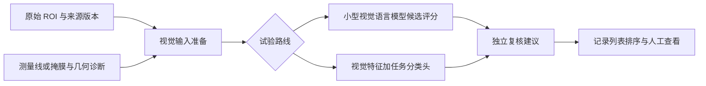

# Jev 开源替代与图像输入方案调研

调研日期：2026-09-20。项目：`fiber-diameter-measurement`。本文续接 [Jev 适用性调研](jev-applicability-2026-09-20.md)，依据项目当前源码、上游仓库源码及官方模型卡。

本次仅调研并新增本文；没有安装模型、下载权重、执行上游模型代码或修改应用代码。下面的项目适配排序是工程判断，尚无本项目显微样本的准确率、Windows 兼容性或 GPU 延迟实测。8GB 显存沿用此前讨论的评估目标，本次未重新确认目标机器配置。

## 1. 结论

**有直接支持图像输入的开源 Jev 式实现。最接近现成试验工具的是 `hr98w/jev-visual`；面向本项目的 Windows／NVIDIA 部署，更值得验证 Qwen3.5-2B 的候选评分，以及 SigLIP2／DINOv2 加小型分类头。**

本次核实的“平替”分为三类：

- **现成视觉语言模型直接评分**：图像和问题进入模型，只读取给定选项的分数，省去逐字生成答案；`jev-visual`、`PocketJev` 属于这一类。
- **训练专门的决策网络**：输入图像或特征，一次前向计算各选项的得分；`jevlike` 提供了视觉实现，但不是拿来就能判断纤维的通用模型。
- **视觉编码器与分类器**：SigLIP2、DINOv2 本身不是 Jev 复现；对于固定的图像质量类别，它们是值得比较的更直接方案。

这些实现能替代部分“输入材料 → 给定候选 → 程序接收结果”的功能，不足以证明复现了 Jev 的训练方法、概率校准和服务能力。支持图片也不自动意味着能输出可靠掩膜、精确测径或判断纤维材质。

## 2. 支持图片的候选

| 实现／模型 | 图像如何进入 | 本地运行和许可 | 对本项目的判断 |
| --- | --- | --- | --- |
| [jev-visual](https://github.com/hr98w/jev-visual) | 图片与状态直接进入 Qwen3.5-0.8B-4bit；共享图像前缀，多问题候选评分 | MLX，Apple Silicon；代码 MIT，基座另遵循上游许可 | **最适合在 Mac 上先验证交互和问题设计**；当前不是 Windows 即用方案 |
| [PocketJev](https://github.com/NullPo-jp/PocketJev) | 相机／相册图片直接进入 Qwen3-VL-2B 的 4bit 版本，读取选项字母 logits | iOS 18+、Swift／MLX；代码 MIT | 是真实的本地看图决策应用，适合参考界面与评分方式；不适合直接移植 Qt 主程序 |
| [jevlike](https://github.com/vinnylarouge/jevlike) | 卷积视觉特征与候选向量进入注意力评分头 | PyTorch，项目有 CPU／MPS／CUDA 路径；代码 MIT | **适合学习如何训练小型视觉决策器**；现有视觉代码和权重围绕游戏，需重新定义输入并训练 |
| [JEVfire](https://github.com/kikoncuo/jevfire) | 当前图片示例先调用独立视觉模型生成描述，再把描述交给文本决策接口 | 本地服务可组合；代码 MIT | **间接支持图片**；不是图片一次前向直接决策，额外描述阶段可能丢失测量细节 |
| [Qwen3.5-2B](https://huggingface.co/Qwen/Qwen3.5-2B) | 原生图像＋文字输入；可自行实现候选 logits 评分 | 开放权重 Apache-2.0；Transformers 等运行方式 | **本项目灵活视觉判断的首轮候选**；要开发评分适配层，Windows 运行与峰值显存待验证 |
| [SigLIP2](https://huggingface.co/google/siglip2-base-patch16-224)／[DINOv2](https://github.com/facebookresearch/dinov2) | 图片直接编码；SigLIP2 可比较文字标签，或两者均接自训练分类头 | 所列原版模型及相应代码为 Apache-2.0；不把同仓库其他领域模型的许可一概视为相同 | **固定类别图像复核的优先基线**；没有通用指令决策能力，显微类别需要单独评价或训练 |

### 2.1 jev-visual：最直接的视觉 Jev 式开源实现

作者报告已在 M4／16GB、macOS 15.1、Python 3.13.1 上运行。一次请求支持 1–64 个问题、每题 2–26 个选项；下载约 596 MiB 的模型权重后可本地推理。**权重文件大小不等于运行内存。** 它没有重新训练或校准模型，也不宣称复现 TypeSafe 的内部架构。[固定版本说明](https://github.com/hr98w/jev-visual/blob/19af545f096e8db4c4dd5d47aed42d92ec252111/README.md)

源码证据比名称更关键：

- `prepare_inputs(..., images=[image])` 和 `get_input_embeddings(..., pixel_values=...)` 确认图片确实进入视觉模型。适配器当前只验证了 Qwen3.5。[模型适配源码](https://github.com/hr98w/jev-visual/blob/19af545f096e8db4c4dd5d47aed42d92ec252111/jev_visual/adapters.py)
- 默认按候选字母评分；还实现了完整候选序列的 teacher-forced 概率计算。多题可以复用一次图像与公共状态计算，但缓存分支会复制状态，仍有显存和复制成本。[评分源码](https://github.com/hr98w/jev-visual/blob/19af545f096e8db4c4dd5d47aed42d92ec252111/jev_visual/scoring.py)
- 输入会转为 RGB，并缩到最长边 768 像素以内。直接提交整张数字切片会损失细小结构；应从原图提取合适 ROI 后再评价。[预处理源码](https://github.com/hr98w/jev-visual/blob/19af545f096e8db4c4dd5d47aed42d92ec252111/jev_visual/preprocessing.py)

作者给出的 M4／16GB 测试中，64 个决策由独立评分的 37.30 秒降至共享评分的 2.40 秒，排除了模型加载和预热。这个结果说明同图多题的计算复用价值，**不能换算成单个 ROI 的必然延迟，也不是显微准确率或与 Jev 的同条件比较**。该测试中的生成 JSON 基线在多个规模下未完成有效结构，不能把其耗时当成功任务耗时。[基准口径](https://github.com/hr98w/jev-visual/blob/19af545f096e8db4c4dd5d47aed42d92ec252111/README.md)

对 FDM 的价值：可以很快验证“同一个 ROI 分别询问交叠、可见性、是否需要复核”的可行性。若最终部署 Windows，需要实现并核对 PyTorch 等后端；不能只把 MLX import 换掉就宣称完成移植，尤其要核对视觉位置编码、缓存和评分一致性。

### 2.2 PocketJev：确实看图，但属于移动端实现

评分函数接收 `imageURL`，通过多模态 processor 处理图片，取最后位置的 logits，仅对候选字母 A–Z 做 softmax。它检查候选字母是否为单 token，并关闭思考生成；每次决策会新建 cache，当前没有复用同图跨问题的视觉前缀。[评分引擎源码](https://github.com/NullPo-jp/PocketJev/blob/8c10d03757f6fe0b1d101d916a95100d6bee0402/PocketJev/JevDecisionEngine.swift)

其应用价值是证明“拍照／选图 → 提问 → 返回固定选项”的本地产品形态。当前查到的资料不足以提供可迁移到 Windows 或显微任务的延迟、准确率结论。[项目说明](https://github.com/NullPo-jp/PocketJev)、[Qwen3-VL-2B 官方模型及许可](https://huggingface.co/Qwen/Qwen3-VL-2B-Instruct)

### 2.3 jevlike：有视觉网络，但要区分文本接口与游戏视觉分支

其文本模型支持上下文与候选评分；视觉分支 `DoomScorerV2` 则使用 RGB 加运动差分通道、卷积特征、位置编码与候选 embedding。视觉分支的候选是训练过的动作 ID，**并非任意输入中文问题就能零样本回答的通用视觉模型**。[视觉网络源码](https://github.com/vinnylarouge/jevlike/blob/94f5fd1b0b11d52bbdfdf4e0ee6aa96b568f8452/jevlike/vision.py)

若借鉴到纤维图像，需要去除／重定义游戏运动通道、图像布局和动作集合，收集本项目标签并训练。相比照搬游戏网络，更合理的对照是预训练视觉编码器加线性层或小 MLP；再判断额外的候选注意力结构是否带来收益。[项目训练与示例说明](https://github.com/vinnylarouge/jevlike)

### 2.4 JEVfire：图片支持是两阶段流程

`image_context.py` 先向视觉模型的 `chat/completions` 请求短描述，然后把描述字符串发送到 `decisions`；代码分别记录视觉、决策和总耗时。JEVfire 决策服务本身不接收这张图片。[图像示例源码](https://github.com/kikoncuo/jevfire/blob/5df83b558bf635e006d31f8f2fc2798d0e3ff051/examples/image_context.py)

它可以用于“先理解宏观场景，再按规则做多个文本判断”。对于细小边界、交叉点或掩膜偏差，图像先转自然语言会形成信息瓶颈；本项目不宜将其作为第一条视觉复核路线。宣传中服务端文本评分耗时，也不能代表完整看图判断耗时。

## 3. 其他热门平替是否能直接看图

| 项目 | 当前核实的输入与机制 | 对本项目的价值和限制 |
| --- | --- | --- |
| [Bespoke Nimble](https://github.com/bespokelabsai/nimble) | **仅文本**；Qwen3.5-9B 加 LoRA，候选 token 评分。README 明确说明即使基座含视觉模块，当前也不接受图片 | 可研究任务训练与文本判断；9B 非量化 BF16 权重约 18GB，不作为 8GB 首选。CUDA 路径逐字段处理完整提示，不能套用 Mac 的共享并行收益 |
| [Laya](https://github.com/NandhaKishorM/laya) | **文本**；ModernBERT／mmBERT 编码器加决策头，约 322M／421M；mmBERT 在这里指多语言，不是多模态 | Apache-2.0；适合文本路由或自训练决策。作者公开报告基础检查点在 typed-decisions 零样本测试接近随机，不能把专门微调版本成绩推广到任意任务 |
| [SemIf，原 OpenJev](https://github.com/TheoLeeCJ/SemIf) | 当前公开接口为文本／JSON 状态；直接评分与前缀复用，代码 MIT | 可参考评分框架和 CUDA 实现；不能因为使用 Qwen3.5 就认定它已接好图像管线 |
| [Kev](https://github.com/jaredpalmer/kev) | 当前围绕文本上下文、候选、LoRA 和决策头训练；代码 Apache-2.0 | 适合研究专门训练的小模型；不是现成显微视觉判断模型 |

**Nimble 的许可需分别看。** Hugging Face 发布的是约 165 MiB 的 LoRA 适配器，需另取 Qwen3.5-9B 基座，模型包标注 Apache-2.0；本次核对的 GitHub 提交根目录未发现项目级 LICENSE，GitHub 元数据也未识别仓库许可证。不能把“公开仓库”或仓库内其他组件的许可证自动当成整个代码库的许可。[官方模型卡](https://huggingface.co/bespokelabs/Bespoke-Nimble-9B)、[本次检视的代码提交](https://github.com/bespokelabsai/nimble/tree/35fe1f4fdbc64fa3dbbf5ac0042f3f5680c1ad28)

这些项目中的速度、准确率排行榜来自不同硬件、数据、问题数量和训练条件。本次没有足够的同条件证据给出“哪个全面超过 Jev”的排名。

## 4. 面向 Windows 与 8GB 的两条候选路线

### 4.1 灵活问题：Qwen3.5-2B 加封闭候选评分

官方模型支持图像与文字输入、开放 Apache-2.0 权重，2B 默认非思考模式。拟议适配器把问题限定为少量候选，读取候选分数，由 Python 组装结果；这是需要开发的实现，不是官方现成 Jev API。[官方模型卡和运行示例](https://huggingface.co/Qwen/Qwen3.5-2B)

建议先评价 2B；0.8B 可作为更轻的对照，4B 量化作为后续质量对照。仅按标称参数数乘每参数字节数估算，2B 的 16bit 权重约 4GB，4B 的 16bit 权重约 8GB。这只是粗略权重预算，实际参数构成、未量化层、视觉激活、缓存、运行库和现有分割模型均会增加占用。**不能据此宣布 2B 必然能与现有分割模型同时驻留 8GB GPU。**

候选评分适配需要验证：

1. 使用正确的多模态模板、图片 processor 和关闭思考的设置，确保评分位置对应答案。
2. 候选映射到经 tokenizer 检查的单 token 字母；若直接评分多 token 中文答案，需正确计算整个序列，不能只取首字。
3. “没有合适选项／信息不足”应进入候选；归一化后的最大分数不代表真实正确率。
4. 首轮使用独立完整前向作为参照。共享缓存优化必须与该参照核对，不宜直接照搬 MLX 的缓存对象到 CUDA。

Windows 部署建议从独立 PyTorch worker 评价起，固定依赖与模型版本；这只是实现方向，未做安装验收。官方模型卡要求新的 Transformers 支持。本项目当前 [pyproject.toml](../../pyproject.toml#L28) 为 Torch／TorchVision 可选依赖；本次读取 `uv.lock` 得到 Torch 2.10.0、TorchVision 0.25.0，且没有 Transformers。锁文件不等于已安装环境或 Windows 打包版本，不能继续拿历史环境版本当当前事实。

### 4.2 固定类别：SigLIP2／DINOv2 加小型分类头

SigLIP2 官方支持图文相似度、零样本图片分类和视觉特征提取；DINOv2 可提取图像特征接分类器，原版 ViT-S/14 为 21M、ViT-B/14 为 86M 参数。两者都有可下载的原版权重。[SigLIP2 模型卡](https://huggingface.co/google/siglip2-base-patch16-224)、[DINOv2 官方实现](https://github.com/facebookresearch/dinov2)

对固定任务，例如“明显交叠／单根目标／无目标／无法判断”，我更倾向先比较这条路线：缓存视觉特征后训练简单分类头，可以减少标注方案变化时的试验成本，也更容易与纯几何特征分类器公平比较。这里的工程优势推断不代表它已在纤维图上胜过 Qwen。

SigLIP2 的文字标签相似度可用作零样本起点，但不能假定它理解所有显微专业类别。正式比较应包含用真实标签训练的分类头。224 像素模型对整幅大图的缩放可能掩盖细边界，需保留原始 ROI 和缩放记录；通用图像特征也不应被当作精确边界证据。DINOv2 仓库还包含许可不同的领域扩展，选型时需指定原版模型，不能直接套用整个仓库同一许可的假设。

## 5. 本项目最值得试的接入点

与上次纯文本 Jev 的结论相比，直接图像输入让**视觉复核与视觉辅助配方选择**成为新的候选用途。

| 场景与优先级 | 建议输入和输出 | 当前代码入口 | 判断 |
| --- | --- | --- | --- |
| **第一优先：测量记录视觉复核排序** | 原始 ROI、测量线／掩膜视图、几何诊断 → 建议优先复核及有限原因类别 | [快速测径诊断](../../src/fdm/services/fiber_quick_geometry.py#L305)、[记录控制器](../../src/fdm/ui/measurement_records.py#L59) | 能直接验证是否比现有分数发现更多交叠、裁边、背景干扰；先比较规则和小分类器 |
| **第二优先：按图像和目的推荐处理配方** | ROI＋用户目的＋当前可用配方 → 配方 ID／不适用 | [配方目录](../../src/fdm/services/analysis_batch.py#L545)、[图像配方](../../src/fdm/services/image_recipe_presets.py#L45) | 更适合小型 VLM，尤其是视觉情形与文字目的需要结合时 |
| **后续：分割实例复核** | 原图与候选掩膜、面积／边界特征 → 疑似粘连／漏分／需复核 | [实例结果](../../src/fdm/services/area_inference.py#L135) | 只能作为复核建议；细小轮廓误差仍依赖像素级评价 |
| **后续：数字切片异常视野标记** | 有效覆盖区域的 tile／ROI＋清晰度等指标 → 提醒查看该位置 | [来源快照](../../src/fdm/services/segmentation_source.py#L48)、[质量报告](../../src/fdm/services/preview_analysis.py#L87) | 不应把拼接未覆盖区判作空白；先标记，验证抽样偏差后再讨论自动跳过 |

已有 `SegmentationSourceSnapshot` 包含原图像素、坐标原点、焦层、来源版本和有效覆盖，适合作为视觉判断输入的来源约束。应提取原始 ROI，避免用受缩放、标尺、光标影响的界面截图。若需要测量线／掩膜视图，应同时保留无标注原图；单图接口可采用明确标注的对照拼图，但要重新评价缩放后的可见细节。视觉模型需要的 RGB 转换不应改变原始测量数据。

建议结果使用独立结构，记录模型版本、问题版本、候选、各项分数、ROI、焦层和源版本。现有 [Measurement.confidence](../../src/fdm/models.py#L575) 有其算法含义，不能直接覆盖为候选 softmax 分数。后台返回时还需确认文档、焦层和来源仍匹配。

此图为建议架构，尚未实现。新模型应由 `uv` 管理的独立环境和后台 worker 承载；先采用单任务、batch=1，并与现有 GPU 分割调度协调。多模型同时驻留是否可行以目标机器峰值测试为准。

仍不建议让这些模型负责直径／面积数值、标定、精确计数、骨架化、电机步数或软限位。仅凭清晰度数值选焦层也无需视觉语言模型；跨焦层对象关联和二维轮廓仍需要分割、空间位置及关联算法，图像“选择题”不能替代该链路。

## 6. 最小验证方案

**第一轮只做离线视觉复核，不接自动删除、测量修正或设备动作。**

1. 先取 30–50 个真实 ROI 做失败模式探索，覆盖普通图片、数字切片、不同焦层、交叠、低对比度、无目标及裁边。探索后固定问题和类别，再扩充至数百个经人工复核的样本；这些数量只是起步规模，不代表统计充分性。
2. 按原始样品／切片划分训练、校准和保留测试集，邻近 tile、相同对象的焦层和增强版本留在同一集合。标注“哪里有错、是否影响测量、需不需要复核”，不要仅用现有算法分数生成真值。
3. 比较四组：现有规则；几何特征分类器；SigLIP2／DINOv2 特征分类头；Qwen3.5-2B 候选评分。Mac 上可用 jev-visual 提前检验题目，但不能把其结果当成 Windows 验收。
4. 主要指标为固定人工复核量下的错误发现率、错误记录漏看率和操作时间；补充各类召回率／macro-F1、拒答比例、校准误差与可靠性图。观察保留样本的直径／面积分布，防止“复核建议”最终导致系统性漏掉粗细极端值。
5. 测量端到端 p50／p95、冷启动、峰值显存、与现有分割争用时的界面响应。耗时应包含 ROI 提取、转换、视觉编码、前缀计算、评分及回传，不能仅测最后一次矩阵乘法。
6. 做图像打乱／遮蔽、候选顺序变化、量化前后等对照。模型如果换图仍给出相同高分建议，可能主要利用了候选或文本先验；“信息不足”选项也需要真实测试，不能只写进提示词就假定有效。

如果视觉模型相对已有规则没有明显增加错误发现率，应停止引入额外运行时；如果固定类别的小分类器已满足要求，也无需为同一任务驻留语言模型。只有同时验证了实际增益、资源占用和人工可用性，再考虑产品集成。

## 7. 本次检视的上游版本

新项目变动很快。下表记录本次获取仓库树时的提交，用于复核文中的能力和限制；不是承诺这些提交适合直接发布。

| 仓库 | 检视提交 |
| --- | --- |
| hr98w/jev-visual | [19af545f096e8db4c4dd5d47aed42d92ec252111](https://github.com/hr98w/jev-visual/tree/19af545f096e8db4c4dd5d47aed42d92ec252111) |
| NullPo-jp/PocketJev | [8c10d03757f6fe0b1d101d916a95100d6bee0402](https://github.com/NullPo-jp/PocketJev/tree/8c10d03757f6fe0b1d101d916a95100d6bee0402) |
| vinnylarouge/jevlike | [94f5fd1b0b11d52bbdfdf4e0ee6aa96b568f8452](https://github.com/vinnylarouge/jevlike/tree/94f5fd1b0b11d52bbdfdf4e0ee6aa96b568f8452) |
| kikoncuo/jevfire | [5df83b558bf635e006d31f8f2fc2798d0e3ff051](https://github.com/kikoncuo/jevfire/tree/5df83b558bf635e006d31f8f2fc2798d0e3ff051) |
| bespokelabsai/nimble | [35fe1f4fdbc64fa3dbbf5ac0042f3f5680c1ad28](https://github.com/bespokelabsai/nimble/tree/35fe1f4fdbc64fa3dbbf5ac0042f3f5680c1ad28) |
| NandhaKishorM/laya | [d113dca2512fb3eaca313534bc54c7162d87c1d4](https://github.com/NandhaKishorM/laya/tree/d113dca2512fb3eaca313534bc54c7162d87c1d4) |
| TheoLeeCJ/SemIf | [ca3ba65f142967030ecb453346e94d6f476a69df](https://github.com/TheoLeeCJ/SemIf/tree/ca3ba65f142967030ecb453346e94d6f476a69df) |
| jaredpalmer/kev | [20fa6268c8ceb226530be2fb5266ab2c36b37724](https://github.com/jaredpalmer/kev/tree/20fa6268c8ceb226530be2fb5266ab2c36b37724) |

当前选择建议：**Mac 验证用 jev-visual；Windows 的灵活看图决策先评估 Qwen3.5-2B；固定视觉复核类别优先比较 SigLIP2／DINOv2 加分类头。** 这三者服务于不同阶段和需求，不应仅凭项目名称或一次演示选定正式依赖。
