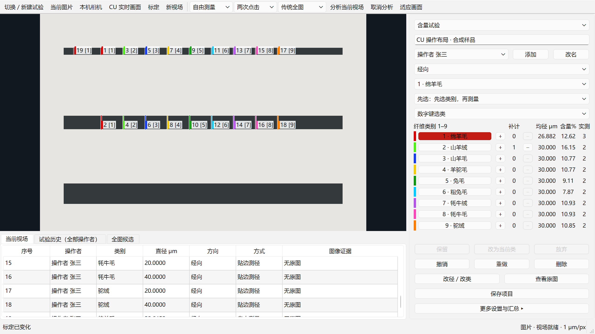

# CU 实时试验实施与验收记录

## 当前修订与验收状态

当前源码修订为 **R4**。相对 R3，生产代码只有峰值扫描中的一行变更：复用已有的 `finite_distance(double)`，替代逐像素 `std::isfinite`，保留转换、计算和遍历顺序。Windows 独立快照共 **1008 文件**，清单 SHA256 为 `f53b73e983dc723f84be2795f36c86d2dd4c40d9c1cc3d4fedb61e814d009347`，原生源码 SHA256 为 `b22a7b134aadbafc1fe91e570c027f62bbdd335620d58c279f89d524eb9b44dc`。源码变化与原有暂存保护见 [R4 身份核对](r4-peak-change-identity.json)。

R4 macOS 相关专项 **278 tests** 通过；Windows 相关专项 **482 tests、145 subtests** 通过，人工 246、运动 111、全图 177 组金标保持一致。同进程 5 次预热、30 次交替配对中，Windows 峰值内核 P95 在 2K／4K／6K 从 **11.585／45.805／98.812 ms** 降至 **0.309／1.181／2.171 ms**；153 组边界及全部采样结果均无差异。macOS 基本持平。见 [Windows 配对](peak-pair-windows-final-r4.json) 与 [macOS 配对](peak-pair-macos-final-r4.json)。这是内核证据，不能替代完整界面延迟；R4 core／full 包构建、同包自检与实际 GUI 入口验证已完成；两平台正式短程采样、分阶段运动计时及实际 Windows Qt 一小时均已完成。一小时的 24 项完整性检查全部通过，但 GUI 单次发布最大值超出 4 ms 门槛，整体性能仍未全部通过。

R4 两平台 **36 个 UI 条件中 15 个通过、21 个未达标**，见 [R4 性能报告](R4_PERFORMANCE.md) 和 [短程独立审计](performance-audit-short-final-r4.md)。Windows 动态 2K 三个条件均完成 30/30，P95 为 51.855／41.335／52.820 ms（原图关／开／联合），仍有 50 ms 延迟或 4 ms GUI 发布门槛未通过；4K 三个条件仅完成 12／16／2 条，6K 三个动态条件均为 0/30。6K 静止保存原图还存在预算拒收和帧率不足。所有拒收、超时和一条短线失败保留在分母中，不能用成功样本的低延迟替代整组验收。

实际运动链路的 Windows P95 在 2K／4K／6K 为 11.230／40.649／92.451 ms，低于 R3 对应的 21.259／81.881／188.339 ms，逐阶段结果零差异。优化有效，但不足以让全部分辨率满足严格最新显示帧核验及 27 FPS 的要求；没有通过放宽运动规则、静默降分辨率或提前入账换取通过。

最近一次完整全量回归来自 R3；R4 的一行原生改动由上述相关专项与金标验证，没有重跑无关界面全量。R3 两平台 36 个 UI 条件中 14 个通过、22 个未达标，实际 Qt 一小时未运行，见 [R3 性能报告](R3_PERFORMANCE.md) 与 [独立审计](performance-audit-final-r3.md)。R1／R2／R3 的失败证据全部保留，**尚不能宣称整体高频性能通过**。

R3 历史修订在 R2 的后台组距重算、即时计算完成通知和等价运动优化之上，补齐了另存为后的原图路径重定位、逐行无损 PNG、编码工作区预算，以及线程任务提交失败的原子回滚。Windows 独立快照共 **980 文件**，清单 SHA256 为 `dbe309b7dfcfd4f731581c583acb5b1d4718be018c3b4e850ccf242947135ef5`，目录为 `C:\tmp\fdm-cu-live-final-r3-20261015`；相对 R2 有 43 项新增／变更、没有删除。

R3 macOS 集成专项 **224 tests、107 subtests** 通过；Windows 专项 **815 tests、73 subtests** 通过，人工 246、运动 111、全图 177 组金标再次通过。macOS 全量也已完成：**4,606 tests、1,650 subtests 通过，5 项相同基线失败，457.25 秒**。R3 core／full 冻结包已完成 clean 构建及 16 项真实功能自检，内部无面积模型安装包也已取回。R3 短程结果已完整归入 [R3 性能报告](R3_PERFORMANCE.md)，实际 Qt 一小时未运行；保留 [R1 已测结果](PERFORMANCE.md) 和 R2 阶段构建，不覆盖旧失败。

R2 完成过 macOS 全量：4,534 tests、1,650 subtests 通过，5 项改动前快照已复现的界面失败。其 952 文件清单为 `9ca1c13ea22b23e0f5025e727933fd671d8b375f65813a94e276cb402ab0bde2`。R2 未运行独立短程性能或真实 Qt 小时采样；[R2 性能页](R2_PERFORMANCE.md) 只保留待验收项及明确标注的 R1 全图引用，不能写成已完成 R2 性能复测。

## 交付范围与现场保护

分支 `lard/cu-live-measurement` 从 `f1a90a5a84e90376a4300fb0874a87771765d91c` 创建。本轮未提交、推送或合并。结束后重新核对 491 个主机生产／构建／测试文件与 R4 快照一致，原有 15 项暂存改动保留；初始暂存补丁 SHA256 为 `4714a75cdf221724b2a9b2addbfdf5087d1490dfe50c9dc9b2ef403ebdaee2b3`。主窗口新增入口位于“试验 → 实时试验”，没有改写已有数字切片、静态测量或模型快速测径规则。

初始状态、暂存补丁、工作区补丁及文件摘要保存在 `/private/tmp/fdm-cu-live-baseline-20261015-002706`。 收尾身份见 [主机核对](final-r4-host-identity-after-soak.json) 与 [Windows 核对](final-r4-windows-identity-after-soak.json)：Windows 1008 个快照文件中 1007 个字节一致，唯一差异是原打包脚本将自动生成的 `version.auto.iss` 从 LF 重写为 CRLF，版本仍为 0.4.7；不存在未解释的源码变化，测试进程已退出。Windows 的 R1／R2／R3／R4 均使用独立 `C:\tmp\fdm-cu-live-*` 验证目录，原 Downloads 项目没有被覆盖或切换分支。

本报告区分代码实现、合成回归、虚拟机及真实设备。合成一致性不代表显微计量认证；虚拟机也不替代实际相机、采集卡和 CU 渲染画面的验收。

## 已实现功能

| 模块 | 实现与操作 | 证据入口 |
|---|---|---|
| 实时工作区 | 静态图、本机相机、外部 CU 来源；实际绘制帧绑定；两次点击／拖动；独立控制器 | `test_live_experiment_runtime.py`、`test_live_experiment_content_workspace.py` |
| CU 操作过渡 | 九类直接操作表、逐类补计数、先选／后选、右键非模态选类、类别色与场内编号；当前列表和全部历史分开 | [操作过渡说明](../../cu-live-transition.md)、Windows UI probe |
| 人工贴边 | C++17 局部阈值、连通域、边缘追踪、拟合与平均垂距；自由测量由用户显式选择 | [人工／运动／来源报告](../cu-manual-motion-capture-20261015/README.md) |
| 两种全图链 | 传统与 Mid→Cu→Thin 多尺度；常驻隔离进程、共享内存、候选审核与批量赋类 | [全图与发布报告](../cu-automatic-and-release-20261015.md) |
| 含量与账本 | 11 方法标签、40 材料定义、3 操作者×经纬×最多9类、额外计数、增量统计、撤销／重做 | `test_live_experiment_content_statistics.py`、`test_live_experiment_content_models.py` |
| 原图与项目 | 默认完整无损 PNG、同帧共享、失败状态、项目资源摘要校验、历史独立复核、CSV／Excel | `test_live_experiment_evidence.py`、`test_live_experiment_content_project_assets.py` |
| Windows 捕获 | WGC 优先；受控独立 PrintWindow 回退；Microview 已知单帧 ABI 的持久内存桥 | 来源专项报告和 `validate_windows_capture.py` |
| 构建 | core／full、原有一键脚本、缺失／过期双扩展自动重建、真实计算自检 | 全图与发布报告；最终包清单另列 |

普通及越限人工入账、全图整批确认均核验**当前最新已显示帧**。显示推进时目标随之推进，最初两秒期限不延长。新移动帧未经核验时不会先永久入账；超时明确拒绝。本轮修正了早期固定屏障会允许“先入账、后清场”的窗口。

帧预算同时计入像素所有者和采集流转余量。内存压力只暂停新操作或丢弃尚未显示的新预览，不冒充视场移动，不删除已确认记录。停止采集超过等待时间时保留线程／SDK／GPU 所有者，阻止启动另一来源；关闭操作可重试，不遗忘仍存活资源。

## 算法与统计正确性

- 人工：三个恢复版本共 **246/246** 对照；接受与合理拒绝保持一致，192 个成功结果在 macOS 与 Windows 均达到原数值核对。
- 全图：**177** 例中 175 例严格匹配，另外 2 例是有原版交叉证据的 CU6 容量扩展（30→35）。最终候选、已导出中间图像、内部 pass 计数均无未解释差异；额外 33 个完整中间阶段一致。
- 运动：37 例×3版本的 **111** 项参考回放；生产无符号 Sobel 修复产生的 12 项预期差异单列，不按旧有符号缺陷验收。
- 含量：11 方法×2模板×纤维／织物×4组距构成 **176** 个基础配置；另覆盖材料分支、缺类、纯计数、单样本、缺密度、零重量、舍入、超过旧行数，以及增量结果与完整重算。
- 真实测量规则未通过更改阈值来迎合测试。旧 OpenCV AA、旋转卡尺及 L1 拟合差异采用窄兼容实现；4K 直方图整数乘法溢出明确作为原程序容量缺陷修正。

R3 公共原生源码保持 R2 摘要：`4ec56fd735aa4c8edcdcfe2905bc488f3e8cc1534c2363a0d28e4cee2cfc13c8`；首轮 R1 摘要 `d3499aa56f20c64c4415adedd10e8d73b8653240806201cb1f3dac4967367086` 保留在原始报告中。人工、全图、原生运动峰值都通过同一构建身份校验。C++ 不使用 fast-math 或开发机专用 CPU 指令选项。

## 界面、来源与冻结验证

R4 Windows Qt 使用实际 `windows` 平台，200% DPI 下验证 1280×720 的九类按钮、逐类加减和数字键模式可达；请求 1330×900 时受虚拟机桌面限制为 1293×802，仍全部可达。右键菜单非模态、后选绑定最新测量操作（含计算和待确认阶段）、行内补计不改变当前类别均通过。截图及 JSON：`build/cu-live-windows-final-r4/ui-probe-final-r4/`。

截图是源码运行的实际 Qt 工作区探针，使用合成样品；不是原 CU 截图、真实显微图或安装后验收。R4 副本摘要保存在 `ui-windows-1280x720-r4.identity.json`；旧 R1／R3 图片与摘要另行保留。

此前受控 WGC 9/9 项和 PrintWindow 8/8 项通过（R4 未重跑捕获交互，仅重新构建及真实导入检查），覆盖遮挡、位置、尺寸、最小化／恢复、关闭、200% DPI；各自还在独立 PyInstaller 冻结探针中通过。WGC 直接转换为独立 BGR 所有者，计入实际 staging pitch、GPU 帧池和下一交付缓冲。静止相同像素没有被误判为断流。

该证据来自受控窗口；当前虚拟机没有正在运行的实际 CU 预览，Microview 也没有真实相机／采集卡连接。因此两者不能写成真实设备已验收。

## 回归与性能记录

R1 全量为 **4,449 tests、1,650 subtests 通过，5 项既有失败**，耗时 479.82 秒。5 项为导出选项小窗口两种主题、旧检查器连续布局／顺序、1536×864 工具按钮样式，均在改动前快照复现。最终后选／改名／确认专项及真实 Qt 探针通过。全量启动后补了一行隐藏待删除的旧类别控件，消除了刷新重影，另统一了后选下拉及提示文字；均未改计算或状态规则，分别用实际绘制探针复核。最终 macOS 文案与布局证据在 `build/cu-live-measurement/cu-ui-probe-final-wording/`，Windows 以发布快照对应探针为准。日志为 `full-regression-final.log`，基线与 Qt 全量诊断另附。

R3 最终全量为 **4,606 passed、1,650 subtests passed、5 项相同基线失败，457.25 秒**，日志与失败名称对照见 [R3 日志](full-regression-final-r3.log) 和 [R3 结果](full-regression-final-r3.json)。90 秒 faulthandler 仅输出诊断，主题测试随后通过；整轮正常结束。新增保存、编码、预算与入队失败路径已包含在本轮中。

R2 在最终手势与采样阶段标记修正之后完成全量：**4,534 passed、1,650 subtests passed、5 项相同基线失败，435.16 秒**，日志为 [full-regression-final-r2.log](full-regression-final-r2.log)。新增功能专项此前为 812 passed／57 subtests，最后工作区与采样审计专项为 96 passed。一次先行全量运行在 Qt 原生互斥锁上挂起后被终止，没有计作通过；详细重跑完成，90 秒主题诊断栈对应的测试随后通过。测试进程存在大量累计 widget，但锁持有者和根因未确定，不能把该挂起归因成已验证的基线问题或宣称已修复。详见 [R2 全量诊断](qt-full-regression-r2-diagnostic.json)。

正式采样在测试和构建全部停止后串行执行，固定输入、源码摘要、依赖和线程配置，5 次预热、30 次正式采样。父进程 Qt／运动保留应用的 OpenCV 默认并记录 requested、reported、parallel framework；全图工作进程仍请求单线程。macOS GCD 的 `getNumThreads()` 不等同实际工作线程数，不能据其数字虚称固定 18 或 4 个工作线程。

`performance-*.json` 的初轮记录早于预算、兼容原语和严格入账修正，属于优化前诊断，**不作为最终成绩**。当前 R4 正式 JSON 的逐条件结果见 [R4 性能报告](R4_PERFORMANCE.md)；[R1 性能报告](PERFORMANCE.md)保留为历史证据，按 [采样前固定规则](performance-acceptance-rules.md) 判定；未返回或拒收的尝试保留在分母中，不能以成功样本的延迟代表整组通过。

动态输入的主要瓶颈是严格最新显示帧核验，而不是人工 C++ 局部测径。[运动性能分析](motion-performance-analysis.md) 将已测结果、可证明的等价优化及尚未验证的流水设计分开列出；没有通过降低分辨率、冻结显示或放宽运动判据来掩盖失败。

软件压力测试分别记录无画布控制器与真实 Qt 画布，不把手工构造 `PresentedFrameToken` 当作真实画面已绘制。一小时最终测试使用实际 `paintEvent`、QTest 两次点击、30 Hz 合成流、每十秒换场、PNG 与后台全图联合负载，并记录已入账历史、场景身份、缓冲和四个时段的延迟。

较早的 macOS 控制器压力测试实际运行 3,600.05 秒，14,331 条接受与 PNG 状态一致，后台全图成功 360 次，无记录或任务错误（`soak-one-hour-macos.json`）。它使用早期源码、手工呈现令牌，且横向位移未触发换场（清场 0 次）；仅作为后台账本／写盘稳定性证据，不作为最终 UI、运动清场或性能验收。

## R4 Windows 实际 Qt 一小时结果

[原始报告](cu-live-workspace-hour-windows-final-r4.json)来自独立 R4 源码工作区，使用 Windows Qt、实际 QPainter 与 QTest 两次点击；输入为 2K、30 Hz 合成帧，每十秒垂直换场，开启 PNG，并每十秒提交传统全图任务。它不是实际相机、CU 窗口或已安装程序的一小时验收。

实际运行 **3,600.0007 秒**，**14,036 条**测量全部入账并绘制，**360 个视场、359 次移动与清场一一对应**，后台传统全图 **360 次正常完成**。24 项完整性检查全部通过：没有跨场入账、错误宽度、异常拒收或未映射操作；14,108 次提交等于 14,036 次入账加 72 次预期移动取消，另有 9 次草稿因移动取消。撤销历史逐条保留，账本重新加载完全一致，任务排空并正常关闭后帧租约为零。

**14,036 个 PNG 文件全部逐个核对 SHA256**；两种相同像素载荷去重后分别解码，再核对每条记录对应的合成场景，缺失、摘要错误、像素／尺寸错误及多余文件均为零。没有声称独立解码 14,036 次。

| 指标 | 实测 | 固定门槛结果 |
|---|---:|---|
| 不同帧绘制 | 29.999 FPS | 通过 ≥27 |
| 第一击草稿 P95／P99 | 12.999／15.964 ms | 通过 |
| 第二击结果可见 P95／P99 | 27.880／32.528 ms | 通过 |
| 换场到标记消失 P95／P99 | 74.212／85.090 ms | 通过 |
| GUI 同步发布 P95／最大值 | 1.188／23.716 ms | **最大值未通过 ≤4 ms** |
| 四个十五分钟区间的结果可见 P95 | 28.278／27.935／27.758／27.676 ms | 本批没有随历史数量持续上升 |

四个区间的 GUI 发布最大值均超过 4 ms；原始小时报告没有保留精确超限次数，只能确认至少四次，不能从分位数倒推。脚本 `passed=true` 表示其完整性检查通过，**不代表全部性能门槛通过**。最终独立判定见 [R4 审计](performance-audit-final-r4.md)。

逻辑帧预算峰值 **58.00 MiB**；父子进程总 RSS 的 100 ms 采样峰值约 **462.25 MiB**，二者口径不同，采样可能遗漏更短的峰值。人工任务、原图待写、预览邮箱和全图在途队列的观测最大值各为 1。所有测试产物保存在隔离目录，既有用户项目没有被覆盖。

## R4 Windows 内部验证安装包

当前候选产物为 internal full、不含面积识别模型安装包：[本地文件](../../../build/cu-live-measurement/windows-release/final-r4/fiber-diameter-measurement-setup-0.4.7-no-area-models.exe)。大小 **398,816,084 bytes**，SHA256 **`6faadecbd90c94a6cb3252dc68fb629e481e6a5408e7d12d4f4fb138b9eaca9a`**。沿用原脚本 clean 构建 core／full，保留四个内部含量模板，没有使用 public 模式。

同一安装包解出的 **4,768 个文件**大小和摘要全部一致；**16 项 rev3 功能自检**、**11 个模块实际 PYZ 代码对象核对**通过。实际 EXE 经主窗口菜单进入实时工作区，11 个关键控件可见，关闭后自然退出 0，无强制结束及遗留进程。full EXE SHA256 为 `14184c6f4829b412d4a17ff95e2ddf19cf305ddf954de8691fc5a036ab4c4276`。

没有执行注册式安装、覆盖升级或卸载，既有安装记录保持不变。源码 Qt 布局探针和同包 EXE 入口探针分别记录，均不替代真实 CU／相机与正式性能验收。完整证据见 [R4 发布说明](../cu-windows-release-final-r4-20261015.md) 和 [R4 发布 JSON](../cu_windows_release_final_r4_20261015.json)。

## R3 Windows 安装包（保留的验证产物）

R3 验证产物为 internal full、不含面积识别模型安装包：[本地文件](../../../build/cu-live-measurement/windows-release/final-r3/fiber-diameter-measurement-setup-0.4.7-no-area-models.exe)。大小 **398,844,521 bytes**，SHA256 **`e341089d859e2db05213dba2c10b16be40150e531fa2dbb6a86381fea3533058`**。core 与 full 均由原脚本 clean 构建，保留四个内部含量模板；没有使用 public 模式。

上述同包解出后，**4,768 个文件**逐个核对大小和摘要，**16 项 rev3 实际计算自检**及 **11 个模块的实际 PYZ 代码对象核对**全部通过。完整 GUI 入口从隔离空项目进入实时工作区，11 个关键控件可见，关闭后自然退出 0；无强制清理、无遗留进程。原安装注册记录保持一致，本轮未进行注册式安装、覆盖升级或卸载。包内源码一致和功能检查不替代性能、真实相机或 CU 渲染兼容性验收。

完整证据见 [R3 发布说明](../cu-windows-release-final-r3-20261015.md) 和 [R3 发布 JSON](../cu_windows_release_final_r3_20261015.json)。R2 安装包及发布报告保留为中间验证快照，不作为当前候选包。

## 首轮 R1 Windows 内部验证安装包（历史证据）

产物为 `build/cu-live-measurement/windows-release/fiber-diameter-measurement-setup-0.4.7-no-area-models.exe`，398,393,836 字节，SHA256 `8a37a58a382db75729ce8d33085df83445a3cfae299fbb622e79ddab2aa037be`。它使用 internal full、排除面积模型，保留四个私有含量模板；没有启用 public release。core 与最终 clean full 均通过原生和新增八项真实功能自检。

同一安装器只读解包后，4,766 个清单文件全部摘要匹配，包内 PYZ 的最新后选文案核对通过，再次执行真实 frozen self-check 成功。没有运行安装器的安装流程：固定 AppId 会影响虚拟机既有卸载记录，因此保留既有安装，解包前后只读核对该记录未变。不能将本次写成“实际安装／卸载已验收”。

实际解包 EXE 的完整入口流于 03:41 补验通过：隔离空项目 → “试验 → 实时试验” → 精确识别工作区标题 → 11 个关键控件全部存在且可见 → 关闭工作区 → 主窗口真实未保存对话框选择“放弃” → 自然退出，退出码 0，未强制结束，遗留进程为零。保存了点击后的 UI Automation 树及 owned HWND 关系，证据位于 `build/cu-live-windows/gui-corrected/`。早期探针只搜索桌面直接子窗口，遗漏 Qt 所属窗口，已由本次按 PID／HWND 的完整验证替代。该验证仅放弃本次新建隔离空项目，没有修改已有项目或安装记录；入口验证也不替代真实相机、实际测量和安装／卸载验证。

尝试复用缓存的中间 full 包被包内文案门禁查出旧 PYZ，已归档为不合格，未交付。最终 full 由未修改的原脚本执行 clean 构建，EXE SHA256 为 `2c414d30dc4aafeedfbd85b47d7a35fd686f84f3642506a0820617592adcdd06`；以最终安装器核验为准。完整构建清单、自检与安装包证据见 [Windows 发布记录](../cu_windows_release_20261015.json) 和 [全图与发布报告](../cu-automatic-and-release-20261015.md)。

## 复制、预算与复现边界

帧从采集来源交付后转交不可变所有者，手势持有已显示帧引用；人工 C++ 只整理必要 ROI，鼠标移动不反复复制整幅图。人工基准另外测量完整快照复制与“快照＋服务”，不能用纯内核耗时冒充点击到结果耗时。全图工作进程先将输入复制到共享内存，服务入口再取得独占像素（BGRA 转 BGR 也会分配）；正式 worker 往返包含这些成本，并非零复制。

UI 合成来源的显式像素复制计入生产线程及端到端测量，同时记录来源池、流转余量、帧租约峰值和进程 RSS。计数覆盖应用显式持有的缓冲，不宣称覆盖 Qt、驱动或 GPU 内部全部内存传输。R3 的 512 MiB 逻辑缓冲账本包含独立像素所有者、来源流转预留及编码工作区。逐行 PNG 不再生成完整 RGB 或完整压缩数组；编码工作区按 `2 MiB + 两条扫描行` 计费，同一串行写入组取最大值，独立写入组相加。新操作仍检查两帧预览余量，准入失败不清本场；原图任务在编码完成后释放自身原帧，别的消费者继续持有和计费。2 MiB 是支持环境中的 codec 余量定义，不是跨任意分配器的物理内存证明；Qt、驱动、OS 缓存和其它计算工作区另计。2 GiB 是全图计费工作区，两者均不等于进程总 RSS 上限。

[PNG 诊断](png-diagnostics/README.md) 保留原型的少量配对速度与独立解释器 RSS 记录，用于选型，不替代 R3 生产 UI 的正式采样。R1／R2 的 OpenCV 编码曾同时持有完整压缩缓冲，此限制保留在旧报告；不能把它当作 R3 仍未计费的缓冲。

最终仓库还补齐了 `benchmark` extra 的锁文件：只增加 `psutil 7.2.2` 及其 extra 元数据，保留全部原有依赖版本，`uv lock --check` 与离线检查通过。这项锁文件变化以 `benchmark-lock-overlay.json` 单列，未改写首轮 905 文件清单；R2／R3 新清单包含它。Windows R2 验证环境随后单独补装 `psutil 7.2.2`，R3 沿用；其它依赖版本未变，旧版缺少子进程 RSS 的结果保留原状。

## 待验收边界

逐设备、执行方式和发布形态见 [设备验收矩阵](DEVICE_MATRIX.md)。本轮仍有明确未完成的性能验收，当前安装包定位为内部验证候选，不能标为全面通过。

- Windows 实机相机／采集卡的连续采集 ABI、帧龄、实际 30 FPS、断流恢复；目前使用已确认的单帧采样 ABI，没有猜测连续接口签名。
- 实际 CU 渲染窗口，以及曝光变化、失焦、轻振、慢移、快移、回位等带时间戳显微录像；静止半小时误清场指标尚不能由合成图证明。
- 4K／6K 动态噪声下的严格最新帧核验尚未达标，6K 原图保存仍有缓冲准入拒收及帧率不足；2K 部分短程条件与一小时 GUI 单次发布门槛也有超限。不能用相同帧缓存快路径或一小时完整性通过覆盖这些失败。
- 本轮不导入 CU 旧试验文件、不自动识别材料、不控制载物台、不扩大到面积识别。

禁用或撤回实时试验时可继续使用原有静态测量与快速测径入口；不要将包含 `live-experiments/v1` 数据的项目交给不支持该特性的旧版本覆盖保存。完整原图和试验账本已经进入现有项目资产体系。
