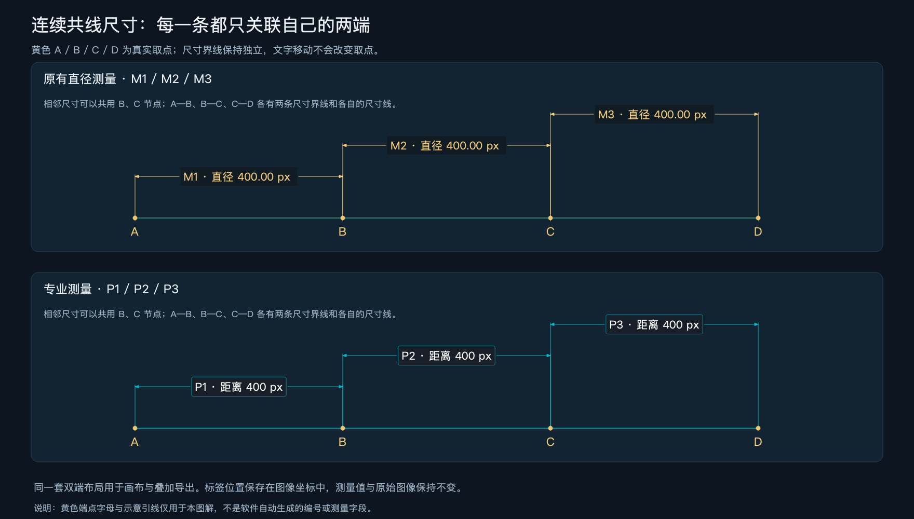
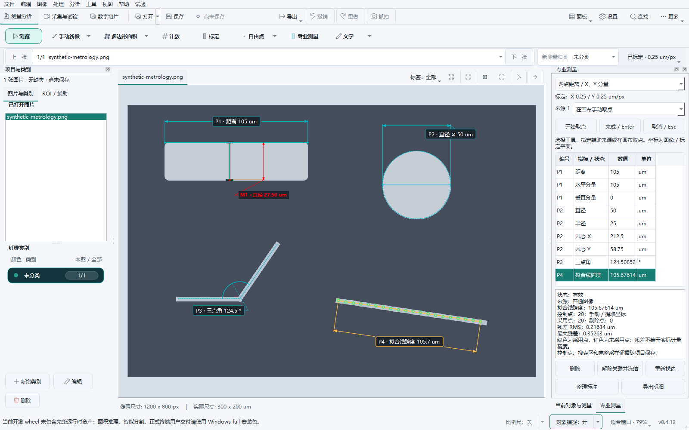

# 专业二维测量与关联标注：实现和验证

日期：2026-10-27。源码版本 `0.4.12`，基线提交 `62f89d284d99eac20a5538fe07085e28d95063f9`；本文件记录当时的功能阶段结果。后续 Windows 测试包版本升为 `0.4.13`，本轮仅更新版本元数据，功能阶段 JSON 保留实际验证时的 `0.4.12`。安装包及包内程序验证另行记录。使用方法见 [专业测量操作说明](../../professional-measurement.md)。

## 交付结果

- 新增专业测量面板：20 个工具入口，包括关联距离、角度、圆／圆弧、长度／面积、相对坐标、多点拟合和三类卡尺。使用独立结果表及 CSV／Excel 明细，不混入纤维直径统计。
- 普通图像及数字切片均可使用；焦层、来源版本、完整 X/Y 标定、几何定义、ROI 和拟合证据随项目保存。布局参与保存、撤销／重做，但不重新找边或改变数值。
- 原有直径和新的线性专业尺寸共用关联标签：可拖动、自动放置、右键切换单引出／双端引出；新建有唯一首尾的线性尺寸默认双端引出。
- 项目声明 `professional-measurements/v1`、`measurement-annotations/v1`，实际采用双端样式时另加 `measurement-dual-dimensions/v1`；不支持相应特性的读取器不能覆盖原文件。

## 连续尺寸与专业制图参考

双端样式采用两条尺寸界线、平行尺寸线、成对箭头和可移动文字。每段的两条界线始终分别对应自己的首尾；共用一个节点不会把相邻两段合并。尺寸界线在实际端点附近留间隙，并略超出尺寸线；文字超出区间时仍保留连接。短尺寸使用外置箭头，避免文字遮住整个测量范围。

对齐尺寸的三步输入与平行尺寸线参考 [QCAD 官方说明](https://www.qcad.org/doc/qcad/latest/reference/en/scripts/Draw/Dimension/DimAligned/doc/DimAligned_en.html)；文字／箭头空间不足时的处理参考 [AutoCAD 官方适配说明](https://help.autodesk.com/cloudhelp/2021/ENU/AutoCAD-Core/files/GUID-E2E21B42-82AF-4D46-B9DD-F0844D20F719.htm)。这是 FDM 的显示布局实现，不宣称完整 CAD 标准或 GD&T 合规。



黄色 A/B/C/D 和黄色示意线只用于解释图示，不是产品自动生成的端点字段。图中尺寸由真实共享渲染器绘制；[示例记录](dual-dimensions-final/manifest.json)包含 16 组端点对应检查、图片哈希和渲染源码哈希。另有 [横／竖／斜与短尺寸](dual-dimensions-final/02-orientations-short-and-distant.png)、[半径与水平分量](dual-dimensions-final/03-radius-and-horizontal-component.png)示例。

## 回归范围与结果

- macOS：**848 项测试、38 个子测试通过**，耗时 40.03 s。[JUnit](macos-regression.xml)。
- Windows 11：**848 项测试、38 个子测试通过**，耗时 120.46 s。[JUnit](windows-regression.xml)。

以上是 [明确列出的定向回归文件](test-scope.json)，不是整个仓库的全部测试。

| 范围 | 关键验证 |
|---|---|
| 计算与标定 | 距离、夹角与补角、过中间点的圆弧、圆边界关系、自交／退化输入、X/Y 非等方标定、单位换算、像素平面提示。 |
| 拟合 | 直线／圆／双边卡尺，梯度与阈值交点，弱对比、多边缘、噪声、缺口、离群点、采用／剔除证据与样本标准差。 |
| 原始数据 | 查看亮度／曝光不改变找边输入；原图、原始切片文件、数值导出和显示布局分离。RGB、RGBA 与灰度输入均有覆盖。 |
| 异步生命周期 | Esc 取消、迟到结果、替换原始 RasterPlane、焦层／来源／参数／完整标定变化；重新拟合目标被删除或修改时拒绝旧预览，保留独立布局修改。 |
| 关联与保存 | 修改辅助基准后重算，来源删除后失效，解除关联只冻结所选尺寸；项目往返、撤销／重做、旧读取器阻止覆盖。 |
| 尺寸表达 | 连续首尾相接、横竖斜、短区间、外置文字、首尾投影、半径／分量切换、标签拖远、单击不产生撤销、Esc 恢复。 |
| 数字切片 | 全局坐标、来源焦层、切层取消、原生像素覆盖缺口、过期渲染帧与来源版本核对；切片元数据查询在后台，不读取图像 BLOB。 |
| 画布与导出 | 标签与结果表联动、空间索引、缓存像素一致性、比例尺／当前视场裁剪提示、叠加图保留布局、CSV／Excel 明细。 |

原生 Windows 扩展回归曾出现 10 个旧测试夹具失败：7 个将逻辑坐标直接用于 DPR 2 的物理图像，3 个依赖 Unix 路径、未同步的模型目录或实际网络路径可达性。已改为按 DPR 采样物理像素、使用临时资源目录和隔离网络路径判断；保持严格像素断言，未为这些失败修改产品行为。此前另修复了 Windows 文件句柄释放顺序及比例尺测试的物理／逻辑输出尺寸差异。

## 界面与性能

Windows 使用现有虚拟机、既有 x64 Python 3.12.13 / Qt 6.10.2 环境，源码位于独立的 `C:\tmp\fdm-cu-live-professional-20261027`，不覆盖安装包或安装目录、不安装新依赖。Qt 使用原生 `windows` 平台；分别请求 100%、150%、200% 缩放，覆盖亮／暗主题、宽／窄窗口。200% 使用 3840 × 2160 输出请求，实际窗口、画布尺寸和 DPR 均记录在 JSON；这不是物理 4K 显示器的人工验收。

每轮 200 个可见标注、40 次连续拖动采样。表中斜线左侧为专业测量，右侧为现有直径；时间单位 ms。最终负载使用双端样式。目标为拖动重绘 P95 ≤ 33 ms。

| 场景 | 拖动绘制 P95 | 事件至绘制完成 P95 | 按下至首帧（含缓存建立） | 逻辑画布 / DPR |
|---|---:|---:|---:|---|
| [macOS · 100%](macos-final/result.json) | 0.67 / 0.70 | 0.99 / 1.05 | 24.68 / 27.18 | 988 × 727 / DPR 1 |
| [Windows · 100%](windows-final-100/result.json) | 1.82 / 1.97 | 2.40 / 7.11 | 63.97 / 124.58 | 988 × 727 / DPR 1 |
| [Windows · 150%](windows-final-150/result.json) | 2.14 / 2.14 | 2.75 / 7.25 | 75.43 / 134.99 | 668 × 445 / DPR 1.5 |
| [Windows · 200% / 原生窗口](windows-final-200/result.json) | 2.49 / 3.17 | 3.79 / 8.29 | 87.59 / 150.28 | 681 × 527 / DPR 2 |
| [Windows · 200% / 4K 离屏](windows-offscreen-4k-fonts/result.json) | 4.15 / 3.99 | 6.32 / 6.54 | 95.51 / 118.36 | 1308 × 809 / DPR 2 |

原生 200% 轮次的亮色 QWidget 抓图曾达到 3840 × 2160，但后续窗口和性能场景被虚拟显示器限制为 2586 × 1604；不能将整轮称为原生 4K 验收。另使用 `offscreen` 插件、Windows 现有字体目录 `C:\Windows\Fonts` 完成实际 3840 × 2160 输出，用于补充大画布和控件布局检查；其性能单列，不与原生窗口混同。离屏插件的符号字体回退与原生 Windows 有差异（截图中的直径符号可能显示替代字形），离屏轮次不作为原生字形验收。

所有最终场景通过 33 ms 拖动绘制目标。按下首帧单独列出，不隐藏缓存首次构建成本；这些时间不包含显示器扫描、输入设备或真实样品处理的延迟。

初轮 Windows 100% 尚未加入拖动静态图层缓存，专业／现有标签拖动 P95 分别为 **38.10 / 44.96 ms**，未达标；[原始结果](windows-initial-100/result.json)予以保留。随后复用静态叠加层，仅重绘正在拖动的标签，并验证缓存与直接绘制逐像素一致。初轮与最终样式不同，因此不以二者计算严格提速倍数。



[Windows 窄窗口暗色](windows-final-150/professional-narrow-dark.png) · [200% 原生高 DPI 界面](windows-final-200/professional-wide-light.png) · [3840 × 2160 离屏布局](windows-offscreen-4k-fonts/professional-wide-light.png)。完整截图与来源哈希分别保存在各场景目录。

## 复现与证据

在已有项目依赖环境中，以 `test-scope.json` 的文件列表运行 pytest。界面审计可运行：

```text
python scripts/validate_professional_measurement.py --output build/professional-audit-new --width 1600 --height 1000 --scale 1 --theme both --samples 40 --require-performance
python scripts/validate_dual_dimensions.py --output build/dual-dimensions-new
```

输出目录必须是新的，避免覆盖原始记录。每次审计记录运行前后源码 SHA-256、实际 Qt 输出尺寸、样本序列、校验项和截图哈希。交付文件与源文件的哈希见 [SHA256SUMS](SHA256SUMS)；当前验证源码另列于 [source-manifest.json](source-manifest.json)。

## 验证边界

本轮证明计算、软件状态、持久化、图像边界、共享绘制及上述虚拟机性能。没有执行 DSX 原厂程序或设备控制，没有构建／安装 Windows 发布包，也没有验证真实样品的计量精度。切片来源核对基于清单及瓦片位置／焦层等元数据，不是整片图像内容哈希。真实精度仍需以已知尺寸样本、实际倍率和双轴标定单独确认。
