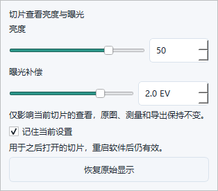

# 数字切片亮度、曝光与设置记忆

日期：2026-10-26。此次交付源码和验证证据，安装包另行构建。

## 使用

点击切片查看区太阳图标“亮度/曝光”，或“视图 → 切片亮度/曝光…”。命令搜索支持“亮度”“曝光”“EV”。

- 亮度 −100～+100，调整中间灰阶；曝光 −4.0～+4.0 EV，步长0.1，两项可组合。关闭面板后键盘焦点回到画布。
- “记住当前设置”默认关闭。勾选后保存当前两项值，作为之后打开切片的默认值，软件重启后仍有效。其他已打开切片不被同步修改；仅切换标签或打开面板不覆盖默认值。
- 勾选期间在松开滑块、完成数字输入或关闭面板时保存；拖动预览不反复写盘。取消勾选清除默认值，但保留当前切片效果。恢复原始显示将两项归零，保持复选框状态；若已勾选，也保存0／0。
- 保存失败显示错误并保留当前查看效果；新切片使用上次成功保存的默认值。若退出软件时最后一次保存失败，先显示警告再退出。首选项保存和主题切换保留新默认值。
- 查看调整不改变相机曝光，也不能恢复丢失的高光。原始像素、测量、分割、导出和项目数据不变。比例尺导出预览显示原始像素，并在任一参数非零时标明“导出预览 · 原始显示”。

## 实现

`DigitalSlideCanvas` 持有 `(brightness, exposure_tenths)`，使用原子设置入口和统一变化信号；旧亮度入口保持兼容。曝光使用整数十分之一 EV。

显示像素按 sRGB 解码→乘 `2^EV`→截断→sRGB 编码→Gamma→量化处理，组合成单张256项查找表，一次 `cv2.LUT` 完成，Alpha不变。曝光0直接复用旧Gamma LUT，双0直通；不改变原始渲染器/算法缓存。LUT缓存有界256项，显示副本仍共用96 MiB预算和可见区域分块。

原生视场、概览、切层交接、导航、标注底图失效条件和延迟挂载统一纳入两项值。工具栏固定文字避免数值变化影响视场几何，太阳图标使用现有主题矢量机制。输入合并仍为约33ms；持久化提交与预览信号分离。

应用设置增加三个字段：`digital_slide_remember_view_adjustments`、`digital_slide_view_brightness`、`digital_slide_view_exposure_tenths`。不进入切片文件、文档序列化或采集方案字段集合；旧配置和无效值安全回退。取消记忆时参数归零。

## 验证记录

macOS 与 Windows 11 的最终功能回归均为 **475项测试、15项子测试通过**。覆盖算法、各显示路径、透明通道、缓存、标签隔离、重启与无效配置、保存失败、真实键盘小数输入、首选项往返、主题变更、退出保存失败提示及普通图像回归。

所有界面和性能测量来自合成3×3网格、5焦层、单原生视场1024×768；不涉及设备控制。Windows 最终轮18组：3种调节模式 × 1366×768／DPR1、1920×1080／DPR1.5、3840×2160／DPR2 × 亮暗主题。18组性能指标全部达标；界面完整流程16组通过，另外2组在第二次打开面板时记录 `popup_is_visible=false`，没有覆盖原始失败。见下方补测记录。

Windows 测试使用独立源码快照、复用已有 Python 3.12 x64及匹配本机扩展，普通用户交互会话执行。源文件逐项SHA校验，本机扩展对应 native 源文件与现有构建逐项一致。独立 APPDATA、LOCALAPPDATA 和临时目录避免写入用户设置。

4K表示Qt控件完整栅格尺寸3840×2160、DPR2截图检查，不是物理4K显示器或相机验收；未改桌面分辨率。性能记录为输入/设置到Qt实际绘制完成，包含33ms合并，无显示器呈现延迟。虚拟机结果不能外推为 Windows 10 1909、真实大切片或安装包验收。

复现命令：

```powershell
python scripts/validate_slide_brightness.py --output <新的目录> --platform windows --width 3840 --height 2160 --scale 2 --theme dark --adjustment-mode combined --samples 41 --require-performance
```

`--adjustment-mode` 可选 `brightness`、`exposure`、`combined`；输出目录必须是新目录，以保留已有证据。


下表取每种模式6组中的最大值（毫秒），不是把不同分辨率的样本混成一个P95：

| 模式 | 首次设置到绘制 | 滑块输入到绘制 P95 | 连续调节响应 P95 | 连续绘制间隔 P95 |
|---|---:|---:|---:|---:|
| 仅亮度 | 30.17 | 49.87 | 25.93 | 47.30 |
| 仅曝光 | 21.33 | 48.88 | 20.70 | 47.69 |
| 组合 | 16.40 | 47.98 | 30.59 | 45.82 |

首次响应目标100ms、后续响应P95目标50ms。滑块首次响应最大22.59ms；连续输入首次响应最大19.02ms。保留显示副本最大34,666,848字节（约33.06MiB），低于96MiB预算；此值不是进程峰值内存。49.87ms接近目标边界，结果不保证所有机器或每次短测量都低于50ms。

界面异常与补测：最终轮“1920×1080／1.5／暗色／仅亮度”和“3840×2160／2／亮色／组合”各出现一次弹窗未保持可见；两组的性能及此前数据边界均通过。首轮对应场景通过。为排除检查进程在交互桌面启动造成焦点变化的可能性，固定对两个场景各补测3次，测量期间不启动额外交互进程；原失败和补测全部留存。焦点干扰目前只是推断，未获得足够事件追踪来确定原因。两个场景各3次的完整界面、数据边界和性能检查均通过（共6／6），没有再次出现弹窗关闭。仍不把这项瞬时现象视作已确定根因；后续安装包人工验证应留意焦点切换行为。补测记录见 [1920×1080三次](windows-r2-repeat/result.json) 和 [4K三次](windows-r2-repeat-4k/result.json)。

已修复并有测试的边界：键入小数时控件不再重写正在编辑的文本；打开首选项或更换主题不清除记忆；退出软件时最后保存失败会在主窗口消失前显示警告。

## 证据与截图

- [macOS 最终回归](mac-final-pytest.log) · [Windows 最终回归](windows-r2/out/pytest.log)
- [最终核验](final-verification.json) · [证据 SHA-256 清单](SHA256SUMS.txt)
- [最终源码清单](source-manifest.json) · [本机扩展复用核验](windows-r2/native-reuse.json)
- [完整性能表](performance-summary.csv) · [结构化结果](performance-summary.json)
- `windows-r1/` 为首轮，`windows-r2/` 为包含三项边界修复的最终源码；补测使用同一最终源码，不改变产品逻辑。



[4K暗色完整界面](windows-r2/out/combined-3840x2160-2-dark/brightness-popup-window.png) · [4K暗色调节面板](windows-r2/out/combined-3840x2160-2-dark/adjustments-popup-remembered.png) · [原始显示导出预览](windows-r2/out/combined-1366x768-1-light/scale-export-preview-original-brightness.png)
