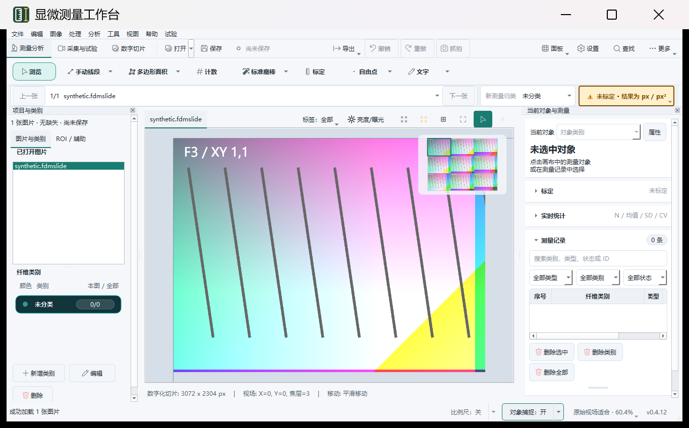

# 0.4.12 亮度／曝光与设置记忆 Windows 测试包

日期：2026-10-26至27日。功能与版本提交：`4417873881085c289e9f1e329b36904d85c77861`。本轮安装器构建、内容核验及包内实际EXE界面验证均通过。提交均为本地提交，未推送。

## 安装包

[Windows x64 0.4.12 测试安装包](../../../dist/internal/slide-adjustments-20261026/FDM-0.4.12-slide-adjustments-7b6bef153c0f.exe)

- 大小：399,126,277字节（380.64 MiB）。
- Build ID：`7b6bef153c0f43718d385aedee2bb86c`。
- SHA-256：`ac9e231c358b2662ff47ed33fce15a53e3748999b7fa35fefae3d58cc41acae5`。
- [本机保留与哈希核验](host-retained-installer.json) · [包身份](package/installer-identity.json) · [发布清单](package/release-manifest.json)。

## 实际安装包验证

安装器实际解包后的4,819项文件集合、大小和SHA-256全部匹配，三份内部模板与源资源一致，相机DLL保持原哈希，不含面积模型或测试SDK。构建后的443项产品源码、原生源码和资源与源快照再次核对一致。

实际解包EXE执行`--self-check --json`：退出0、无错误；版本和Build ID匹配。revision6原生测量、alignment子进程、optical子进程等检查通过，见[完整自检](package/extracted-selfcheck.json)。

普通用户Session1通过UI Automation操作实际EXE，使用合成切片和隔离配置，连续3次启动并正常退出：

| 操作 | 已验证结果 |
|---|---|
| 原始显示→仅曝光+1EV | 中央ROI均值138.279→189.262，像素改变 |
| 亮度40、曝光+1.3EV并记住 | 保存值40／13，中央均值223.215 |
| 重启 | 两项值及勾选状态恢复，ROI哈希与重启前一致 |
| 恢复原始显示 | 两项0／0、仍勾选，保存值0／0；ROI哈希与初始完全一致 |
| 亮度20、曝光−0.7EV后取消记忆 | 当前显示不变，保存参数清零 |
| 再次重启 | 未勾选、0／0，ROI哈希与初始完全一致 |

源切片SHA-256全程不变，三个进程退出码均为0，没有强杀。[最终界面结果](frozen-gui/20261026-235600-534f90517e2a42b7b9e4b4792430eca0/result.json)。

首次探针已经验证曝光和重启记忆，但在UIA调用恢复按钮后立即读取旧值，提前中止。最终探针仅增加结果等待（不重发动作），约168ms后观察到0／0，全部流程通过；同时修正外层脚本的退出码传递。产品和安装包字节没有修改。保留[首次结果](frozen-gui/20261026-235238-b6d4e0c5eea3411299f46e90be480465/result.json)及[初版探针](probe-initial.ps1)。一次Parallels远程启动参数错误未启动测试进程，改用短本地脚本路径后完成。

[仅曝光+1EV](frozen-gui/20261026-235600-534f90517e2a42b7b9e4b4792430eca0/02-exposure-plus-1.png) · [取消记忆后重启为原始显示](frozen-gui/20261026-235600-534f90517e2a42b7b9e4b4792430eca0/08-restarted-neutral.png)

## 构建范围

内部 full 配置，排除面积识别模型，保留内部模板。使用现有 Windows 11 虚拟机、x64 Python 3.12、MSVC 和 Inno Setup，独立构建目录为 `C:\tmp\fdm-slide-adjustments-release-20261026`。启用 `PIP_NO_INDEX=1`，没有安装开发依赖，没有覆盖原安装。0.4.11安装器保留作回退。

源快照由已提交源码、既有内部运行资源和 pybind11 头文件组成，共959项，逐项验证SHA-256。源码ZIP为87,254,017字节，SHA-256为`8b0b4ab0f0a2e5dca937aea2e7c9f83d290d38d05528bec5ea0328ec6742d881`。快照没有`.git`，包内构建清单标记`source_commit=unknown`及`git status unavailable`；外层源清单记录上述真实提交，不伪造干净发布状态。

## 已有验证

- 功能阶段在macOS和Windows各通过475项测试、15项子测试，18组Windows性能测量达标；两组弹窗可见性异常均保留原始结果，各补测3次通过。详见[功能报告](../slide-adjustments-20261026/README.md)。该阶段使用0.4.11版本元数据；本轮产品逻辑保持一致，将版本元数据升至0.4.12。
- 提交前发布门禁258项测试、123项子测试通过：[日志](precommit-tests.log)。首次受限环境中有4项发布自检失败（工作子进程／渲染器退出检查）；同一命令在正常本机权限下全部通过，未修改产品代码或放宽断言。保留[首次结果](precommit-sandbox.log)。

## 使用

打开数字切片后点击太阳图标“亮度/曝光”。亮度为−100～+100，曝光为−4.0～+4.0 EV，两项可组合。

“记住当前设置”把当前两项作为以后打开切片的默认值，重启仍有效，不同步修改已有标签。取消勾选后，新切片恢复0／0，当前查看效果保留；“恢复原始显示”同时归零。原始图像、测量、分割、导出及切片文件保持不变。

本轮包内程序验证不等同于覆盖安装／升级、真实设备、Windows 10 1909或物理4K屏幕验收。

## 收尾与清理

新包在项目交付目录保留并独立核验SHA-256后，清理本次临时文件共3,746,015,276字节（约3.49GiB）：Windows独立构建／解包目录3,168,491,655字节，宿主机专用传输和构建临时目录577,523,621字节。这是删除文件的逻辑大小，不代表虚拟磁盘容器已缩减同等大小。

0.4.11回退安装器及其SHA保持不变；未覆盖原安装或清理历史源码与研究目录。虚拟机保持运行。

[Windows清理回执](windows-cleanup.json) · [宿主机清理回执](host-cleanup.json) · [回退包身份](rollback-installer.json) · [最终核验](final-verification.json) · [全部证据SHA-256](SHA256SUMS.txt)。

原始Windows日志可能采用系统编码，保留原字节。`transfer.json`记录跨系统传输的逐文件哈希；`SHA256SUMS.txt`覆盖本报告目录（清单自身除外）。执行脚本使用本次固定路径，仅用于复核，不能直接用于其他目录清理。
