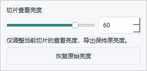

# 数字切片查看亮度：实现与验证

日期：2026-10-23。本文记录功能实施阶段，后续提交和0.4.11测试安装包见[发布记录](../slide-brightness-release-20261023/README.md)。功能已实现；macOS 与 Windows 11 各 **299 项测试、11 项子测试通过**。六组 Windows 界面的像素／数据边界检查和首轮响应目标通过。性能接近50ms边界：固定补测的合并样本达标，个别短轮次仍有0.1～0.7ms超限，不能承诺所有机器或每轮均低于50ms。

## 使用与行为

在数字切片工具栏点击“亮度：0”，或使用“视图 → 切片查看亮度…”／命令搜索。滑块和数值输入范围为−100～100；“恢复原始亮度”回到0。

- 每张打开的切片独立保存运行时值；切层、缩放、移动、切换标签保留，关闭或重新挂载后归零。
- 主画布及导航缩略图同步变化。亮度不进入文档模型、项目、应用配置或`.fdmslide`，不触发保存提示。
- 原始像素、测量、处理／分割输入和全部导出保持原亮度。比例尺导出预览区域使用原始像素，非零亮度时显示“导出预览 · 原始亮度”。
- 弹窗关闭后恢复画布键盘焦点；滚轮不会穿透到切层。普通图像沿用现有显示调整。



[4K暗色主界面](windows-r6/out/3840x2160-2-dark/native-bright.png) · [4K暗色弹窗](windows-r6/out/3840x2160-2-dark/brightness-popup.png) · [原亮度导出预览](windows-r6/out/1366x768-1-light/scale-export-preview-original-brightness.png)

## 实现

| 文件 | 改动 |
|---|---|
| `src/fdm/ui/slide_brightness.py` | `gamma=2^(value/50)`、256项`cv2.LUT`、RGB同曲线、Alpha保留、0值直通；96MiB按字节限制的缓存及可见区域分块 |
| `src/fdm/ui/digital_slide_canvas.py` | 亮度属性／信号；原生、低清、概览和交接帧统一显示映射；缩略图更新、生命周期和标注底图失效 |
| `src/fdm/ui/slide_brightness_control.py` | 弹窗、固定范围宽度按钮、精确定时器；按上次实际应用时刻保持约33ms节拍，首批异步合并，松手立即应用 |
| `src/fdm/ui/main_window.py` | 工具栏／菜单／搜索入口、活动标签同步、关闭与焦点处理 |
| `src/fdm/ui/scale_overlay_editor.py` | 复用原标签显示导出预览原亮度提示，避免新增浮层遮挡 |

显示副本与原图、渲染器缓存分离。缓存键包括源图身份、亮度和裁剪区域；默认0不调用LUT。超预算图像按可见源区分块，隐藏切片清空亮度缓存。占位背景、标注和界面颜色不参与映射。

按钮为全部201个值预留当前字体／样式需要的最大宽度，尺寸计算只在字体、样式或DPI变化时更新；窄窗口改变亮度不再触发画布变宽、视图代次或取图范围变化。

## 自动回归

- [macOS最终日志](macos-final-r6.log)、[JUnit](macos-final-r6.xml)：299 passed、11 subtests passed，22.35s，Qt offscreen。
- [Windows最终日志](windows-r6/out/pytest.log)、[JUnit](windows-r6/out/pytest.xml)：299 passed、11 subtests passed，57.05s，用户Session1、原生Windows Qt后端、测试DPR1。
- 新增测试：`test_slide_brightness.py`、`test_slide_brightness_ui.py`、`test_slide_brightness_boundaries.py`。既有浏览渲染、导航交接、标注生命周期、普通图像显示调整、比例尺和导出测试同时运行。
- 覆盖灰度／RGB／Alpha、非整齐stride、零值不转换、单次映射、缓存身份／淘汰／分块、部分覆盖背景、标签隔离、关闭重置、全屏和键盘、布局稳定性、文档脏标记／序列化、源图与分割／处理输入、三类导出像素一致。
- 既有比例尺测试用`Path(...).name`替换按`/`拆分文件名，兼容Windows路径。

## Windows界面与性能

环境：Windows 11 ARM64 build26200，现有AMD64 Python3.12.13、OpenCV4.13.0、PySide6 6.10.2。使用既有依赖和独立临时目录；该阶段没有安装开发环境或生成新安装包。

每组生成3×3网格、5焦层、单原生视场1024×768的合成切片；运行切层、平滑移动、整视场跳转、概览、回到原生、比例尺预览和弹窗场景。全部图像、原始文件哈希、处理来源及导出像素对照保存在[最终证据目录](windows-r6/out/)。截图实际尺寸及DPR已逐组核对。

以下单位均为毫秒。单值测试每次等待对应绘制完成；连续测试在约1秒内以目标5ms间隔输入，保留产品合并，观察自然绘制，不调用强制重绘。

| 实际PNG / DPR / 主题 | 首次滑块响应 | 单值响应P95 | 连续输入响应P95 | 连续绘制间隔P95 |
|---|---:|---:|---:|---:|
| 1366×768 / 1.0 / 亮 | 13.14 | 49.73 | 25.94 | 42.97 |
| 1366×768 / 1.0 / 暗 | 12.28 | 49.28 | 22.04 | 49.02 |
| 1920×1080 / 1.5 / 亮 | 12.89 | 45.13 | 21.12 | 43.10 |
| 1920×1080 / 1.5 / 暗 | 13.54 | 44.60 | 25.10 | 50.66 |
| 3840×2160 / 2.0 / 亮 | 9.13 | 45.17 | 21.18 | 41.62 |
| 3840×2160 / 2.0 / 暗 | 18.09 | 48.00 | 24.40 | 48.46 |

原定首次响应≤100ms、连续响应P95≤50ms在六组首轮均满足。新增的绘制间隔≤50ms检查在1920×1080／150%暗色首轮测得50.66ms，因此[首轮总结果](windows-r6/result.json)如实保留为failed（其余五组复合检查通过）。

对此预先固定补测三次，使用完全相同源码和阈值，全部样本纳入，不挑选成功轮次：

| 1920×1080／150%暗色 | 单值响应P95 | 连续输入响应P95 | 连续绘制间隔P95 |
|---|---:|---:|---:|
| 原轮次 | 44.60 | 25.10 | 50.66 |
| 固定补测1 | 50.46 | 23.60 | 44.31 |
| 固定补测2 | 50.13 | 20.23 | 50.68 |
| 固定补测3 | 49.40 | 23.75 | 45.57 |
| 全部样本合并 | 49.94 | 24.19 | 48.47 |

[合并数据](windows-r6-repeat/aggregate.json)包含124个单值响应、113个连续响应和109个绘制间隔。部分短轮次单值响应50.13／50.46ms、绘制间隔50.68ms，说明虚拟机下性能余量有限；合并达标不会覆盖这些记录。所有连续输入的最后值均同步提交并实际绘制，没有已应用却未绘制的更新。

首轮原生视场亮度缓存为3,342,336字节（约3.19MiB）；六组全部场景的最大值为34,666,848字节（约33.06MiB，4K全景浏览），低于96MiB。统计为保留的显示副本，不是进程峰值内存。

## 复现与证据身份

```powershell
python scripts/validate_slide_brightness.py --output <新的目录> --platform windows --width 3840 --height 2160 --scale 2 --theme dark --require-performance
```

脚本自动探测系统DPR，再计算进程缩放，初次显示后恢复请求客户区尺寸。每个缩放启动新进程；输出路径必须是新目录。`--require-performance`将单值和连续性能合并进退出码；连续检查本身也进入顶层`passed`，应同时阅读`failures`和各性能字段。

源码快照：[r6-source-manifest.json](r6-source-manifest.json)，传输包SHA-256：`45afaf24540d003640780975d03f1db90ba52a994503c0bed3d18d1e57f31b6f`。最终产品代码、测试与验证脚本共574个文件已与该快照重新逐文件校验。各轮证据ZIP的SHA-256保存在对应`transfer.json`；`SHA256SUMS.txt`覆盖完整本地验证档案（包含未入Git的原始样本）；`COMMITTED-SHA256SUMS.txt`只覆盖入Git的精选证据，两者均不包含校验清单自身。合成切片、重复导出图及运行配置留在本地。

早期失败保留用于追溯：r2的Session0没有正常绘制事件；r3进入用户桌面后发现系统DPR叠加及50ms固定等待／路径／像素尺寸测试假设；另确认并修复了窄窗口按钮宽度引发的真实视场变化。r4校正尺寸并启用精确定时器，r5缓存按钮尺寸，r6改为33ms节拍。没有用放宽50ms阈值替代修复。

## 验证边界与交付状态

- 计时终点为Qt绘制完成，包含滑块合并等待；不包含OS输入投递、桌面合成或物理显示延迟。连续输入由工具生成，不是物理鼠标轨迹。
- 4K证据是3840×2160完整控件绘制和抓图。虚拟机实际桌面小于4K，窗口部分超出桌面；这不等同于物理4K显示器验收。
- 当前性能源视场为1024×768，不能外推至所有超大原生图像；超预算绘制路径有独立测试。截图和终态检查也不能单独证明每一过渡帧无闪烁，交接／覆盖回归提供额外证据。
- 功能实施阶段交付为源码、测试、验证脚本、截图和报告，当时尚未生成新安装包或提交Git；后续提交及打包状态见顶部发布记录。没有修改DSX研究或硬件控制链路。
- 本轮虚拟机临时目录与传输副本在证据逐文件核对后清理，见`cleanup-receipt.json`；虚拟机保持原有运行状态。
