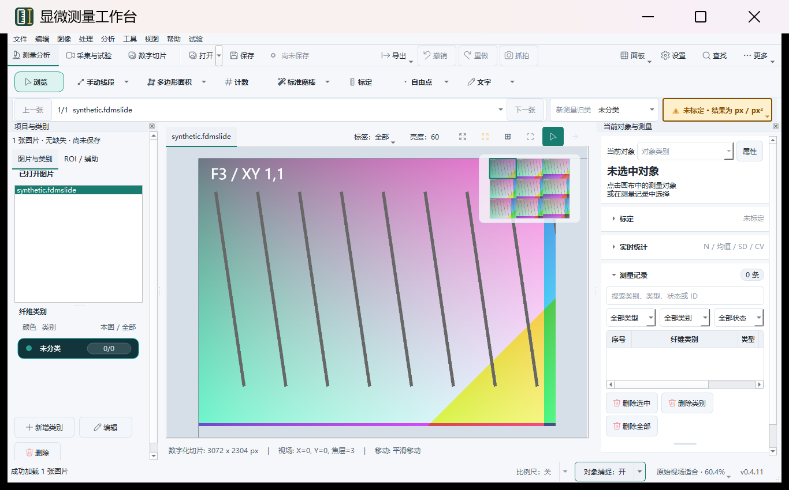

# 0.4.11 亮度版 Windows 测试包

日期：2026-10-23。亮度功能源码提交为 `c3728299c6dea41ef86980b07a45c939868fe2f4`。本轮已生成测试安装器、校验传输哈希、运行包内实际 EXE 自检和亮度界面测试，并完成旧产物与本次临时目录清理。未推送远程。

## 安装包

[下载 Windows x64 测试安装包](../../../dist/internal/slide-brightness-20261023/FDM-0.4.11-slide-brightness-487f083d0ba1.exe)

- 版本：**0.4.11**；大小：**399,050,852 字节（380.56 MiB）**。
- Build ID：`487f083d0ba14114ad9cccc08a1b74ad`。
- SHA-256：`2c6f550749f7a21a3f0399086c1c7b1e695dc6ceac2bcd7797a297d1c0544822`。
- 内部 full 配置；**不含面积识别模型，保留内部模板**。未使用 public-release 配置。
- 打开 `.fdmslide` 后，在切片工具栏点击“亮度：0”，或从“视图 → 切片查看亮度”进入。查看变化不写入原图、切片或项目，导出保持原亮度。

## 构建与来源

使用已有 Windows 11 ARM64 build26200 虚拟机、x64 Python3.12、MSVC 和 Inno Setup。独立目录 `C:\tmp\fdm-brightness-release-20261023` 构建，未覆盖原安装、旧工作区或开发环境；构建启用 PIP_NO_INDEX，没有安装新依赖。

源码来自上述提交，另附既有内部 runtime 资源和 pybind11 头文件。源快照954项文件逐项验哈希；ZIP原始SHA-256为 `3eaa3763d09992358d21dd2d558eb5e40258dbfa9843df0a6d6c521707b3b3be`。构建后443项生产源码/原生源码/资源再次验哈希。见[源清单](package/source-manifest.json)。

快照没有`.git`，项目构建脚本因此诚实记录 `source_commit=unknown`、`source_dirty=true / git status unavailable`；没有伪造干净发布状态。提交追溯依据是源清单及外层 `source_git_baseline=c372829…`。[安装包身份](package/installer-identity.json)明确记录这种追溯方式。它是供测试的内部包。

首次包装脚本把 PyInstaller 正常stderr日志误当成PowerShell异常，实际干净 onedir 和安装器均已生成。保留[原始包装状态](initial-release-status.json)。随后通过 `cmd` 内部重定向，复用同一干净 onedir 重新执行安装器检查和Inno编译，明确取得[退出码0](repackage-exit.txt)及[完整重打包日志](repackage.log)。产品源码没有因此改变。

## 验证

- 提交前亮度/打包门禁：**117 tests +117 subtests**通过，见[日志](precommit-tests.log)。前一功能阶段macOS及Windows各299 tests +11 subtests；完整显示/导航/导出/性能边界见[功能验证报告](../slide-brightness-20261023/README.md)。
- 安装器实际解包：**4,819个文件**的集合、大小及SHA-256一致；三份内部模板与源资源一致；相机DLL保持原哈希；不含测试SDK或面积模型。见[发布清单](package/release-manifest.json)。
- 实际解包EXE执行 `--self-check --json`：退出0、无错误、版本与Build ID一致；revision6原生、alignment子进程、optical子进程均通过，见[完整自检](package/extracted-selfcheck.json)。自检配置和临时文件均隔离。
- Session1普通用户通过UI Automation操作实际EXE：打开合成切片，亮度0→60→恢复0；图像中央均值 **138.279→192.825→138.279**，恢复后的ROI像素哈希与初始完全一致。源切片SHA不变，正常退出0，没有强杀。见[最终界面结果](frozen-gui/20261023-141342-6cb22f6b8993436ead9b0508a7a524de/result.json)。
- 首轮界面探针已成功设置60，但错误假设Qt弹窗必须具有非零原生Owner。保留[失败记录](frozen-gui/20261023-140724-8fb59b2ee89040a48b92fc8414896383/result.json)和[初版探针](probe-initial.ps1)。修正为PID、弹窗类/AutomationId和精确按钮联合匹配后通过；最终记录确认Owner确实为0。此修正仅涉及验证脚本。

[原始亮度](frozen-gui/20261023-141342-6cb22f6b8993436ead9b0508a7a524de/01-original.png) · [恢复0](frozen-gui/20261023-141342-6cb22f6b8993436ead9b0508a7a524de/03-restored-0.png)

本轮验证的是安装器内容与包内EXE；**未覆盖原有注册安装，也未测试实际安装/升级流程、真实采集设备或Windows10 1909**。4K与性能源于前一轮源码验证，详见对应边界；本次GUI截图为1366×850，不宣称补做物理4K验收。

## 清理

新包通过验证且本机SHA确认后，删除旧产物 **1,634,282,322 字节（1.52 GiB）**：

| 范围 | 删除内容 | 字节 |
|---|---|---:|
| 本机 | 两份0.4.10旧安装器、旧wheel测试安装副本、pyc/pytest/uv缓存及旧transfer ZIP | 829,038,458 |
| Windows | 两份0.4.8旧安装器传输ZIP、14份与保留src二进制逐项SHA一致的build/lib副本 | 805,243,864 |

另清理本次工作产生的临时构建、解包及传输副本 **3,744,963,038 字节（3.49 GiB）**，保留验证证据及唯一新安装器。合计删除文件逻辑大小 **5,379,245,360 字节（5.01 GiB）**；此值不是虚拟磁盘容器已缩减大小。

清理明细：[本机旧产物](local-cleanup.json)、[Windows旧产物](windows-old-cleanup.json)、[Windows本次临时目录](windows-current-cleanup.json)、[宿主本次临时目录](host-current-cleanup.json)。原安装、venv、编译器、历史源码/恢复副本、研究资料和原有验证证据保留；两处内容独有的历史原生二进制也保留。虚拟机继续保持运行。

`SHA256SUMS.txt`覆盖本目录归档文件（清单自身除外）；[transfer.json](transfer.json)保留跨系统传输的原始逐文件哈希。部分原始日志为Windows编码，已另保留带原始哈希的UTF-8可读副本。执行脚本归档用于复核当次过程，固定路径及日期不应当作通用清理工具直接用于其他目录。
