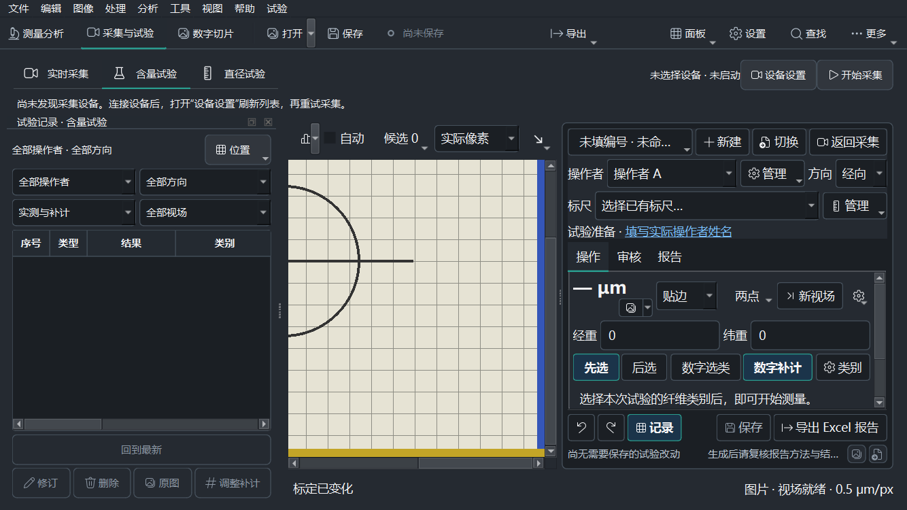
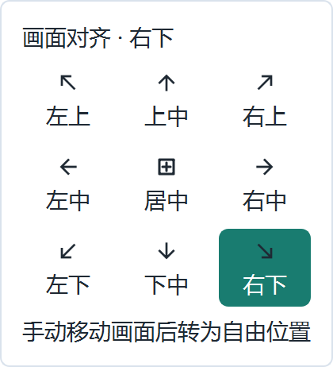
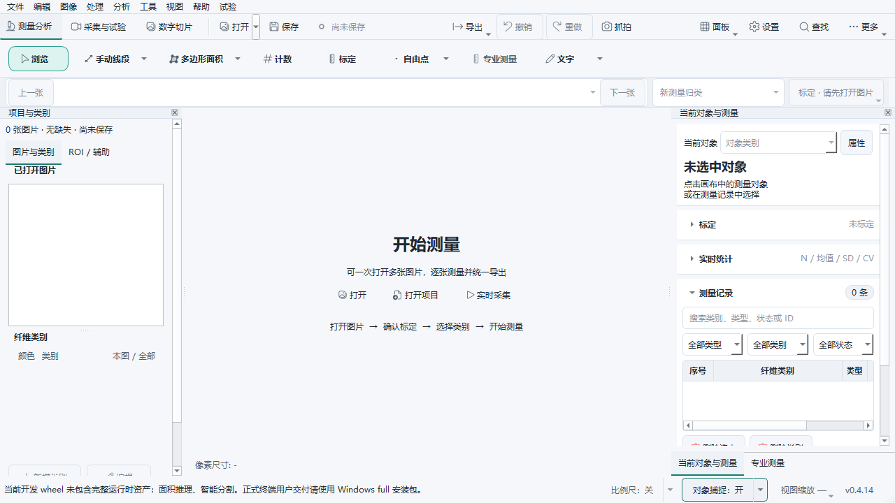

# 工作区面板隔离与采集画面对齐

完成日期：2026-10-29。源码基线：`70d7669`（0.4.14）。本轮不升级版本、不提交、不构建安装包。原有 DSX 未提交工作保留；测试使用带哈希的源码副本。

## 功能与使用

### 面板随功能切换

| 页面 | 允许的主窗口面板 |
| --- | --- |
| 测量分析、欢迎页 | 项目与类别、当前对象与测量、结果、专业测量；依赖文档的专业操作在无文档时禁用 |
| 实时采集 | 使用页面内采集设置，隐藏上述四个测量面板 |
| 含量、直径试验 | 使用各自侧栏、报告和试验记录，隐藏四个测量面板 |
| 数字切片采集 | 采集范围与焦层、样品台与采集设置 |

菜单、命令搜索、Dock 右键菜单、直接显示及恢复旧布局共用支持规则。相机停止不会改变页面身份，也不能继续编辑后台测量文档。返回测量分析时恢复面板开关、宽度、标签组合和窄窗侧栏选择。专业测量离页时取消未完成取点、拟合和预览；迟到结果不能写入后台文档。拒绝离开试验时保持原页面与布局。

DSX 独立工作台保持原有窗口管理方式。

### 画面对齐

在采集画面的“显示方式”旁点击“画面对齐”（自由状态显示“自由位置”），选择左上、上中、右上、左中、居中、右中、左下、下中或右下。窄窗自动折叠为方向图标，悬停仍显示完整说明。

- 四种显示方式均可使用：实际像素、适应窗口、百分比、物理倍率。
- 对齐只移动图像，不改变比例；缩放、分辨率、窗口和侧栏变化后持续保持所选方向。
- 实时预览实际拖动画面，或试验画面手动滚动浏览后，转为自由位置。仅程序恢复、同尺寸新帧、滚动条范围变化和对焦操作不会解除对齐。
- 方向跨采集页面和重启共享；自由位置按设备与帧尺寸保存。旧配置缺少方向时保持自由状态。
- 待确认结果、后台测量期间继续遵守已有显示修改限制。改变对齐会取消未完成取点，更新显示代次、点击映射和标注缓存。
- 普通图像、数字切片查看器和轮廓对比的定位方式未扩展。图像、标定、测量值和试验项目不因对齐改变。

## 实现范围

`workspace.py` 定义页面身份和支持表，管理临时隐藏与用户偏好。`professional_measurement.py` 负责专业任务的工作区代次。`main_window.py` 接入导航、菜单、搜索、快捷键和恢复布局；`acquisition_workbench.py` 在接受离开试验后才切换布局。

`display_preferences.py` 继续使用 `acquisition-display.json`；新增 `alignment`，并用 `center_coordinates: viewport` 区分可落在图像外的视区中心，兼容旧中心约束。`acquisition_alignment.py` 计算统一偏移；`DocumentCanvas` 的新接口仅由临时采集预览启用，试验使用 `LiveMeasurementCanvas`。位置写盘按200 ms合并。

`acquisition_alignment_button.py` 提供主题图标和九宫格；共享工具栏在窄窗口折叠“全图分析”和对齐文字，不挤大窗口。

## 验证结果

| 环境／检查 | 结果 | 证据 |
| --- | --- | --- |
| macOS 源码联合回归 | 231 passed，20 subtests passed | [日志](local/regression.log)、[JUnit](local/regression.xml) |
| Windows 11 原生 Qt 源码回归 | 122 passed | [最终日志](windows/native-tests/regression.log)、[JUnit](windows/native-tests/regression.xml) |
| Windows 100%／125%／150%／200% | 全部通过，24组页面／主题检查，88张截图 | [100%](windows/dpi-1/result.json)、[125%](windows/dpi-1.25/result.json)、[150%](windows/dpi-1.5/result.json)、[200%](windows/dpi-2/result.json) |
| 四模式 × 九方向 × 三页面 × 两主题 × 四DPR | 864次位置检查；该合成样本最大位置误差为0；实际像素 `scale × DPR = 1` | 同上 |
| 数据边界 | 对齐前后原像素哈希、标定、试验序列化、项目脏状态一致 | 同上及回归日志 |
| 代码与证据 | `git diff --check` 通过；截图哈希全部匹配 | [汇总](summary.json)、[文件哈希](SHA256SUMS.txt) |

回归覆盖旧配置、重启／隐藏页恢复、九方向与大小图、单轴超出、分数DPR滚动像素相位、同尺寸新帧、真实平移与程序调整区分、保存失败回退、忙碌拒绝、专业拟合迟到返回、取消切页、全屏恢复、专业标注与已有画布变换。

### Windows 验证过程中发现的环境／夹具问题

原始记录保留，未把失败运行计为通过：

1. 初次传输遗漏既有 `validate_workflow_redesign.py` 测试夹具，导致测试收集失败。补传后重跑。
2. 修复测试的跨平台假设：百分比断言按实际DPR计算；窄按钮在父窗口内验证；忙碌模拟使用完整确认数据；注入帧测试不自动启动不存在的相机。
3. 独立源码目录最初未带必需的原生内核，异步视场检测报错并清空当前视场记录，额外错误提示也减少了可见类别数。相同环境下 `70d7669` 基线复现；调用链探针确认 `No module named 'fdm._native._kernels'`。复用上一轮已存在且源码指纹一致的内核，核对ABI、源码及二进制哈希后，122项全部通过，没有放宽产品故障处理或类别数量断言。

原生源码指纹：`d743608532e85f90e11170b87b9ec4fc0661065c866980129eccd23cf62c7b28`。构建身份见 [native.json](windows/native-tests/native.json)。该依赖仅复制到本轮隔离目录，未覆盖现有安装。

## 界面示例







## 复现与边界

界面验证入口：`scripts/validation/validate_workspace_alignment_ui.py`。在依赖已配置的 Windows 源码目录执行，每个DPR使用新进程及新的输出目录：

```powershell
python scripts/validation/validate_workspace_alignment_ui.py --output evidence/dpi-1 --platform windows --scale 1
python scripts/validation/validate_workspace_alignment_ui.py --output evidence/dpi-1.25 --platform windows --scale 1.25
python scripts/validation/validate_workspace_alignment_ui.py --output evidence/dpi-1.5 --platform windows --scale 1.5
python scripts/validation/validate_workspace_alignment_ui.py --output evidence/dpi-2 --platform windows --scale 2
```

脚本通过独立进程测量基础DPR，再设置进程级Qt缩放；未修改Windows全局显示设置。使用真实Qt窗口和合成图像，配置、日志均隔离，未启动物理相机、串口或DSX。结果证明源码界面与软件行为，不代表安装包、实机采集、真实显示器物理倍率或硬件精度验收。

此次与DSX并行开发：Windows测试固定源码快照；后续DSX独立文件变化不计作本轮验证覆盖。本轮13个产品源码文件与Windows验证时的哈希保持一致。详见 [快照身份](windows/identity.json) 和 [最终补充身份](windows/native-tests/identity.json)。
